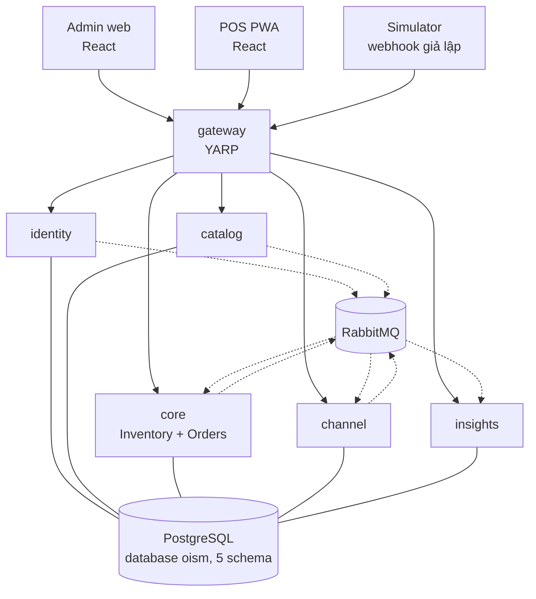

# OISM: Hệ thống quản lý bán hàng và tồn kho đa kênh

*Omnichannel Inventory and Sales Management System*: phần mềm SaaS cho cửa hàng bán lẻ bán cùng lúc tại quầy (POS) và trên Shopee, TikTok Shop, Lazada, với một kho dữ liệu tồn và đơn hàng thống nhất.


Đồ án của nhóm 3 dev, làm trong 5 tuần, chia 10 phase. Tài liệu thiết kế trong [`docs/`](docs/README.md) là nguồn chuẩn; code phải khớp tài liệu.


## Mục lục

- [Bài toán](#bài-toán)
- [Tính năng](#tính-năng)
- [Kiến trúc](#kiến-trúc)
- [Công nghệ](#công-nghệ)
- [Chạy thử trên máy](#chạy-thử-trên-máy)
- [Phát triển và kiểm thử](#phát-triển-và-kiểm-thử)
- [Cấu trúc repo](#cấu-trúc-repo)
- [Tài liệu](#tài-liệu)
- [Trạng thái](#trạng-thái)

## Bài toán

Bán trên nhiều kênh rời nhau gây ra ba lỗi quen thuộc:

1. *Bán vượt tồn* vì tồn giữa các kênh đồng bộ chậm.
2. *Giá vốn hàng bán (COGS) sai*, nên lợi nhuận báo cáo không đáng tin.
3. *Số liệu tồn lệch* vì sửa tay mà không để lại dấu vết.

OISM giải quyết bằng năm cơ chế cốt lõi:

| Cơ chế | Kết quả |
| --- | --- |
| *Sổ kho chỉ thêm mới*: mọi biến động tồn là một dòng trong inventory_transactions, sửa sai bằng dòng đảo | Truy được vì sao con số tồn thay đổi |
| *Giữ hàng có khóa dòng*: available = on_hand − reserved, khóa SELECT ... FOR UPDATE | 50 đơn tranh 1 sản phẩm thì đúng 1 đơn thắng, tồn không bao giờ âm |
| *Giá vốn bình quân gia quyền*: tính lại mỗi lần nhập, chốt vào dòng đơn lúc xuất kho | Lợi nhuận quá khứ không đổi khi giá nhập mới thay đổi |
| *Trung tâm đơn hàng*: đơn POS, đơn tạo tay và đơn sàn về chung một Canonical Order, chạy theo máy trạng thái Draft → Reserved → Confirmed → Completed (hoặc Cancelled) | Một quy trình xử lý cho mọi kênh |
| *Cách ly tenant*: mọi bảng có TenantId, lọc tự động bằng EF Core Global Query Filter | Doanh nghiệp này không thấy dữ liệu của doanh nghiệp khác |

## Tính năng

| Phân hệ | Người dùng | Làm được gì |
| --- | --- | --- |
| Tài khoản và chi nhánh | Owner | Đăng ký cửa hàng, quản lý nhân viên theo vai trò Owner, Staff, Cashier, quản lý cửa hàng và kho |
| Sản phẩm | Owner, Staff | Danh mục nhiều cấp, thương hiệu, sản phẩm có biến thể (màu, cỡ), mã vạch EAN-13 tự sinh hoặc Code128, giá lẻ và giá sỉ |
| Kho | Owner, Staff | Xem tồn và sổ giao dịch, nhập hàng từ nhà cung cấp, chuyển kho hai bước, kiểm kê, đặt ngưỡng cảnh báo |
| Đơn hàng | Owner, Staff | Danh sách đơn đa kênh, tạo đơn qua điện thoại, duyệt, hoàn tất, hủy, in phiếu giao; đơn giữ hàng quá 30 phút tự hủy |
| Bán tại quầy (PWA) | Cashier, Owner | Quét mã rồi Enter là xong một đơn, tiền mặt hoặc chuyển khoản QR, in hóa đơn qua trình duyệt, cài được lên màn hình chính |
| Kênh sàn | Owner | Cấu hình shop Shopee, TikTok, Lazada; nhận webhook giả lập; bắn hàng chục đơn cùng lúc để thử tải |
| Báo cáo và cảnh báo | Owner, Staff | Doanh thu, giá vốn, lợi nhuận gộp lọc theo thời gian, chi nhánh, kênh, SKU (chỉ Owner); giá trị tồn, bán chạy, bán chậm; cảnh báo tồn thấp |
| Dự báo nhập hàng | Owner | Dự báo nhu cầu 14 ngày bằng san bằng hàm mũ, đề xuất số lượng nên nhập, backtest so với phương án cơ sở |
| Thông báo realtime | Mọi vai trò | Đơn mới và tồn thấp hiện popup kèm âm thanh, không cần tải lại trang |

Phạm vi bám đề: 30 yêu cầu chức năng, 11 yêu cầu phi chức năng, cộng 3 mã cho phần dự báo AI. Không làm: kết nối API thật của sàn, bán offline, cổng thanh toán, trả hàng ([PLAN.md mục 2](docs/PLAN.md)).

## Kiến trúc

Năm service .NET 8 đứng sau một API gateway, hai ứng dụng React, một PostgreSQL chia 5 schema và một RabbitMQ.



Đường liền có mũi tên là HTTP qua gateway; đường đứt là event qua RabbitMQ; đường liền không mũi tên là kết nối tới schema riêng của từng service.

| Khối | Trách nhiệm |
| --- | --- |
| gateway | Định tuyến, kiểm JWT, TLS, WebSocket |
| identity | Tenant, người dùng, đăng nhập, phân quyền, chi nhánh |
| catalog | Danh mục, thương hiệu, sản phẩm, SKU, mã vạch, giá |
| core | Sổ kho, số dư, giá vốn, đơn hàng, giữ hàng, POS checkout |
| channel | Nhận webhook ba sàn, chống trùng, chuẩn hóa đơn |
| insights | Báo cáo, cảnh báo tồn, dự báo, thông báo realtime |
| admin, pos | Trang quản trị cho Owner và Staff; PWA bán tại quầy cho Cashier |

Ba quy tắc tóm gọn cả kiến trúc:

1. *Thứ gì phải commit cùng nhau thì ở chung một service.* Đơn hàng, giữ hàng, sổ kho và giá vốn nằm chung core, chung một transaction.
2. *Giữa các service chỉ có event*, phát qua outbox và nhận qua inbox; không gọi HTTP chéo, không đọc schema của nhau.
3. *Mỗi service chia bốn lớp Clean Architecture*: Domain, Application, Infrastructure, Api; phụ thuộc chỉ hướng vào Domain.

Chi tiết: [docs/architecture/](docs/architecture/README.md); lý do của từng lựa chọn: [docs/decisions/](docs/decisions/README.md).

## Công nghệ

| Phần | Công nghệ |
| --- | --- |
| Backend | C# 12, .NET 8, ASP.NET Core Web API, EF Core với Npgsql, FluentValidation, Swagger |
| Dữ liệu và thông điệp | PostgreSQL, RabbitMQ (outbox và inbox tự viết), Hangfire cho job nền |
| Gateway, bảo mật | YARP, JWT RS256, refresh token xoay vòng, BCrypt |
| Realtime | SignalR |
| Frontend | React, Vite, TypeScript strict, TanStack Query, React Router, Ant Design; npm workspaces admin, pos, shared |
| Kiểm thử | xUnit, Testcontainers, coverlet, Vitest, k6 |
| Đóng gói, CI | Docker Compose, GitHub Actions |

## Chạy thử trên máy

### 1. Chuẩn bị

- [Docker Desktop](https://www.docker.com/products/docker-desktop/) (trên Windows cần WSL 2). .NET, PostgreSQL và RabbitMQ đều chạy trong container, không cần cài riêng.
- [Node.js](https://nodejs.org/) 20.19 trở lên cho frontend.

### 2. Tạo khóa JWT

Đăng nhập cần một cặp khóa RSA trong deploy/.env (file này bị git bỏ qua). Trong Git Bash, từ gốc repo:

```bash
grep -v '^JWT_' deploy/.env.example > deploy/.env
openssl genpkey -algorithm RSA -pkeyopt rsa_keygen_bits:2048 -out jwt.pem
echo "JWT_PRIVATE_KEY=$(grep -v -- ----- jwt.pem | tr -d '[:space:]')" >> deploy/.env
echo "JWT_PUBLIC_KEY=$(openssl pkey -in jwt.pem -pubout | grep -v -- ----- | tr -d '[:space:]')" >> deploy/.env
rm jwt.pem
```

Máy đã có PostgreSQL chiếm cổng 5432 thì thêm dòng POSTGRES_PORT=5433.

### 3. Bật backend và nạp dữ liệu demo

```bash
docker compose -f deploy/docker-compose.yml up -d
docker compose -f deploy/docker-compose.yml run --rm seed
```

Lần đầu mất vài phút để tải image và build. Seed tạo 2 cửa hàng, mỗi cửa hàng 2 chi nhánh, khoảng 50 SKU và 60 ngày lịch sử bán; chạy lại không tạo bản trùng.

### 4. Bật frontend

```bash
npm --prefix frontend run dev
```

### 5. Mở và đăng nhập

| Địa chỉ | Là gì |
| --- | --- |
| http://localhost:5173 | Trang quản trị (admin) |
| http://localhost:5174 | Bán tại quầy (POS) |
| http://localhost:8080/api/core/health | Health check qua gateway (thay core bằng service khác) |
| http://localhost:5101/swagger … 5105/swagger | Swagger của từng service |
| http://localhost:15672 | Giao diện quản trị RabbitMQ (user và mật khẩu oism) |

Tài khoản demo, mật khẩu chung Demo@2026:

| Cửa hàng | Owner (admin, POS) | Staff (admin) | Cashier (POS) |
| --- | --- | --- | --- |
| Thời trang Mộc | owner@moc.test | staff@moc.test | cashier@moc.test |
| Tạp hóa Xanh | owner@xanh.test | staff@xanh.test | cashier@xanh.test |

Thử nhanh: vào POS bằng cashier@moc.test, gõ PK-TL rồi Enter để thêm hàng, Enter lần nữa để thanh toán tiền mặt.

### Dừng

Bấm ■ ở nhóm oism trong Docker Desktop, hoặc chạy lệnh dưới. Thêm -v để xóa luôn dữ liệu (khi đó phải chạy lại seed).

```bash
docker compose -f deploy/docker-compose.yml down
```

## Phát triển và kiểm thử

| Việc | Lệnh |
| --- | --- |
| Build backend | `dotnet build backend/Oism.sln` |
| Toàn bộ test backend (cần Docker cho test tích hợp) | `dotnet test backend/Oism.sln` |
| Test backend không cần cài .NET | `docker compose -f deploy/docker-compose.yml run --rm tests` |
| Tự build lại một service mỗi khi lưu file | `docker compose -f deploy/docker-compose.yml watch core` |
| Khởi động lại một service | `docker compose -f deploy/docker-compose.yml restart core` |
| Xem log | `docker compose -f deploy/docker-compose.yml logs -f core` |
| Kiểm kiểu, test, build frontend | `npm --prefix frontend run typecheck`, `npm --prefix frontend test`, `npm --prefix frontend run build` |
| Chạy riêng một ứng dụng | `npm --prefix frontend run dev:admin`, `npm --prefix frontend run dev:pos` |

- Mã nguồn backend/ được mount vào container: sửa code hay thêm migration không cần build lại image, chỉ cần khởi động lại service. Migration mới được áp lúc service khởi động.
- Các lệnh dev của frontend tự chạy npm install trước khi bật. Frontend gọi gateway ở http://localhost:8080, đổi bằng biến VITE_API_URL.
- Mọi luồng đụng tới tồn kho có test tích hợp trên PostgreSQL thật (Testcontainers); test đồng thời chạy lặp 20 lần trong CI.
- Quy ước code và git: [docs/conventions/](docs/conventions/backend.md). Quy tắc cho công cụ AI: [AGENTS.md](AGENTS.md).

## Cấu trúc repo

```
backend/
  gateway/                 API gateway (YARP)
  services/                identity, catalog, core, channel, insights; mỗi service 4 lớp và 2 project test
  shared/                  Oism.SharedKernel, Oism.BuildingBlocks (tenant, auth, outbox, inbox), Oism.Contracts (event)
frontend/
  admin/                   Trang quản trị (React)
  pos/                     PWA bán tại quầy (React)
  shared/                  API client, xác thực, kết nối realtime dùng chung
deploy/
  docker-compose.yml       Môi trường dev và gói demo
  postgres/                Script tạo 5 schema
  seed/                    Dữ liệu demo
docs/                      Yêu cầu, use case, kiến trúc, quyết định, thiết kế, kiểm thử, kế hoạch
.github/workflows/         CI: hai job Backend và Frontend
```

Cây đầy đủ và tài liệu chi phối từng folder: [docs/architecture/source-tree.md](docs/architecture/source-tree.md).

## Tài liệu

| Tài liệu | Nội dung |
| --- | --- |
| [Đặc tả yêu cầu (SRS)](docs/requirements/srs.md) | Toàn bộ yêu cầu trong một tài liệu: sơ đồ use case UML, ERD liên service, quy tắc nghiệp vụ, đặc tả 29 use case, NFR, kiểm thử chấp nhận, RTM |
| [SRS bản tóm lược](docs/SRS.md) | Bản SRS ngắn gồm yêu cầu, mô hình dữ liệu, API, UI/UX |
| [Bản đồ tài liệu](docs/README.md) | Điểm bắt đầu để tìm mọi tài liệu khác và thứ tự ưu tiên khi chúng mâu thuẫn |
| [Yêu cầu](docs/requirements/functional.md), [use case](docs/usecase-userstory/README.md) | Mã yêu cầu và tiêu chí chấp nhận |
| [Kiến trúc](docs/architecture/README.md), [quyết định](docs/decisions/README.md) | Chia service, tenant, transaction, bảo mật; 13 ADR |
| [Thiết kế](docs/design/README.md) | Bảng, API, event, máy trạng thái, luồng, giao diện, dự báo |
| [Kiểm thử](docs/testing/strategy.md) | Chiến lược, 23 kịch bản bắt buộc, báo cáo backtest |
| [Kế hoạch](docs/PLAN.md) | 10 phase, phân công, ưu tiên, rủi ro, RTM rút gọn |
| [Bản dịch và phân tích đề](OISM-ban-dich-va-phan-tich-tieng-Viet.md) | Đề gốc và các điểm cần làm rõ |

## Trạng thái

| Phase | Nội dung | Trạng thái |
| --- | --- | --- |
| 1–2 | Nền tảng, gateway, outbox/inbox, định danh, chi nhánh, danh mục, sản phẩm, SKU | Xong |
| 3–4 | Sổ kho, số dư, phiếu nhập, giá vốn bình quân, máy trạng thái đơn, engine giữ hàng | Xong |
| 5–6 | Duyệt, hủy, hết hạn đơn; POS checkout; chuyển kho; kiểm kê; webhook ba sàn | Xong |
| 7–8 | Báo cáo lợi nhuận, báo cáo tồn, cảnh báo, dự báo nhập hàng, thông báo realtime, PWA, seed data | Xong |
| 9 | Kiểm thử toàn hệ thống, đo tải k6, coverage, gói demo | Đang làm: k6 (T17) chưa chạy; seed chưa tự chạy khi compose up |
| 10 | Tài liệu và bàn giao | Đang làm: đã có SRS |

Chi tiết theo từng task: [docs/README.md](docs/README.md) mục "Trạng thái". Mọi quyết định thiết kế đã được giảng viên xác nhận ngày 2026-10-04.
