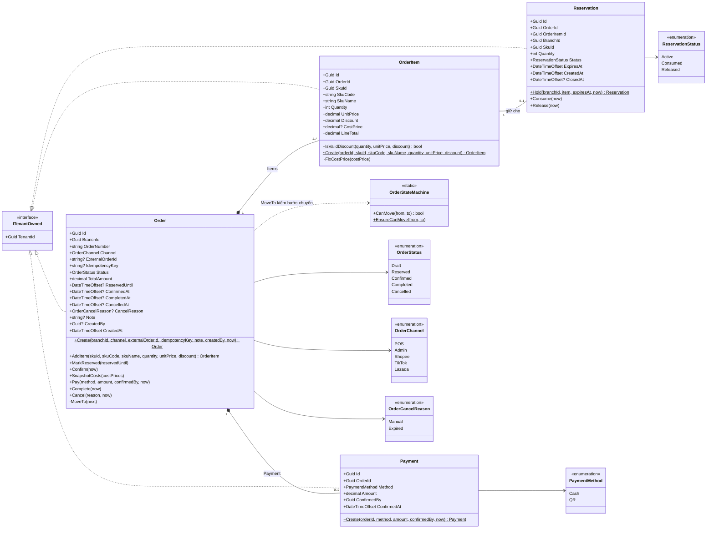
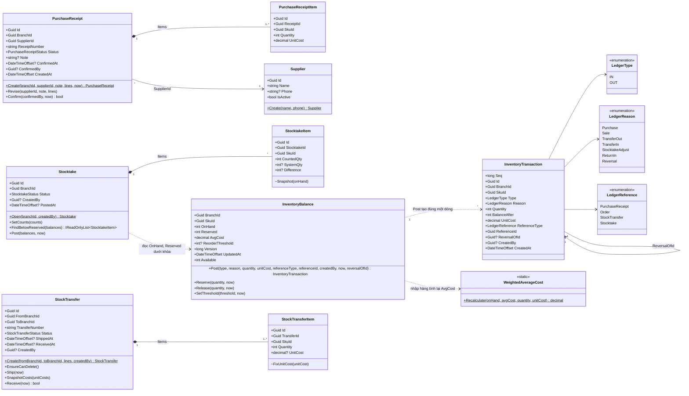
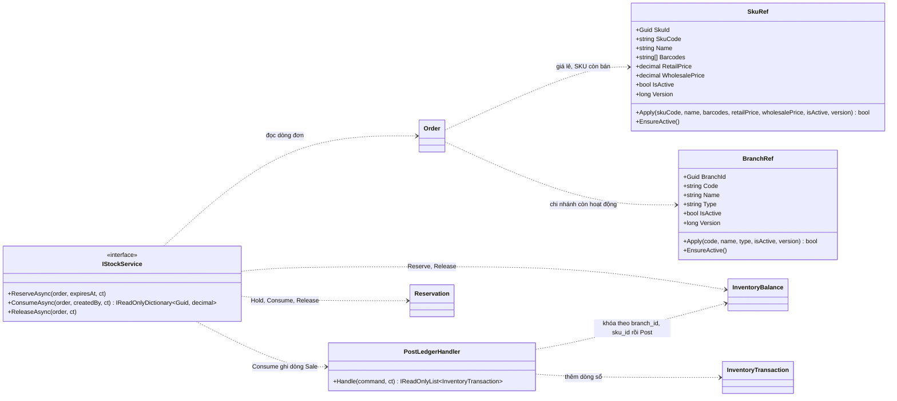

# Sơ đồ lớp UML: Domain của `core`

Sơ đồ lớp của `Oism.Core.Domain`, vẽ theo code ở `backend/services/core/src/Oism.Core.Domain` (task W5-07, mục e.3 của đề). `core` là service duy nhất có quy tắc tồn kho và đơn hàng phải đúng tuyệt đối, nên sơ đồ lớp tập trung ở đây; các service khác có Domain mỏng, bảng của chúng ở [data-model/](data-model/identity.md).

Quy ước của sơ đồ:

- Thuộc tính và phương thức ghi đúng tên trong code (PascalCase). `+` là public, `-` là private, `~` là internal.
- Mọi entity cài `ITenantOwned` (có `TenantId`) và đi qua Global Query Filter ([architecture/multi-tenancy.md](../architecture/multi-tenancy.md)); sơ đồ không lặp lại `TenantId` ở từng lớp.
- Setter của mọi thuộc tính là private: trạng thái chỉ đổi qua phương thức nghiệp vụ, không gán thẳng từ ngoài.
- Domain không tham chiếu EF Core hay ASP.NET Core ([architecture/layering.md](../architecture/layering.md)). Khóa dòng, transaction và ghi outbox nằm ở Application và Infrastructure.

## Module Orders

| Lớp | Quy tắc nằm trong lớp | Nguồn |
| --- | --- | --- |
| `Order` | Chỉ thêm dòng khi còn Draft; `TotalAmount` cộng dồn `LineTotal`; mọi đổi trạng thái đi qua `OrderStateMachine`; `Pay` chỉ một lần và số tiền không nhỏ hơn tổng đơn | [state-machines.md](state-machines.md), [ADR-0005](../decisions/0005-order-lifecycle-and-transactions.md), [ADR-0007](../decisions/0007-pos-payment-no-offline.md) |
| `OrderItem` | Số lượng dương, đơn giá không âm, giảm giá không vượt thành tiền; `CostPrice` ghi một lần và không đổi | Bất biến 8 ở [AGENTS.md](../../AGENTS.md), FR-COST-02 |
| `Reservation` | Chỉ phần giữ Active mới sang Consumed hoặc Released; đóng lần hai ném `InvalidStateTransitionException` | [flows/cancel-expire.md](flows/cancel-expire.md), T06 |
| `OrderStateMachine` | Năm bước chuyển hợp lệ: Draft sang Reserved hoặc Cancelled, Reserved sang Confirmed hoặc Cancelled, Confirmed sang Completed | [state-machines.md](state-machines.md), T08 |

`Reservation` không là con của `Order` trong mô hình đối tượng: nó được tạo và đóng qua `IStockService` của module Inventory, nên Orders không tự đổi `reserved` (bất biến 4 ở [AGENTS.md](../../AGENTS.md)).

## Module Inventory

| Lớp | Quy tắc nằm trong lớp | Nguồn |
| --- | --- | --- |
| `InventoryBalance` | `OnHand` chỉ đổi trong `Post`, và mỗi lần `Post` trả đúng một `InventoryTransaction`; bút toán OUT và `Reserve` từ chối khi vượt `Available`, nên luôn có `Reserved <= OnHand`; `Release` không cho `Reserved` âm; mỗi thay đổi tăng `Version` | Bất biến 4 ở [AGENTS.md](../../AGENTS.md), [ADR-0003](../decisions/0003-ledger-balance-and-locking.md) |
| `InventoryTransaction` | Không có phương thức sửa: sổ chỉ thêm mới, sửa sai bằng dòng `Reversal`; database còn chặn UPDATE và DELETE bằng trigger | Bất biến 5, T16 |
| `WeightedAverageCost` | `(OnHand × AvgCost + Quantity × UnitCost) / (OnHand + Quantity)` theo chi nhánh và SKU, làm tròn 4 chữ số; chỉ nhập mua và nhận chuyển kho tính lại, bút toán khác giữ nguyên giá vốn | [ADR-0004](../decisions/0004-wac-per-branch.md), T09 |
| `PurchaseReceipt` | Chỉ sửa khi Draft; `Confirm` trả `false` nếu đã Confirmed để handler không tác động lần hai | [flows/purchase-receipt.md](flows/purchase-receipt.md), T11 |
| `StockTransfer` | Hai nơi khác nhau; chỉ xóa khi Draft; `Ship` từ Draft, `Receive` từ InTransit; giá vốn nơi gửi chốt lúc xuất | [flows/stock-transfer.md](flows/stock-transfer.md), [ADR-0009](../decisions/0009-transfer-and-stocktake.md), T12 |
| `Stocktake` | Chỉ nhập số đếm khi Open; `FindBelowReserved` nêu SKU đếm thấp hơn lượng đang giữ để chặn chốt | [flows/stocktake.md](flows/stocktake.md), T13 |

## Bản sao tham chiếu và dịch vụ ứng dụng

- `SkuRef` và `BranchRef` là bản sao của `catalog` và `identity`, dựng từ `SkuUpserted` và `BranchUpserted` ([events.md](events.md)). `Apply` trả `false` khi `version` không mới hơn bản đang giữ, nên event tới trễ hay tới trùng không ghi đè.
- `IStockService` và `PostLedgerHandler` nằm ở `Oism.Core.Application`, không phải Domain; chúng có trong sơ đồ vì là hai cửa duy nhất được đổi `reserved` và `on_hand` (bất biến 4). Thứ tự khóa và ranh giới transaction ở [architecture/transactions-and-concurrency.md](../architecture/transactions-and-concurrency.md).
- Ngoại lệ nghiệp vụ của Domain (`InsufficientStockException`, `InvalidStateTransitionException`, `StocktakeBelowReservedException`, `ReferenceNotReadyException`, `InactiveReferenceException`) kế thừa ngoại lệ gốc có mã ở `Oism.SharedKernel`; middleware chung đổi chúng sang ProblemDetails kèm `code` ([api/README.md](api/README.md)).
