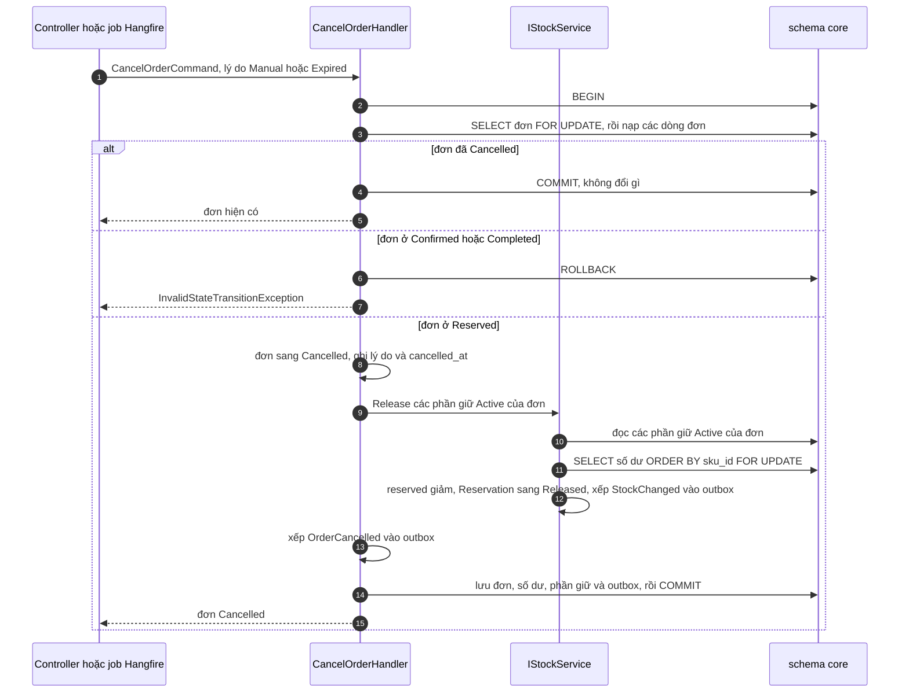

# Luồng: hủy đơn và hết hạn giữ hàng

Hủy tay và hết hạn dùng chung một handler: khóa đơn, giải phóng các phần giữ còn Active, đặt đơn sang Cancelled. Khác nhau duy nhất là lý do và người gọi. Use case [UC-ORD-04](../../usecase-userstory/orders.md) và UC-ORD-05; API `POST /api/core/orders/:id/cancel`.

Trạng thái được kiểm ngay sau khi khóa dòng đơn: đơn ở Confirmed hoặc Completed dừng ở đó, trước khi chạm tới số dư. `id` không có trong tenant trả 404 và không khóa gì.

## Job hết hạn

Job `ExpireReservationsJob` nằm ở Infrastructure của `core`. Hangfire gọi nó mỗi phút theo lịch `expire-reservations`, đặt lúc service khởi động; bảng của Hangfire nằm trong schema `hangfire_core`.

1. Tìm các phần giữ còn Active có `expires_at` nhỏ hơn giờ hiện tại, trên mọi tenant, rồi lấy ra các cặp `tenant_id`, `order_id` khác nhau. Đây là một trong các chỗ được phép bỏ filter tenant ([multi-tenancy.md](../../architecture/multi-tenancy.md)); truy vấn dùng chỉ mục `(status, expires_at)` của `reservations`. Mọi phần giữ của một đơn có cùng hạn, bằng `reserved_until` của đơn.
2. Với mỗi đơn: mở một scope riêng, đặt tenant context theo `tenant_id` của đơn, rồi gọi `CancelOrderHandler` với lý do Expired. Mỗi đơn một transaction.
3. Handler ném `InvalidStateTransitionException` nghĩa là đơn vừa được duyệt: job bỏ qua đơn đó. Lỗi khác thì ghi log, transaction của đơn đó rollback, job đi tiếp đơn sau và đơn lỗi chờ lần chạy kế.

Job chỉ đọc danh sách mà không khóa; việc khóa và kiểm lại trạng thái nằm trong handler. Nhờ vậy đơn vừa được duyệt giữa lúc job đọc và lúc job xử lý sẽ bị bỏ qua. Hai lần chạy chồng nhau cũng không gây hại: lần sau thấy đơn đã Cancelled và không làm gì.

Cấu hình `Jobs:Enabled = false` tắt Hangfire của service. Test tích hợp dùng nó để tự gọi job mà không tranh với lịch chạy mỗi phút; môi trường dev và demo để mặc định là bật.

## Mỗi bước đổi gì

| Bước | Khóa | Số dư | Sổ | Outbox |
| --- | --- | --- | --- | --- |
| Khóa đơn | Dòng `orders` | | | |
| Khóa số dư | Các dòng `inventory_balances` của đơn, theo `sku_id` | | | |
| Giải phóng | | `reserved` giảm đúng bằng tổng phần giữ Active, `version` tăng | Không ghi | |
| Kết thúc | | | | `OrderCancelled`, `StockChanged` |

## Trường hợp biên

- Hủy hai lần, hoặc job chạy lại: lần sau thấy đơn đã Cancelled và không làm gì. Không có phần giữ Active nào còn lại để giải phóng lần hai.
- Hủy đơn Confirmed hoặc Completed: trả 409. Không có luồng trả hàng ([ADR-0005](../../decisions/0005-order-lifecycle-and-transactions.md)).
- Job gặp đơn đang được nhân viên duyệt: ai khóa được dòng đơn trước thì thắng. Job thắng thì thao tác duyệt nhận 409; nhân viên thắng thì job bỏ qua đơn.
- Đơn POS không bao giờ tới tay job: phần giữ của nó được tạo và tiêu thụ trong cùng một transaction.

## Kiểm thử

T06 (hủy hai lần, job chạy lại), T07 (duyệt đúng lúc job chạy), T08 (hủy sau Confirmed).
