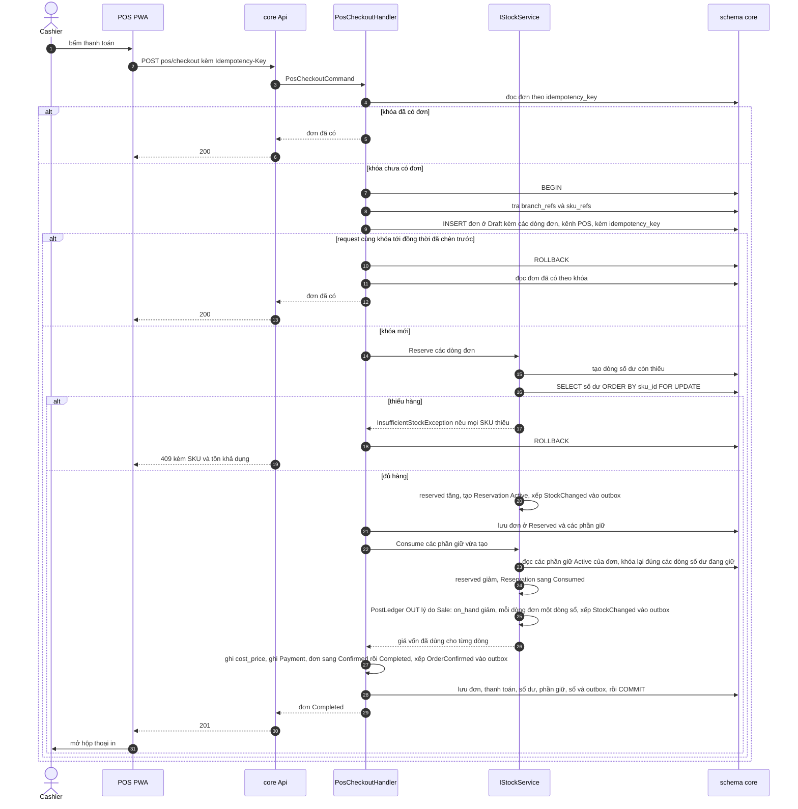

# Luồng: POS checkout

Thanh toán tại quầy chạy toàn bộ chuỗi tạo đơn, giữ hàng, xác nhận, ghi thanh toán và hoàn tất trong một transaction (FR-POS-04). Hoặc mọi thứ được lưu, hoặc không gì được lưu. Use case [UC-POS-02](../../usecase-userstory/pos.md); API `POST /api/core/pos/checkout`; giao diện ở [ui/pos.md](../ui/pos.md).

Handler tra đơn theo `Idempotency-Key` trước khi mở transaction; đã có thì trả ngay đơn đó với mã 200. Nhánh "request cùng khóa tới đồng thời" là trường hợp còn lại: cả hai request đều chưa thấy đơn, request thua bị chặn ở chỉ mục unique lúc chèn.

Bước giữ và bước xuất dùng đúng hai thao tác `Reserve` và `Consume` của đơn online, nên đơn và các phần giữ được lưu xuống database (chưa commit) giữa hai bước để `Consume` đọc lại được. Phần giữ của đơn POS hết hạn ngay tại thời điểm tạo, vì nó chỉ sống bên trong transaction này. Mỗi SKU có hai `StockChanged` trong outbox, một sau bước giữ và một sau bước xuất; bên nhận ghi đè theo `version` nên chỉ bản sau còn lại.

## Mỗi bước đổi gì

| Bước | Khóa | Số dư | Sổ | Outbox |
| --- | --- | --- | --- | --- |
| Chèn đơn | Unique `(tenant_id, idempotency_key)` chặn gửi trùng | | | |
| Khóa số dư | Các dòng `inventory_balances` của giỏ, theo `sku_id` | | | |
| Giữ rồi tiêu thụ | | `on_hand` giảm; `reserved` tăng rồi giảm về như cũ; `version` tăng | Một dòng OUT, `reason = Sale` cho mỗi dòng đơn | |
| Thanh toán | | | | |
| Kết thúc | | | | `OrderConfirmed`, `StockChanged`; không phát `OrderReserved` |

Đơn đi qua Reserved, Confirmed rồi Completed bên trong transaction. Bên ngoài chỉ thấy đơn ở Completed với đủ `confirmed_at` và `completed_at`.

## Vì sao phải kiểm lại ở backend

Tồn khả dụng POS hiển thị lúc chọn hàng có thể đã cũ khi bấm thanh toán: một đơn online vừa giữ đơn vị cuối, hoặc quầy bên cạnh vừa bán. Bước khóa và kiểm trong transaction là nơi duy nhất quyết định. Hàng đang giữ cho đơn online nằm trong `reserved` nên không bao giờ bị POS bán mất.

## Trường hợp biên

- Bấm hai lần hoặc mạng gửi lại: cùng `Idempotency-Key`, lần sau nhận lại đúng đơn đã tạo. Hai request đồng thời cùng khóa thì request thua bị chặn ở unique, rollback rồi đọc lại đơn.
- Cashier gửi `branchId` khác chi nhánh trong token: controller trả 403 trước khi gọi handler.
- `payment.amount` nhỏ hơn tổng đơn: trả 400 sau khi đã tính tổng đơn và trước khi chèn đơn, nên không gì được lưu.
- Lần gửi bị từ chối hoặc lỗi không để lại đơn nào, nên cùng khóa đó dùng lại được cho lần thử sau.
- In lỗi: đơn đã lưu; POS in lại từ dữ liệu đã có, không gọi API này lần nữa.
- Không có trạng thái chờ thanh toán: thu ngân xác nhận đã nhận tiền trước khi bấm ([ADR-0007](../../decisions/0007-pos-payment-no-offline.md)).

## Kiểm thử

T02 (POS và online tranh đơn vị cuối), T03 (bấm thanh toán hai lần), T05 (lỗi giữa chừng rollback hết), T17 (dưới 500 ms).
