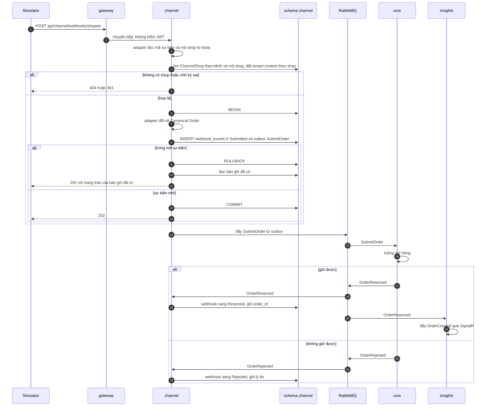

# Luồng: nhận webhook

`channel` nhận webhook, kiểm chữ ký, chống trùng, đổi payload của từng kênh về Canonical Order rồi gửi command `SubmitOrder` cho `core`. Webhook được trả lời ngay bằng 202; kết quả giữ hàng về sau bằng event. Use case [UC-SIM-01](../../usecase-userstory/channel-realtime.md) và [UC-ORD-01](../../usecase-userstory/orders.md); payload ở [api/channel.md](../api/channel.md).

Bản ghi webhook và thông điệp outbox được chèn trong cùng một lần lưu: chỉ mục unique từ chối bản ghi trùng thì thông điệp cũng không được ghi, nên không có command thứ hai. Hai bản của cùng một webhook tới đồng thời cũng đi qua đúng chỗ này; bản thua rollback rồi đọc lại bản ghi của bản thắng.

## Ba hàng rào chống trùng

| Lớp | Hàng rào | Chặn được |
| --- | --- | --- |
| `channel` | Unique `(tenant_id, channel, event_id)` | Sàn gửi lại cùng webhook |
| `core` inbox | `eventId` của `SubmitOrder` | RabbitMQ giao lại cùng thông điệp |
| `core` đơn | Unique `(tenant_id, channel, external_order_id)` | Hai webhook khác mã sự kiện nhưng cùng một đơn |

## Trường hợp biên

- Payload không đổi được về Canonical Order (thiếu trường, sai kiểu, số lượng không dương, giảm giá vượt thành tiền): lưu bản ghi với trạng thái Failed kèm lý do, trả 202, không phát command. Webhook không được trả lỗi 5xx vì payload xấu, để sàn không gửi lại mãi. Quy tắc của từng dòng khớp quy tắc `core` áp cho dòng đơn, để đơn sai dừng ở `channel` thay vì làm consumer `SubmitOrder` lỗi.
- Body không phải JSON, hoặc thiếu mã sự kiện hay mã shop: trả 400 và không lưu gì. Hai trường này phải đọc được trước khi biết webhook của tenant nào và trước khi chống trùng được.
- Shop bị tắt: coi như không có shop, trả 404.
- Hai webhook khác mã sự kiện nhưng cùng một đơn: cả hai bản ghi ở Submitted và cả hai command được phát; `core` chỉ nhận đơn một lần. Khi kết quả về, mọi bản ghi còn Submitted của đơn đó cùng sang Reserved hoặc Rejected.
- Webhook thứ hai tới sau khi đơn đã được giữ hàng: `core` sẽ bỏ qua command của nó mà không phát gì, nên ngay trong transaction nhận webhook, bản ghi mới đi tiếp từ Submitted sang Reserved với `order_id` của bản ghi đã Reserved cho cùng mã đơn. Command vẫn được ghi vào outbox, vì hàng rào ở `core` mới là nơi quyết định đơn trùng. Webhook thứ hai cho một đơn từng bị từ chối thì ở Submitted như thường: `core` không lưu đơn bị từ chối nên xét lại nó và phát kết quả mới.
- `OrderReserved` của đơn thủ công không có mã đơn của sàn nên không đổi bản ghi nào. Thông điệp tới lại sau khi bản ghi đã rời Submitted cũng không đổi gì.
- `skuCode` không có ở `core`: `core` phát `OrderRejected` với lý do `UnknownSku`.
- Tenant context: webhook không có JWT. `channel` đặt tenant context theo `ChannelShop` tìm được; command mang `tenantId` đó.
- Bắn tải: `POST /api/channel/simulator/burst` tự sinh và tự gửi các webhook song song vào chính endpoint webhook, mỗi webhook một mã sự kiện và một mã đơn khác nhau. Payload do chính adapter của kênh dựng theo hình dạng của sàn và được ký bằng `secret` của shop, nên đi qua đủ các bước kiểm chữ ký, chống trùng và chuẩn hóa như webhook của sàn. Đây là lời gọi HTTP của service tới chính nó, không phải tới service khác.

## Vì sao tách khỏi core

Webhook tới theo đợt dồn dập. `channel` chỉ ghi một dòng và một thông điệp cho mỗi webhook rồi trả lời ngay; hàng đợi đệm phần còn lại. `core` xử lý `SubmitOrder` theo nhịp của mình mà không làm chậm POS và nhân viên đang dùng API của nó.

## Kiểm thử

T01 (bắn 50 đơn vào 1 sản phẩm), T03 (gửi lại cùng webhook), T22 (thông điệp giao lại không xử lý trùng).
