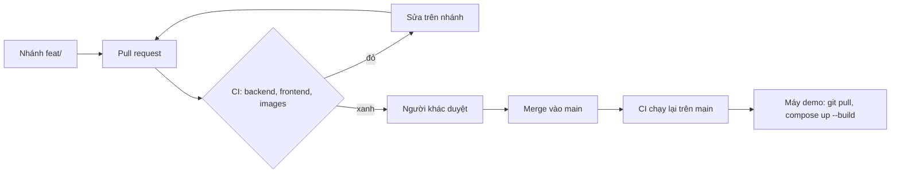

# Kế hoạch triển khai và vận hành

Cách đưa OISM từ mã nguồn tới một hệ thống đang chạy, và giữ nó chạy (mục e.4 của đề, task W5-08). Phạm vi bàn giao là gói Docker Compose chạy trên một máy; phần "Đưa lên môi trường thật" ở cuối liệt kê việc còn phải làm nếu dùng cho cửa hàng thật.

## 1. Môi trường

| Môi trường | Dùng để | Cách dựng | Dữ liệu |
| --- | --- | --- | --- |
| Dev | Viết code, chạy thử trên máy | `deploy/docker-compose.yml`: image SDK, mount mã nguồn, build lại mỗi lần khởi động; frontend chạy bằng Vite | Seed chạy tay |
| CI | Kiểm mỗi PR và mỗi lần đẩy lên `main` | `.github/workflows/ci.yml` trên GitHub Actions | Testcontainers tạo PostgreSQL, RabbitMQ riêng cho từng lớp test |
| Demo | Trình diễn, chấm bài, cài trên máy sạch | `deploy/docker-compose.demo.yml`: image thật, `admin` và `pos` chạy bằng nginx | Seed tự chạy |

Hai gói Compose dùng chung cổng nên mỗi máy chỉ bật một gói một lúc. Bảng cổng và tên service đầy đủ: [architecture/context-and-containers.md](../architecture/context-and-containers.md).

## 2. Thành phần của gói demo

| Container | Image | Cổng ra máy host | Health check | Restart |
| --- | --- | --- | --- | --- |
| `postgres` | `postgres:17-alpine` | Không | `pg_isready` | `unless-stopped` |
| `rabbitmq` | `rabbitmq:4-management-alpine` | Không | `rabbitmq-diagnostics ping` | `unless-stopped` |
| `gateway` | Build từ `backend/gateway` | 8080 (HTTP), 8443 (HTTPS, TLS 1.3) | `GET /health` | `unless-stopped` |
| `identity`, `catalog`, `core`, `channel`, `insights` | Build từ `backend/services/<service>` | Không | `GET /health` | `unless-stopped` |
| `admin`, `pos` | Build từ `frontend/Dockerfile` | 5173, 5174 | `GET /` của nginx | `unless-stopped` |
| `secrets` | Chạy một lần | Không | Không | Không; sinh khóa JWT và chứng chỉ TLS ở lần đầu |
| `seed` | Chạy một lần | Không | Không | `on-failure:3` |

Thứ tự khởi động do `depends_on` kèm điều kiện quyết định: `secrets` thoát thành công, PostgreSQL và RabbitMQ khỏe, rồi tới 5 service, gateway, hai frontend, cuối cùng là `seed`. Chi tiết: [deploy/README.md](../../deploy/README.md).

## 3. Quy trình phát hành



| Bước | Điều kiện qua |
| --- | --- |
| CI job Backend | `dotnet build`, mọi test xanh, coverage của Inventory, Reservation, Costing không dưới 80% ([testing/coverage.md](../testing/coverage.md)) |
| CI job Frontend | Kiểm kiểu, Vitest, build `admin` và `pos` |
| CI job Docker images | Build được mọi image của gói demo |
| Duyệt | Một người khác duyệt theo [conventions/git.md](../conventions/git.md) |
| Sau merge | `main` luôn chạy được; CI trên `main` xanh |

Phiên bản phát hành là commit trên `main`. Muốn đánh dấu một bản đã bàn giao thì gắn tag, ví dụ `v1.0.0`, lên commit đã qua kịch bản demo ([demo-script.md](demo-script.md)).

## 4. Các bước đưa vào vận hành

Làm theo thứ tự; mỗi bước có cách kiểm.

| # | Việc | Kiểm |
| --- | --- | --- |
| 1 | Chuẩn bị máy theo [install-guide.md](install-guide.md) mục 1 và 2 | `docker version`, `docker compose version` |
| 2 | Lấy đúng phiên bản: `git clone`, rồi `git checkout <tag>` nếu có tag | `git log -1` ra đúng commit |
| 3 | Đặt bí mật trong `deploy/.env` (chép từ `deploy/.env.example`): `POSTGRES_PASSWORD`, `RABBITMQ_PASSWORD`, `SEED_PASSWORD` khác giá trị mẫu | File `deploy/.env` có, không nằm trong git |
| 4 | `docker compose -f deploy/docker-compose.demo.yml up -d --build` | `ps -a`: mọi container `healthy`, `seed` `Exited (0)` |
| 5 | Kiểm khói: đăng nhập admin và POS, chạy Postman collection ([design/api/postman/](../design/api/postman/README.md)) | Đăng nhập được; collection xanh |
| 6 | Bàn giao tài khoản: cửa hàng thật tự đăng ký ở `/register`; tài khoản mẫu của seed chỉ dùng để demo | Owner thật đăng nhập được |

Khóa JWT và chứng chỉ TLS do `secrets` sinh vào volume `secrets` ở lần chạy đầu và giữ nguyên qua các lần khởi động lại. Xóa volume đó (`down -v`) là sinh khóa mới: mọi phiên đăng nhập cũ hết hiệu lực.

## 5. Vận hành hằng ngày

### Theo dõi

| Theo dõi gì | Cách xem | Bình thường |
| --- | --- | --- |
| Sức khỏe container | `docker compose -f deploy/docker-compose.demo.yml ps` | Mọi container `healthy` |
| Sức khỏe qua gateway | `GET http://localhost:8080/api/<service>/health` | `Healthy` |
| Log một service | `docker compose -f deploy/docker-compose.demo.yml logs -f core` | Không có dòng `fail` hay `Error` lặp lại |
| Hàng đợi | `docker compose -f deploy/docker-compose.demo.yml exec rabbitmq rabbitmqctl list_queues` | Không hàng đợi nào dồn lên mãi |
| Outbox chưa phát | `select count(*) from core.outbox_messages where processed_at is null;` (tương tự cho `identity`, `catalog`, `channel`) | Gần 0; tăng khi RabbitMQ tắt, tự phát bù khi chạy lại |

Log không ghi mật khẩu, token hay khóa ([architecture/security.md](../architecture/security.md)).

### Job nền

| Job | Service | Lịch | Việc |
| --- | --- | --- | --- |
| Hết hạn giữ hàng | `core` | Mỗi phút | Hủy đơn Chờ duyệt đã quá 30 phút, trả hàng về tồn |
| Tổng hợp ngày | `insights` | 00:05 giờ Việt Nam | Dựng lại bảng tổng hợp doanh thu của ngày hôm qua |
| Dự báo | `insights` | 00:30 giờ Việt Nam | Chạy dự báo cho mọi cửa hàng có dữ liệu |

Job chạy bằng Hangfire, lưu trạng thái trong schema riêng (`hangfire_core`, `hangfire_insights`). Chạy lại một job không gây tác động lần hai.

### Khi một thành phần sập

| Sự cố | Hệ thống làm gì | Người vận hành làm gì |
| --- | --- | --- |
| Một service thoát bất thường | Docker khởi động lại theo `unless-stopped`; health check trở về `healthy` | Xem log để tìm nguyên nhân |
| RabbitMQ tắt | Giao dịch vẫn commit; event nằm trong outbox và phát bù khi RabbitMQ chạy lại (T23) | Bật lại RabbitMQ; kiểm outbox giảm về 0 |
| PostgreSQL tắt | Mọi API trả lỗi 500; không mất dữ liệu đã commit | Bật lại PostgreSQL; kiểm sức khỏe service |
| Event tới trễ | Thao tác ngay sau khi tạo SKU hay chi nhánh có thể nhận 409 `reference_not_ready`; giao diện tự thử lại | Không cần làm gì |

Mục tiêu 99,5% thời gian hoạt động (NFR-USA-01) không đo được trong thời gian đồ án; thiết kế hỗ trợ nó bằng health check, restart policy và outbox.

## 6. Sao lưu và khôi phục

Toàn bộ dữ liệu nghiệp vụ nằm trong database `oism` (5 schema) ở volume `postgres-data`. RabbitMQ không giữ dữ liệu cần sao lưu: event chưa phát còn trong outbox.

Sao lưu, chạy hằng ngày và trước mỗi lần cập nhật phiên bản:

```bash
docker compose -f deploy/docker-compose.demo.yml exec -T postgres pg_dump -U oism -d oism -Fc > oism-$(date +%Y%m%d).dump
```

Khôi phục vào một database đang chạy, sau khi dừng các service để không có ghi mới:

```bash
docker compose -f deploy/docker-compose.demo.yml stop gateway identity catalog core channel insights
```

```bash
docker compose -f deploy/docker-compose.demo.yml exec -T postgres pg_restore -U oism -d oism --clean --if-exists < oism-20261018.dump
```

```bash
docker compose -f deploy/docker-compose.demo.yml start identity catalog core channel insights gateway
```

Thay `oism-20261018.dump` bằng file cần khôi phục. Trigger chặn sửa sổ kho được khôi phục cùng schema. Đề xuất cho môi trường thật: sao lưu mỗi ngày, giữ 30 bản, thử khôi phục mỗi tháng.

## 7. Cập nhật phiên bản

1. Sao lưu database theo mục 6.
2. `git pull` (hoặc `git checkout <tag mới>`).
3. `docker compose -f deploy/docker-compose.demo.yml up -d --build`. Compose chỉ dựng lại container có image đổi.
4. Service áp migration mới lúc khởi động. Mỗi service giữ migration của riêng mình và không sửa migration đã merge ([PLAN.md](../PLAN.md) mục 14), nên migration mới chỉ chạy tiếp từ trạng thái đang có.
5. Kiểm khói như mục 4 bước 5.

Quay về bản trước: `git checkout <tag cũ>`, `up -d --build`; nếu bản mới đã áp migration làm hỏng dữ liệu thì khôi phục bản sao lưu ở bước 1.

Hợp đồng event chỉ thêm trường ([architecture/messaging.md](../architecture/messaging.md)), nên cập nhật từng service một vẫn an toàn: service cũ đọc được event của service mới.

## 8. Nâng cấp nền tảng

.NET 8 hết hỗ trợ ngày 2026-11-10 ([architecture/README.md](../architecture/README.md) mục "Vòng đời nền tảng"). Đề chỉ định .NET 8 nên bản bàn giao giữ .NET 8. Khi vận hành tiếp, nâng lên .NET 10 LTS:

1. `backend/Directory.Build.props`: đổi `TargetFramework` sang `net10.0`.
2. `backend/Directory.Packages.props`: nâng các package `Microsoft.*` và `Npgsql.EntityFrameworkCore.PostgreSQL`, `EFCore.NamingConventions` lên bản cho .NET 10; kiểm thay đổi phá vỡ của Swashbuckle (bản 10 dùng Microsoft.OpenApi 2).
3. Các `Dockerfile` của gateway, 5 service, seed và service `tests`, `seed` của Compose dev: đổi image `sdk:8.0`, `aspnet:8.0` sang `10.0`.
4. `.github/workflows/ci.yml`: `dotnet-version: 10.0.x`.
5. Chạy toàn bộ test, đo lại tải bằng k6 ([testing/load-test.md](../testing/load-test.md)), chạy kịch bản demo hai lần.
6. Cập nhật [conventions/backend.md](../conventions/backend.md) và viết ADR mới cho lần đổi nền tảng.

## 9. Đưa lên môi trường thật

Gói demo cố ý đơn giản để cài trên một máy. Dùng cho cửa hàng thật thì còn các việc sau, chưa làm trong đồ án:

| Việc | Lý do |
| --- | --- |
| Chạy service ở môi trường Production, tắt Swagger, áp migration bằng bước riêng trước khi khởi động | Gói demo chạy Development để tự áp migration lúc khởi động |
| Thay chứng chỉ tự ký bằng chứng chỉ thật, cho frontend gọi gateway qua HTTPS, đặt CORS theo tên miền thật | TLS chỉ tự ký ở gói demo |
| Lưu bí mật ở kho bí mật thay vì file `.env` | `.env` chỉ hợp với máy demo |
| Thêm giám sát và cảnh báo tập trung (log, số liệu) | Hiện chỉ có health check và log của Docker |
| Sao lưu tự động ra nơi khác máy chạy | Mục 6 mới là lệnh tay |
| Kết nối API thật của sàn | Ngoài phạm vi đồ án ([PLAN.md](../PLAN.md) mục 2) |
