# Đặc tả yêu cầu phần mềm (SRS): OISM

Hệ thống quản lý bán hàng và tồn kho đa kênh (Omnichannel Inventory and Sales Management System).

| Mục | Nội dung |
| --- | --- |
| Phiên bản | 1.2 |
| Ngày | 2026-10-18 |
| Trạng thái | Bản chốt phase 10 (URS bàn giao), khớp tài liệu `docs/` và code trên `main` |
| Người soạn | Nhóm OISM (3 dev) |
| Khuôn tham khảo | ISO/IEC/IEEE 29148 (kế thừa IEEE 830) |

> **Vị trí của tài liệu này.** SRS gom các yêu cầu đang nằm rải rác trong `docs/` thành một tài liệu đọc liền mạch, để nộp và để người ngoài nhóm đọc.
>
> - SRS không thêm yêu cầu nào mới. Mỗi bảng chép lại từ tài liệu khác đều có link về nguồn.
> - Phần chỉ có ở đây: sơ đồ use case UML (mục 3.2), ERD liên service (mục 3.3), bảng quy tắc nghiệp vụ BR (mục 3.5).
> - Khi SRS lệch với tài liệu nguồn, tài liệu nguồn thắng theo thứ tự ở [docs/README.md](../README.md) mục "Khi tài liệu mâu thuẫn". Sửa yêu cầu thì sửa tài liệu nguồn trước, rồi cập nhật SRS.

## Mục lục

1. [Giới thiệu](#1-giới-thiệu)
2. [Mô tả tổng quan](#2-mô-tả-tổng-quan)
3. [Mô hình nghiệp vụ](#3-mô-hình-nghiệp-vụ)
4. [Yêu cầu chức năng chi tiết](#4-yêu-cầu-chức-năng-chi-tiết)
5. [Yêu cầu giao diện ngoài](#5-yêu-cầu-giao-diện-ngoài)
6. [Yêu cầu phi chức năng](#6-yêu-cầu-phi-chức-năng)
7. [Yêu cầu dữ liệu](#7-yêu-cầu-dữ-liệu)
8. [Kiểm thử chấp nhận](#8-kiểm-thử-chấp-nhận)
9. [Ma trận truy vết yêu cầu](#9-ma-trận-truy-vết-yêu-cầu)
10. [Phụ lục](#10-phụ-lục)

---

## 1. Giới thiệu

### 1.1 Mục đích

Tài liệu đặc tả những gì OISM phải làm và phải đạt, ở mức đủ để:

- giảng viên và nhóm thống nhất phạm vi nghiệm thu;
- dev viết code và test theo cùng một đích;
- người kiểm thử dựng kịch bản kiểm chứng cho từng yêu cầu;
- người đọc ngoài nhóm hiểu hệ thống mà không phải đọc hết thư mục `docs/`.

Người đọc chính: giảng viên hướng dẫn, ba dev của nhóm, người kiểm thử và người chấm demo.

### 1.2 Phạm vi sản phẩm

OISM là phần mềm SaaS đa tenant cho cửa hàng bán lẻ bán cùng lúc tại quầy (POS) và trên các sàn Shopee, TikTok Shop, Lazada. Hệ thống giải ba lỗi quen thuộc khi bán đa kênh:

1. Bán vượt tồn vì đồng bộ tồn chậm.
2. Giá vốn hàng bán (COGS) sai.
3. Số liệu tồn lệch vì sửa tay.

Cách giải:

| Cơ chế | Mục tiêu |
| --- | --- |
| Sổ giao dịch tồn kho chỉ thêm mới | Mọi biến động tồn truy vết được; không sửa thẳng cột tồn |
| Giữ hàng có khóa dòng ở database | 50 đơn tranh 1 sản phẩm thì đúng 1 đơn thắng, tồn khả dụng không bao giờ âm |
| Giá vốn bình quân gia quyền, chốt lên dòng đơn | Giá vốn đúng theo từng đợt nhập; lợi nhuận quá khứ không đổi theo giá vốn hiện tại |
| Trung tâm đơn hàng với Canonical Order và máy trạng thái | Đơn từ POS, admin và sàn đi chung một đường |
| POS dạng PWA, checkout một transaction | Bán nhanh tại quầy, quét mã rồi Enter là xong |
| Cách ly tenant bằng `TenantId` và Global Query Filter | Doanh nghiệp này không thấy dữ liệu của doanh nghiệp khác |
| Báo cáo, cảnh báo tồn, dự báo nhập hàng | Biết lãi lỗ, biết khi nào cần nhập, nhập bao nhiêu |

Sản phẩm bàn giao gồm backend .NET 8 (5 service sau một gateway), trang quản trị React, PWA POS React, bộ tài liệu, Swagger và Postman, gói Docker Compose có dữ liệu mẫu.

### 1.3 Định nghĩa, thuật ngữ, viết tắt

| Thuật ngữ | Nghĩa trong OISM |
| --- | --- |
| Tenant | Một doanh nghiệp dùng hệ thống, có không gian dữ liệu riêng và một `TenantId` duy nhất |
| Chi nhánh (Branch) | Một cửa hàng (`Store`) hoặc kho (`Warehouse`) của tenant; tồn kho quản lý theo chi nhánh |
| Sản phẩm (Product) | Mặt hàng chung, ví dụ "Áo thun A" |
| SKU | Biến thể quản lý tồn, ví dụ "Áo thun A, Đen, M"; mã SKU duy nhất trong tenant |
| `on_hand` | Tồn thực tế theo sổ của một SKU tại một chi nhánh |
| `reserved` | Tổng số lượng đang giữ cho các đơn chưa xuất kho |
| `available` | Tồn khả dụng, bằng `on_hand − reserved` |
| Sổ kho (Ledger) | Bảng `inventory_transactions`, chỉ thêm mới, mỗi biến động tồn là một dòng |
| Phần giữ hàng (Reservation) | Bản ghi giữ một số lượng của một dòng đơn, trạng thái `Active`, `Consumed` hoặc `Released` |
| WAC | Giá vốn bình quân gia quyền (`avg_cost`), tính theo chi nhánh và SKU |
| COGS | Giá vốn hàng bán, tổng `quantity × cost_price` |
| `CostPrice` | Giá vốn chốt trên dòng đơn lúc xác nhận; không bao giờ đổi |
| Canonical Order | Mô hình đơn chuẩn dùng chung sau khi đổi payload của từng kênh |
| Idempotency | Gửi lại cùng một yêu cầu không tạo thêm tác động nghiệp vụ |
| Outbox, inbox | Bảng ghi thông điệp chờ gửi trong cùng transaction nghiệp vụ; bảng ghi thông điệp đã nhận để bỏ bản trùng |
| Simulator | Công cụ giả lập webhook của ba sàn; không gọi sàn thật |
| p95 | Phân vị 95 của thời gian phản hồi |
| WAPE | Sai số phần trăm tuyệt đối có trọng số, `Σ\|y − ŷ\| / Σy` |
| PWA | Ứng dụng web cài được lên màn hình chính, cache app shell |
| RBAC | Phân quyền theo vai trò |
| AC | Tiêu chí chấp nhận (acceptance criterion), trích dạng `UC-ORD-03 AC-2` |

| Viết tắt | Đầy đủ |
| --- | --- |
| FR, NFR | Yêu cầu chức năng, yêu cầu phi chức năng |
| UC | Use case |
| BR | Quy tắc nghiệp vụ (business rule) trong SRS này |
| ADR | Bản ghi quyết định kiến trúc ở `docs/decisions/` |
| RTM | Ma trận truy vết yêu cầu |
| JWT | JSON Web Token |

### 1.4 Tài liệu tham chiếu

| Tài liệu | Vai trò |
| --- | --- |
| [Bản dịch và phân tích đề](../../OISM-ban-dich-va-phan-tich-tieng-Viet.md) | Đề gốc: 30 FR, 11 NFR, gói công việc, sản phẩm bàn giao |
| [requirements/functional.md](functional.md), [non-functional.md](non-functional.md) | Danh sách mã yêu cầu |
| [usecase-userstory/](../usecase-userstory/README.md) | 29 use case và tiêu chí chấp nhận |
| [decisions/](../decisions/README.md) | 13 ADR cho các điểm đề để ngỏ |
| [architecture/](../architecture/README.md) | Chia service, phân lớp, tenant, transaction, bảo mật |
| [design/](../design/README.md) | Bảng, API, event, trạng thái, luồng, giao diện, dự báo; sơ đồ lớp UML của Domain `core` ở [design/class-diagram.md](../design/class-diagram.md) |
| [design/api/postman/](../design/api/postman/README.md) | Postman collection gọi trọn API qua gateway; Swagger gộp ở `/swagger` của gateway |
| [handover/](../handover/README.md) | Hướng dẫn cài đặt, hướng dẫn sử dụng, kế hoạch triển khai, kịch bản demo |
| [testing/](../testing/scenarios.md) | 23 kịch bản kiểm thử bắt buộc; [báo cáo backtest dự báo](../testing/forecast-backtest.md) |
| [deploy/seed/README.md](../../deploy/seed/README.md) | Dữ liệu demo và tài khoản dùng khi nghiệm thu |
| [PLAN.md](../PLAN.md) | Phạm vi, ưu tiên, lịch, RTM rút gọn |

### 1.5 Quy ước trong tài liệu

- "Phải" là bắt buộc; "không được" là cấm. Mỗi yêu cầu có mã cố định để truy vết.
- Mã yêu cầu giữ nguyên mã của đề (`FR-AUTH-01`...). Ba mã `FR-AI-01` đến `FR-AI-03` do nhóm đặt, giảng viên đã xác nhận ngày 2026-10-04.
- Mức ưu tiên lấy từ [PLAN.md](../PLAN.md) mục 11: **P0** không được cắt; **P1** làm đủ; **P2** làm mức tối thiểu. Yêu cầu mà PLAN không gọi tên riêng được xếp theo hạng mục gần nhất trong PLAN; ví dụ FR-POS-01 và FR-POS-03 xếp P0 vì thuộc "POS checkout".
- Mã lỗi HTTP: 400 dữ liệu vào sai, 401 chưa đăng nhập, 403 thiếu quyền, 404 không có hoặc thuộc tenant khác, 409 trái trạng thái hoặc thiếu hàng.
- Sơ đồ viết bằng Mermaid, xem được trên GitHub, VS Code hoặc mermaid.live.

### 1.6 Bố cục tài liệu

Mục 2 mô tả hệ thống nhìn từ ngoài. Mục 3 dựng mô hình nghiệp vụ: sơ đồ use case, mô hình dữ liệu khái niệm, máy trạng thái và các quy tắc nghiệp vụ dùng chung. Mục 4 đặc tả từng nhóm chức năng và từng use case. Mục 5 đến 7 là giao diện, chất lượng và dữ liệu. Mục 8 và 9 là kiểm thử chấp nhận và truy vết.

---

## 2. Mô tả tổng quan

### 2.1 Bối cảnh sản phẩm

OISM là hệ thống mới, không thay thế phần mềm có sẵn. Bên ngoài OISM chỉ có người dùng, simulator webhook và hộp thoại in của trình duyệt; không có cổng thanh toán, dịch vụ AI ngoài hay dịch vụ email.

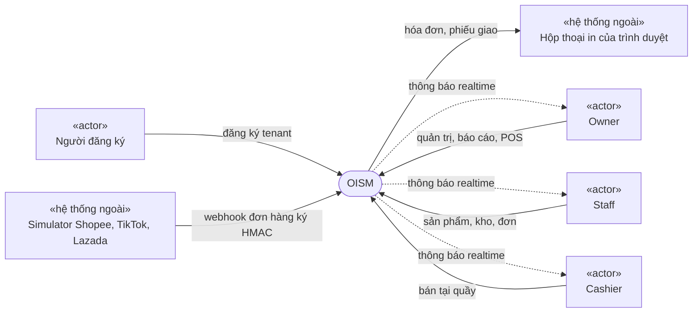

Bên trong, hệ thống gồm 5 service .NET 8 sau một API gateway, hai ứng dụng React, một database PostgreSQL chia 5 schema và một RabbitMQ.

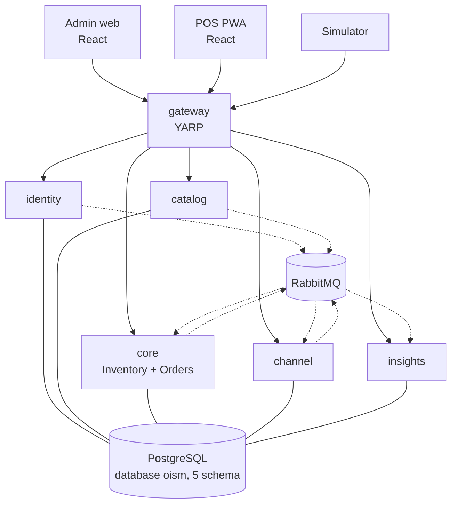

| Khối | Trách nhiệm | Schema |
| --- | --- | --- |
| `gateway` | Định tuyến, kiểm JWT, TLS, WebSocket, rate limit đăng nhập | Không |
| `identity` | Tenant, người dùng, đăng nhập, phân quyền, chi nhánh | `identity` |
| `catalog` | Danh mục, thương hiệu, sản phẩm, SKU, mã vạch, giá niêm yết | `catalog` |
| `core` | Sổ kho, số dư, giá vốn, phiếu nhập, chuyển kho, kiểm kê, đơn hàng, giữ hàng, POS checkout | `core` |
| `channel` | Nhận webhook ba sàn, chống trùng, chuẩn hóa đơn, công cụ bắn tải | `channel` |
| `insights` | Báo cáo, cảnh báo tồn, dự báo, thông báo realtime | `insights` |
| `admin`, `pos` | Trang quản trị cho Owner và Staff; PWA bán tại quầy cho Cashier | Không |

Đơn hàng và tồn kho nằm chung `core` vì phải commit trong cùng một transaction ([ADR-0001](../decisions/0001-microservices-by-transaction-boundary.md)). Các service khác trao đổi dữ liệu bằng event qua outbox và inbox, không gọi HTTP chéo.

### 2.2 Chức năng chính

| Nhóm | Mã | Chức năng |
| --- | --- | --- |
| Tenant và xác thực | FR-AUTH | Đăng ký tenant, đăng nhập JWT, phân quyền Owner/Staff/Cashier, quản lý chi nhánh |
| Sản phẩm | FR-PROD | Danh mục phân cấp, thương hiệu, sản phẩm và SKU, mã vạch EAN-13/Code128, giá lẻ và giá sỉ |
| Kho | FR-INV | Sổ kho chỉ thêm mới, phiếu nhập, chuyển kho hai bước, kiểm kê |
| Giá vốn | FR-COST | Tính lại WAC khi nhập, chốt giá vốn lên dòng đơn |
| Đơn hàng | FR-ORD | Nhận đơn đa kênh, máy trạng thái, duyệt, hoàn tất, hủy, in phiếu giao |
| Chống bán vượt | FR-RSE | Tồn khả dụng, giữ hàng, trừ hoặc giải phóng |
| Bán tại quầy | FR-POS | Tìm và quét nhanh, chặn bán vượt, tiền mặt hoặc QR, in hóa đơn, checkout nguyên tử |
| Báo cáo | FR-REP | Doanh thu, giá vốn, lợi nhuận gộp; giá trị tồn, bán chạy, bán chậm; cảnh báo tồn thấp |
| Giả lập và realtime | FR-SIM | Webhook giả lập, thông báo SignalR, job Hangfire |
| Dự báo | FR-AI | Dự báo nhu cầu, đề xuất số lượng nhập, backtest |

### 2.3 Lớp người dùng

| Actor | Là ai | Dùng ứng dụng | Đặc điểm và quyền chính |
| --- | --- | --- | --- |
| Người đăng ký | Chủ cửa hàng chưa có tài khoản | Admin (trang đăng ký) | Tạo tenant; trở thành Owner ngay sau đó |
| Owner | Chủ cửa hàng | Admin, POS | Toàn quyền trong tenant: người dùng, chi nhánh, giá, báo cáo lợi nhuận, dự báo, cấu hình shop sàn, simulator; bán được ở POS |
| Staff | Nhân viên kho và đơn | Admin | Sản phẩm, kho, đơn hàng, báo cáo tồn; không xem giá vốn, lợi nhuận; không đặt giá; thấy mọi chi nhánh |
| Cashier | Thu ngân | POS | Gắn với đúng một chi nhánh; chỉ tìm SKU, thanh toán, nhận thông báo của chi nhánh mình |
| Simulator | Công cụ giả lập ba sàn | Webhook | Không có JWT; xác thực bằng chữ ký HMAC của shop |
| Hệ thống | Job nền Hangfire | Không | Hủy đơn hết hạn mỗi phút; tổng hợp báo cáo và chạy dự báo mỗi đêm |

Mỗi người dùng thuộc đúng một tenant. Không có quản trị viên toàn nền tảng.

### 2.4 Môi trường vận hành

| Thành phần | Môi trường |
| --- | --- |
| Backend | C# 12, .NET 8, ASP.NET Core Web API; chạy trong container Docker |
| Dữ liệu | PostgreSQL, một database `oism`, mỗi service một schema; EF Core với Npgsql |
| Thông điệp | RabbitMQ, exchange `oism.events` loại topic |
| Job nền | Hangfire trên PostgreSQL (schema `hangfire_core`, `hangfire_insights`) |
| Realtime | SignalR qua WebSocket |
| Frontend | React, Vite, TypeScript strict, TanStack Query, React Router, Ant Design; npm workspaces `admin`, `pos`, `shared` |
| Triển khai demo | Docker Compose trên một máy chỉ cần Docker |
| Thiết bị người dùng | Máy tính để bàn, máy tính bảng, thiết bị POS cầm tay (màn hẹp hơn 768 px) có trình duyệt hỗ trợ WebSocket và Service Worker (giả định của SRS) |
| Ngoại vi | Máy quét mã vạch kiểu bàn phím (gõ mã rồi gửi Enter); máy in mà trình duyệt in được |

Cổng trên máy dev: gateway 8080 (HTTP) và 8443 (HTTPS); `admin` 5173; `pos` 5174; service 5101 đến 5105; PostgreSQL 5432; RabbitMQ 5672 và 15672.

### 2.5 Ràng buộc thiết kế và triển khai

| # | Ràng buộc | Nguồn |
| --- | --- | --- |
| C-01 | Công nghệ do đề chỉ định: .NET 8, EF Core, PostgreSQL, SignalR, Hangfire, ReactJS, Docker Compose, GitHub Actions | Đề, gói công việc 1 đến 5 |
| C-02 | Clean Architecture bốn lớp trong mỗi service: Domain, Application, Infrastructure, Api; Domain không tham chiếu EF Core hay ASP.NET Core | NFR-MAINT-01 |
| C-03 | Đơn hàng và tồn kho chung service `core`, chung transaction | NFR-SEC-02, ADR-0001 |
| C-04 | Service không gọi HTTP sang nhau, không đọc schema của nhau; dữ liệu dùng chung đi bằng event qua outbox và inbox | ADR-0001, ADR-0013 |
| C-05 | Mọi bảng nghiệp vụ có `tenant_id`; dùng EF Core Global Query Filter | NFR-TENANT-01, ADR-0002 |
| C-06 | Khóa bi quan `SELECT ... FOR UPDATE` theo thứ tự: chứng từ trước, rồi số dư theo `branch_id`, `sku_id` tăng dần | NFR-PERF-02, ADR-0003 |
| C-07 | Không dùng MediatR, AutoMapper, MassTransit, FluentAssertions; không thêm package ngoài danh sách khi chưa được đồng ý | Quy ước backend |
| C-08 | Test luồng đụng tồn kho chạy trên PostgreSQL thật (Testcontainers); không dùng database in-memory hay SQLite | Chiến lược kiểm thử |
| C-09 | Tiền lưu `numeric(18,4)`, làm tròn 4 chữ số, nửa lên; thời gian lưu UTC | ADR-0004, quy ước thiết kế |
| C-10 | Quỹ thời gian 3 dev × 5 tuần = 75 ngày công; khoảng 22 ngày dành cho hạ tầng phân tán | PLAN mục 1 |

### 2.6 Giả định và phụ thuộc

- Mọi tenant dùng giờ Việt Nam (UTC+7) cho ngày báo cáo.
- SKU hoặc chi nhánh vừa tạo tới `core` sau một nhịp event; trong khoảng đó thao tác dùng tới chúng nhận 409 `reference_not_ready` và giao diện tự thử lại.
- Báo cáo, cảnh báo tồn và thông báo realtime trễ theo event, thường dưới vài giây.
- Thu ngân tự kiểm đã nhận tiền (tiền mặt hoặc chuyển khoản QR) trước khi bấm thanh toán.
- Dữ liệu seed chỉ để trình diễn; nó không chứng minh độ chính xác của dự báo trên dữ liệu thật.
- .NET 8 hết hỗ trợ khoảng tháng 11/2026 theo lịch của Microsoft; nhóm giữ .NET 8 theo đề.

### 2.7 Ngoài phạm vi

| Hạng mục | Lý do |
| --- | --- |
| Gọi API thật của Shopee, TikTok Shop, Lazada; đẩy tồn ngược về sàn | Đề chỉ yêu cầu bộ mô phỏng webhook (ADR-0006) |
| Bán hàng offline trên POS | Cần chính sách phân bổ tồn và xử lý xung đột (ADR-0007) |
| Cổng thanh toán, đối soát QR tự động | Thu ngân xác nhận tay (ADR-0007) |
| Hóa đơn điện tử, máy in chuyên dụng | Đề chỉ yêu cầu in qua trình duyệt |
| Trả hàng và hoàn tiền; hủy đơn sau Confirmed | Đề không có FR riêng; sổ chỉ dành sẵn lý do `ReturnIn` (ADR-0005) |
| Nhận thiếu hoặc hủy phiếu chuyển kho đang vận chuyển | ADR-0009; hàng thiếu xử lý bằng kiểm kê ở nơi nhận |
| Quản trị viên toàn nền tảng; người dùng thuộc nhiều tenant | Đề chỉ có Owner, Staff, Cashier (ADR-0011) |
| Thuế, phí vận chuyển, phí sàn trong báo cáo | ADR-0008 |
| Kubernetes, service mesh, tracing phân tán | Docker Compose đủ cho gói demo |

---

## 3. Mô hình nghiệp vụ

### 3.1 Các mô hình trong tài liệu

Đề yêu cầu mô hình hóa bằng UML 2.0 và bàn giao ERD (mục e.3 của đề). SRS bổ sung hai mô hình mà phần còn lại của `docs/` chưa có ở mức yêu cầu:

- **Sơ đồ use case UML:** có ranh giới hệ thống, quan hệ `«include»`, `«extend»` và kế thừa giữa actor. Sơ đồ ở [usecase-userstory/README.md](../usecase-userstory/README.md) chỉ là bản đồ dạng flowchart.
- **ERD liên service có thuộc tính:** ERD ở [design/data-model/](../design/data-model/core.md) tách theo từng schema, chỉ có quan hệ, không cho thấy liên kết logic giữa các service (chi nhánh và SKU ở `core` là bản sao dựng từ event).

Mỗi mô hình nằm ở đâu:

| Sơ đồ | Đặt ở | Mức |
| --- | --- | --- |
| Sơ đồ use case UML | SRS mục 3.2 | Yêu cầu: ai làm gì |
| ERD khái niệm và logic, liên service | SRS mục 3.3 | Yêu cầu dữ liệu: thực thể, thuộc tính chính, bản số |
| ERD vật lý từng schema (cột, kiểu, chỉ mục) | [design/data-model/](../design/data-model/core.md) | Thiết kế; nguồn chuẩn khi lệch |
| Máy trạng thái | SRS mục 3.4, chi tiết ở [design/state-machines.md](../design/state-machines.md) | Yêu cầu hành vi |
| Sơ đồ tuần tự 8 luồng lõi | [design/flows/](../design/flows/) | Thiết kế |
| Sơ đồ lớp UML của Domain `core` | [design/class-diagram.md](../design/class-diagram.md) | Thiết kế; vẽ theo code |

### 3.2 Sơ đồ use case

Quy ước: hình chữ nhật «actor» là actor; hình bo tròn là use case; khung "OISM" là ranh giới hệ thống; mũi tên ghi "kế thừa" là quan hệ tổng quát hóa giữa actor; nét đứt `«include»`, `«extend»` theo nghĩa UML; nét đứt "kích hoạt" là use case này gây ra use case kia một cách bất đồng bộ (qua event); nét đứt "đọc kết quả" là use case dùng dữ liệu do use case kia sinh ra. Mermaid không có ký hiệu use case UML riêng nên dùng flowchart với quy ước này.

#### 3.2.1 Quan hệ giữa các actor

Owner làm được mọi việc của Staff và của Cashier, cộng các việc chỉ Owner được làm. Vì vậy Owner kế thừa cả hai actor kia.

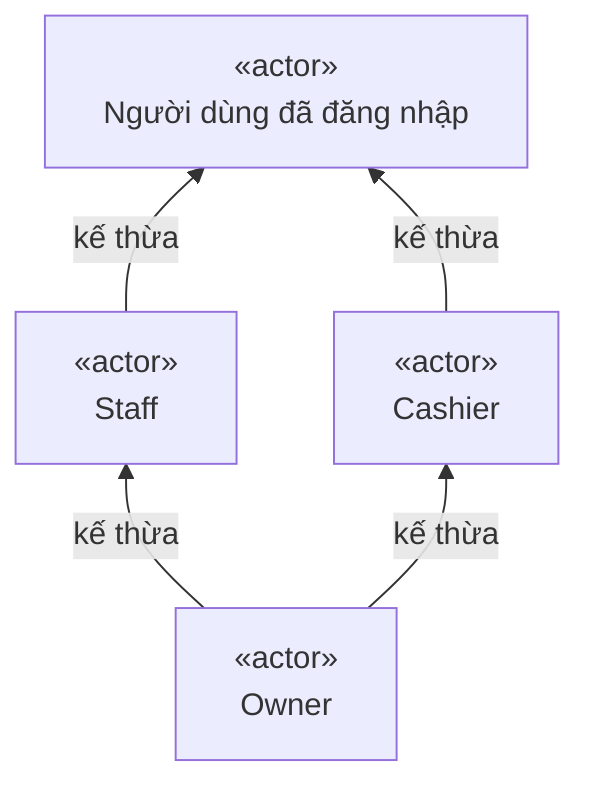

"Người dùng đã đăng nhập" là actor trừu tượng: mọi use case gắn với nó (đăng nhập, nhận thông báo) dùng được cho cả ba vai trò.

#### 3.2.2 Tổng quan theo gói

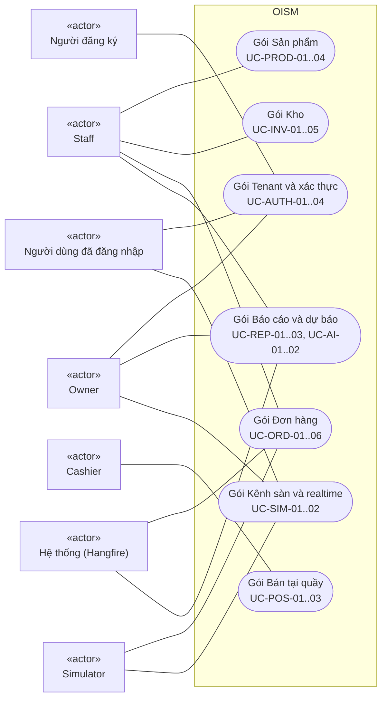

Owner nối với mọi gói qua quan hệ kế thừa ở 3.2.1; sơ đồ chỉ vẽ thêm các gói có use case chỉ Owner làm.

#### 3.2.3 Tenant, xác thực, sản phẩm

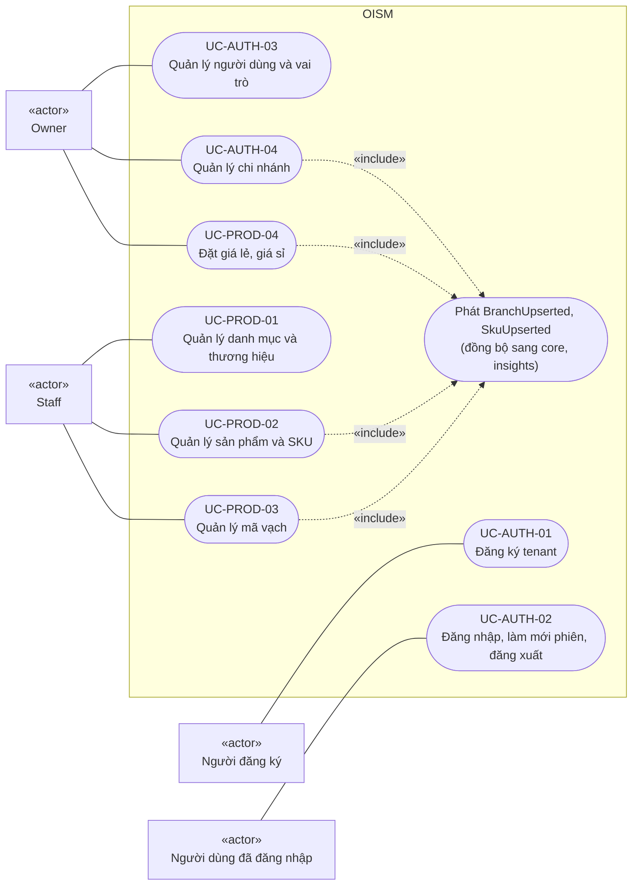

#### 3.2.4 Kho

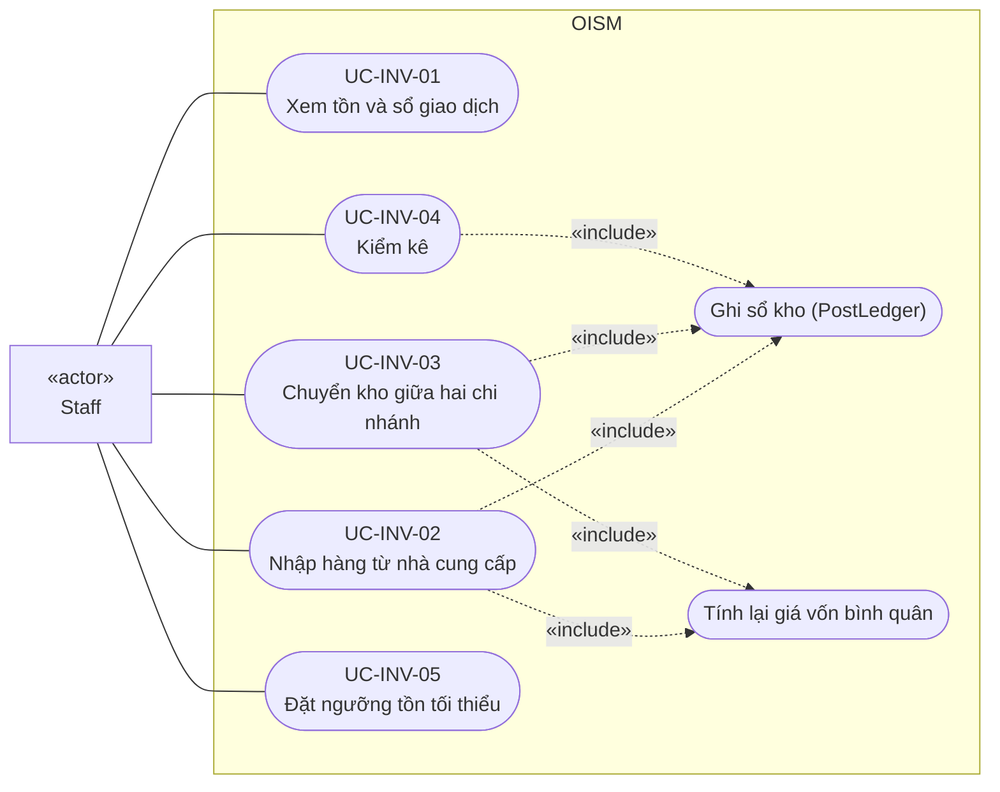

Owner dùng được mọi use case ở đây qua quan hệ kế thừa. Riêng giá vốn (`avgCost`, `unitCost`) chỉ hiện cho Owner.

#### 3.2.5 Đơn hàng, bán tại quầy, kênh sàn

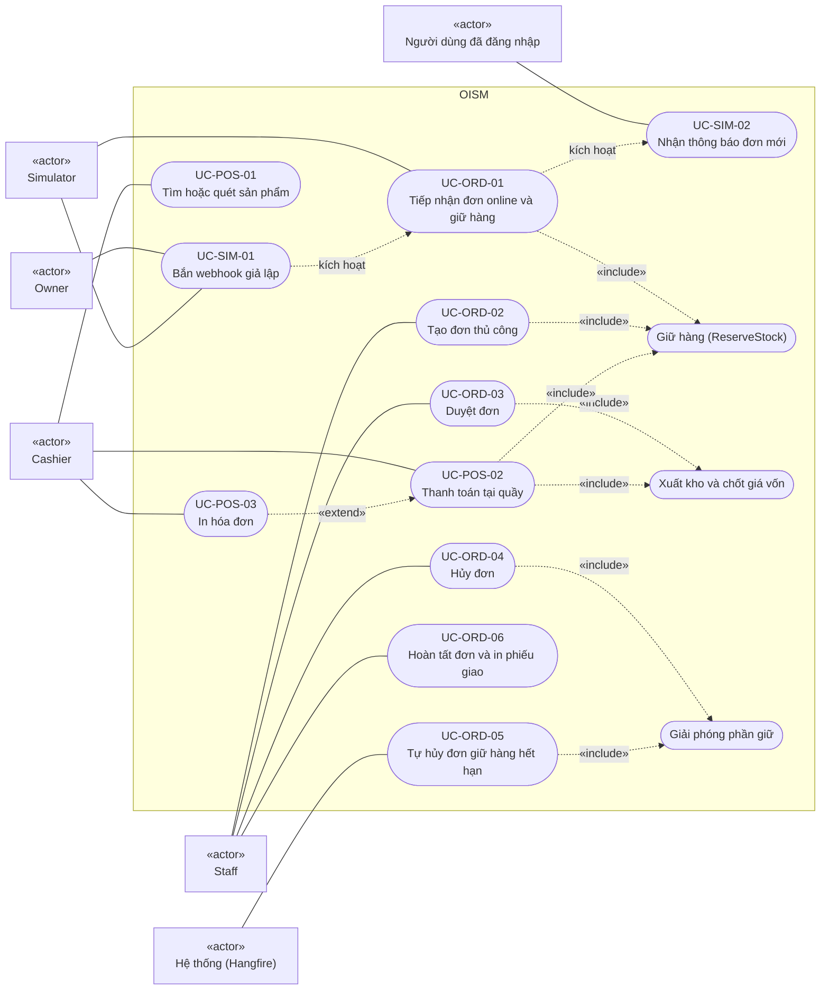

Ghi chú: "Giữ hàng", "Xuất kho và chốt giá vốn", "Giải phóng phần giữ" là ba thao tác dùng chung của `IStockService` (`Reserve`, `Consume`, `Release`), không phải màn hình riêng. POS checkout gọi cả `Reserve` lẫn `Consume` trong một transaction.

#### 3.2.6 Báo cáo, cảnh báo, dự báo

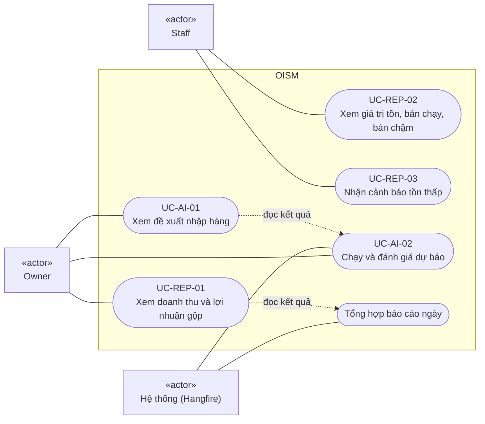

#### 3.2.7 Danh mục use case

| Mã | Use case | Actor chính | Yêu cầu | Ưu tiên |
| --- | --- | --- | --- | --- |
| UC-AUTH-01 | Đăng ký tenant | Người đăng ký | FR-AUTH-01 | P0 |
| UC-AUTH-02 | Đăng nhập, làm mới phiên, đăng xuất | Mọi vai trò | FR-AUTH-02 | P0 (làm mới phiên P1) |
| UC-AUTH-03 | Quản lý người dùng và vai trò | Owner | FR-AUTH-03 | P0 |
| UC-AUTH-04 | Quản lý chi nhánh | Owner | FR-AUTH-04 | P0 |
| UC-PROD-01 | Quản lý danh mục và thương hiệu | Owner, Staff | FR-PROD-01 | P1 |
| UC-PROD-02 | Quản lý sản phẩm và SKU | Owner, Staff | FR-PROD-02 | P0 |
| UC-PROD-03 | Quản lý mã vạch | Owner, Staff | FR-PROD-03 | P1 |
| UC-PROD-04 | Đặt giá lẻ, giá sỉ | Owner | FR-PROD-04 | P0 (giá sỉ P2) |
| UC-INV-01 | Xem tồn và sổ giao dịch | Owner, Staff | FR-INV-01, FR-RSE-01 | P0 |
| UC-INV-02 | Nhập hàng từ nhà cung cấp | Owner, Staff | FR-INV-02, FR-COST-01 | P0 |
| UC-INV-03 | Chuyển kho giữa hai chi nhánh | Owner, Staff | FR-INV-03 | P1 |
| UC-INV-04 | Kiểm kê | Owner, Staff | FR-INV-04 | P1 |
| UC-INV-05 | Đặt ngưỡng tồn tối thiểu | Owner, Staff | FR-REP-03 | P1 |
| UC-ORD-01 | Tiếp nhận đơn online và giữ hàng | Simulator | FR-ORD-01, FR-RSE-02 | P0 |
| UC-ORD-02 | Tạo đơn thủ công | Owner, Staff | FR-ORD-01, FR-RSE-02 | P0 |
| UC-ORD-03 | Duyệt đơn | Owner, Staff | FR-ORD-03, FR-RSE-03, FR-COST-02 | P0 |
| UC-ORD-04 | Hủy đơn | Owner, Staff | FR-ORD-03, FR-RSE-03 | P0 |
| UC-ORD-05 | Tự hủy đơn giữ hàng hết hạn | Hệ thống | FR-SIM-03, FR-RSE-03 | P1 |
| UC-ORD-06 | Hoàn tất đơn và in phiếu giao | Owner, Staff | FR-ORD-02, FR-ORD-03 | P0 (in phiếu giao P2) |
| UC-POS-01 | Tìm hoặc quét sản phẩm | Cashier, Owner | FR-POS-01, FR-POS-02 | P0 |
| UC-POS-02 | Thanh toán tại quầy | Cashier, Owner | FR-POS-03, FR-POS-04, FR-COST-02 | P0 |
| UC-POS-03 | In hóa đơn | Cashier, Owner | FR-POS-03 | P0 |
| UC-REP-01 | Xem doanh thu và lợi nhuận gộp | Owner | FR-REP-01, FR-SIM-03 | P1 |
| UC-REP-02 | Xem giá trị tồn, hàng bán chạy, bán chậm | Owner, Staff | FR-REP-02 | P2 |
| UC-REP-03 | Nhận cảnh báo tồn thấp | Owner, Staff | FR-REP-03 | P1 |
| UC-AI-01 | Xem đề xuất nhập hàng | Owner | FR-AI-01, FR-AI-02 | P2 |
| UC-AI-02 | Chạy và đánh giá dự báo | Owner, Hệ thống | FR-AI-01, FR-AI-03 | P2 |
| UC-SIM-01 | Bắn webhook giả lập | Owner, Simulator | FR-SIM-01 | P0 |
| UC-SIM-02 | Nhận thông báo đơn mới theo thời gian thực | Mọi vai trò | FR-SIM-02 | P1 |

### 3.3 Mô hình dữ liệu khái niệm (ERD)

#### 3.3.1 Tổng thể liên service

Mỗi thực thể thuộc đúng một schema, tức một service sở hữu (bảng dưới sơ đồ). Quan hệ nét liền là khóa ngoại thật trong cùng schema. Quan hệ nét đứt là tham chiếu logic giữa hai service: chỉ lưu ID, không có khóa ngoại, dữ liệu đi bằng event và được lưu thành bản sao (`branch_refs`, `sku_refs`, `sku_names`).

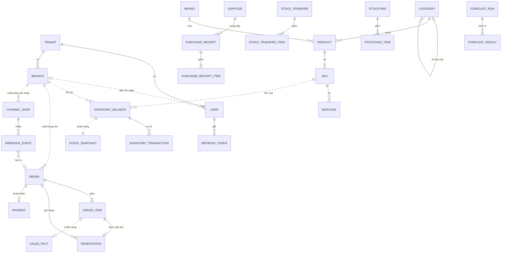

| Schema | Thực thể |
| --- | --- |
| `identity` | TENANT, USER, REFRESH_TOKEN, BRANCH |
| `catalog` | CATEGORY, BRAND, PRODUCT, SKU, BARCODE |
| `core` | INVENTORY_BALANCE, INVENTORY_TRANSACTION, SUPPLIER, PURCHASE_RECEIPT(_ITEM), STOCK_TRANSFER(_ITEM), STOCKTAKE(_ITEM), ORDER, ORDER_ITEM, RESERVATION, PAYMENT; bản sao `branch_refs`, `sku_refs` |
| `channel` | CHANNEL_SHOP, WEBHOOK_EVENT |
| `insights` | SALES_FACT, STOCK_SNAPSHOT, DAILY_AGGREGATE, FORECAST_RUN, FORECAST_RESULT; bản sao `sku_names` |

Dòng sổ kho trỏ tới chứng từ nguồn bằng cặp `reference_type`, `reference_id` (phiếu nhập, đơn, phiếu chuyển kho hoặc phiên kiểm kê), không phải khóa ngoại, nên sơ đồ không vẽ quan hệ này.

#### 3.3.2 Định danh, danh mục, kênh sàn

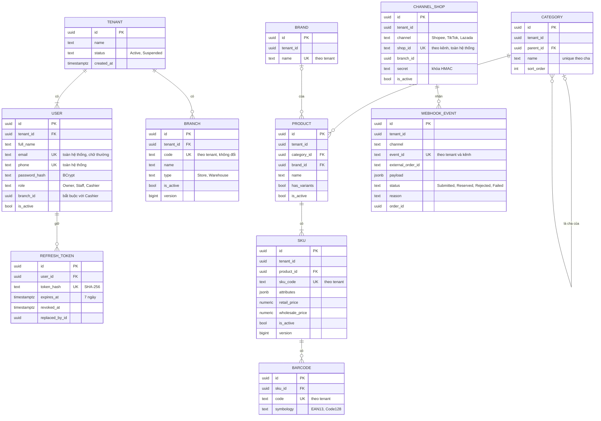

#### 3.3.3 Kho và đơn hàng (schema `core`)

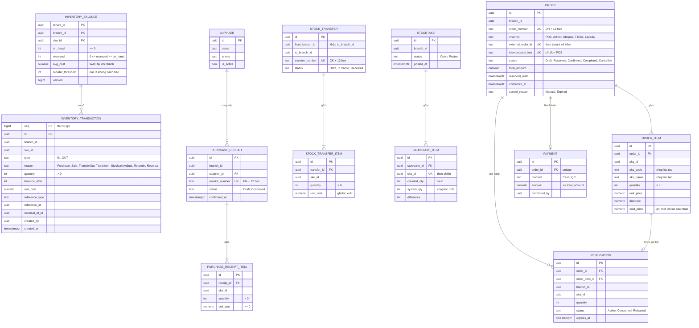

Mọi thực thể ở sơ đồ này có thêm `tenant_id`; sơ đồ bỏ cột đó cho gọn, trừ ở INVENTORY_BALANCE nơi nó là một phần khóa chính. Danh sách cột đầy đủ, kiểu và chỉ mục ở [design/data-model/core.md](../design/data-model/core.md).

#### 3.3.4 Bảng đọc của báo cáo (schema `insights`)

`insights` chỉ giữ bảng dựng từ event; xóa sạch rồi phát lại event phải dựng lại được.

| Bảng | Một dòng là | Dựng từ |
| --- | --- | --- |
| `sales_facts` | Một dòng đơn đã xác nhận: số lượng, doanh thu, giá vốn, `confirmed_at`; khóa chính `order_item_id` | `OrderConfirmed` |
| `stock_snapshots` | Tồn mới nhất của một SKU tại một chi nhánh, kèm ngưỡng | `StockChanged` |
| `daily_aggregates` | Tổng theo ngày (giờ Việt Nam), chi nhánh, kênh, SKU | Job đêm từ `sales_facts` |
| `sku_names` | Mã và tên SKU để hiển thị | `SkuUpserted` |
| `forecast_runs`, `forecast_results` | Một lần chạy dự báo và kết quả theo chi nhánh, SKU | Job dự báo |

### 3.4 Máy trạng thái

#### 3.4.1 Đơn hàng

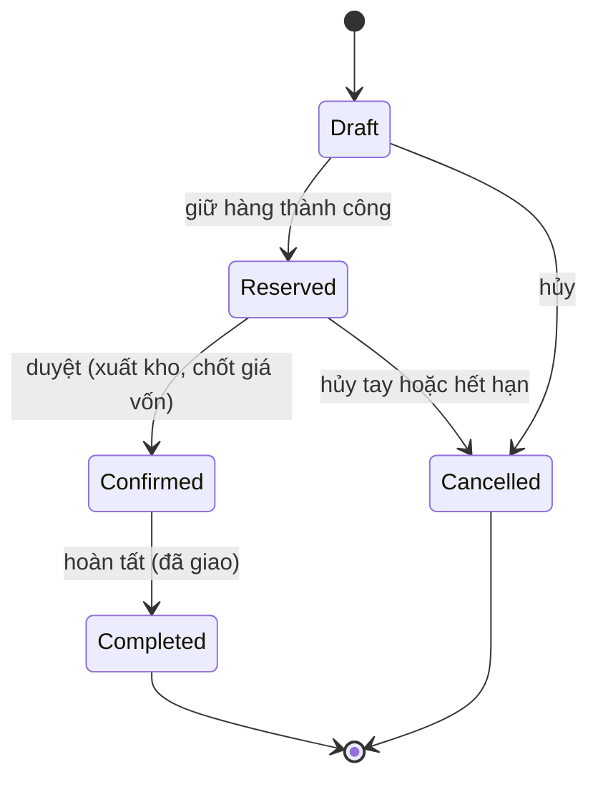

| Từ | Sang | Kích hoạt | Tác động tồn trong cùng transaction |
| --- | --- | --- | --- |
| Draft | Reserved | Tiếp nhận đơn online, tạo đơn thủ công, POS checkout | `reserved` tăng; tạo phần giữ Active |
| Reserved | Confirmed | Nhân viên duyệt; POS checkout | `on_hand` và `reserved` giảm; chốt `cost_price`; ghi sổ OUT lý do `Sale`; phần giữ sang Consumed |
| Confirmed | Completed | Nhân viên hoàn tất; POS checkout | Không |
| Draft | Cancelled | Hủy | Không |
| Reserved | Cancelled | Nhân viên hủy; job hết hạn | `reserved` giảm; phần giữ sang Released |

Mọi bước chuyển khác bị từ chối bằng 409 `invalid_state_transition`. Draft chỉ tồn tại bên trong transaction tạo đơn; đơn bị từ chối không được lưu. Đơn POS đi Draft → Reserved → Confirmed → Completed trong một transaction, bên ngoài chỉ thấy Completed.

#### 3.4.2 Chứng từ khác

| Đối tượng | Trạng thái | Ghi chú |
| --- | --- | --- |
| Phần giữ hàng | Active → Consumed hoặc Released | Tổng phần giữ Active của một SKU tại một chi nhánh luôn bằng `reserved` |
| Phiếu nhập | Draft → Confirmed | Draft sửa được; Confirmed không sửa, không xóa |
| Phiếu chuyển kho | Draft → InTransit → Received | Chỉ xóa được khi Draft; không hủy khi đã InTransit |
| Phiên kiểm kê | Open → Posted | Chốt bị chặn nếu có SKU đếm thấp hơn `reserved` |
| Bản ghi webhook | Submitted → Reserved hoặc Rejected; hoặc Failed | Received chỉ tồn tại trong transaction nhận webhook |

### 3.5 Quy tắc nghiệp vụ dùng chung

Các quy tắc dưới đây được nhiều use case dùng; mục 4 trích theo mã BR.

| Mã | Quy tắc | Nguồn |
| --- | --- | --- |
| BR-01 | `available = on_hand − reserved`. Sau mọi transaction: `on_hand ≥ 0`, `reserved ≥ 0`, `reserved ≤ on_hand`. Database có CHECK làm hàng rào cuối | FR-RSE-01, ADR-0003 |
| BR-02 | `on_hand` chỉ đổi cùng việc ghi đúng một dòng sổ, qua một cửa duy nhất `PostLedger`. `on_hand` luôn bằng tổng IN trừ tổng OUT của sổ cho cùng tenant, chi nhánh, SKU | FR-INV-01, ADR-0003 |
| BR-03 | Sổ kho chỉ thêm mới; `UPDATE`, `DELETE` bị trigger từ chối. Sửa sai bằng dòng `Reversal` trỏ tới dòng gốc | NFR-SEC-03 |
| BR-04 | `reserved` chỉ đổi qua `IStockService` (`Reserve`, `Consume`, `Release`), luôn kèm đổi trạng thái phần giữ | ADR-0003 |
| BR-05 | Giá vốn bình quân tính theo (chi nhánh, SKU): `avg_cost mới = (on_hand × avg_cost + SL nhập × đơn giá nhập) / (on_hand + SL nhập)`. "Tồn cũ" là `on_hand` gồm cả phần đang giữ. `on_hand = 0` thì giá vốn mới bằng đơn giá nhập. Đơn giá nhập chưa gồm thuế, chiết khấu, phí vận chuyển | FR-COST-01, ADR-0004 |
| BR-06 | Chuyển kho: nơi gửi xuất theo `avg_cost` của mình; nơi nhận coi đó là đơn giá nhập và tính lại bình quân theo BR-05. Kiểm kê chỉ đổi số lượng, giữ nguyên `avg_cost` | ADR-0004 |
| BR-07 | `cost_price` của dòng đơn ghi một lần lúc đơn sang Confirmed (hoặc lúc POS checkout) bằng `avg_cost` đọc dưới khóa; sau đó không đổi | FR-COST-02 |
| BR-08 | Confirmed là thời điểm xuất kho. Completed là đã giao, không tác động tồn. Chỉ hủy được từ Draft hoặc Reserved | ADR-0005 |
| BR-09 | Phần giữ hàng hết hạn sau 30 phút (cấu hình `Reservation:HoldMinutes`); job quét mỗi phút | ADR-0005 |
| BR-10 | Đơn nhiều SKU giữ được toàn bộ hoặc bị từ chối toàn bộ. Một SKU ở nhiều dòng thì cộng số lượng trước khi kiểm. SKU chưa có dòng số dư tại chi nhánh coi như `available = 0` | ADR-0005 |
| BR-11 | Đơn giá dòng đơn bỏ trống thì lấy giá lẻ hiện tại của SKU. `discount ≥ 0` và không vượt `quantity × unit_price`. `total_amount = Σ(quantity × unit_price − discount)` | API core |
| BR-12 | Mỗi transaction lấy khóa theo cùng thứ tự: dòng chứng từ trước, rồi các dòng số dư theo `branch_id`, `sku_id` tăng dần. Một use case là một transaction; lỗi thì rollback toàn bộ | ADR-0003, ADR-0005 |
| BR-13 | Ba hàng rào chống trùng: unique `(tenant_id, channel, event_id)` ở webhook; unique `(tenant_id, channel, external_order_id)` ở đơn; unique `(tenant_id, idempotency_key)` cho POS. Consumer ghi inbox trước khi xử lý | ADR-0006 |
| BR-14 | Thanh toán POS: `Cash` hoặc `QR`, thu ngân xác nhận tay; `amount` là tiền khách đưa và không nhỏ hơn `total_amount`; không có trạng thái chờ thanh toán | ADR-0007 |
| BR-15 | Doanh thu thuần = Σ(`quantity × unit_price − discount`) của dòng đơn đã Confirmed hoặc Completed; COGS = Σ(`quantity × cost_price`); lợi nhuận gộp = doanh thu thuần − COGS. Mốc ghi nhận `ConfirmedAt`; ngày cắt theo giờ Việt Nam; không tính thuế, phí | ADR-0008 |
| BR-16 | Giá trị tồn = Σ(`on_hand × avg_cost`) theo chi nhánh và SKU. Bán chạy: giảm dần theo số lượng bán 30 ngày. Bán chậm: SKU còn tồn, tăng dần theo số lượng bán 30 ngày | ADR-0008 |
| BR-17 | Cảnh báo tồn thấp khi `available ≤ reorder_threshold` của SKU tại chi nhánh; ngưỡng null thì không cảnh báo | FR-REP-03, ADR-0008 |
| BR-18 | Kiểm kê bị từ chối cả phiên nếu một SKU có số đếm nhỏ hơn `reserved`, kèm danh sách đơn đang giữ | ADR-0009 |
| BR-19 | Chi nhánh đã tắt không nhận đơn, phiếu nhập, phiếu chuyển kho, phiên kiểm kê mới; dữ liệu cũ giữ nguyên. SKU ngừng bán (SKU hoặc sản phẩm tắt) không hiện ở POS và đơn chứa nó bị từ chối | UC-AUTH-04, UC-PROD-02 |
| BR-20 | Mã duy nhất: mã SKU, mã vạch, mã chi nhánh, tên thương hiệu theo tenant; tên danh mục theo cha trong tenant; email và số điện thoại trên toàn hệ thống; mã shop theo kênh trên toàn hệ thống | Data model |
| BR-21 | Mã chứng từ do `core` đặt: đơn `DH`, phiếu nhập `PN`, phiếu chuyển kho `CK`, kèm 12 ký tự hex đầu của `id` viết hoa; không theo số thứ tự | Data model core |
| BR-22 | Không xóa dữ liệu nghiệp vụ; dùng cờ `is_active`. Chỉ chứng từ còn Draft xóa được (phiếu chuyển kho, dòng phiếu nhập) | Quy ước thiết kế |
| BR-23 | Dự báo chỉ là khuyến nghị: không tạo phiếu nhập, không ghi sổ, không đổi ngưỡng | ADR-0010 |

---

## 4. Yêu cầu chức năng chi tiết

Mỗi nhóm gồm bảng phát biểu yêu cầu, rồi đặc tả từng use case theo khuôn: actor, tiền điều kiện, luồng chính, ngoại lệ, hậu điều kiện, tiêu chí chấp nhận. Tiêu chí chấp nhận ở đây là bản tóm; nguyên văn và nguồn chuẩn ở [usecase-userstory/](../usecase-userstory/README.md). Mã kịch bản `Txx` trỏ tới mục 8.

### 4.1 FR-AUTH: tenant và xác thực

| Mã | Hệ thống phải | Ưu tiên | Service |
| --- | --- | --- | --- |
| FR-AUTH-01 | Cho tạo tenant mới; mỗi tenant có không gian dữ liệu riêng và một `TenantId` duy nhất | P0 | identity |
| FR-AUTH-02 | Cho đăng nhập, đăng xuất bằng email hoặc số điện thoại kèm mật khẩu; trả JWT chứa `TenantId`, `UserId`, `Role` | P0 | identity |
| FR-AUTH-03 | Kiểm soát truy cập API và màn hình theo vai trò: Owner toàn quyền, Staff quản lý kho và đơn, Cashier chỉ dùng POS | P0 | identity, gateway, mọi service |
| FR-AUTH-04 | Cho Owner tạo, sửa, bật hoặc tắt chi nhánh và kho | P0 | identity |

#### UC-AUTH-01 Đăng ký tenant

- **Actor:** người đăng ký, sau đó là Owner. **Yêu cầu:** FR-AUTH-01, NFR-TENANT-01. **API:** `POST /api/identity/tenants` (công khai).
- **Tiền điều kiện:** không.
- **Luồng chính:**
  1. Người đăng ký nhập tên doanh nghiệp, họ tên, email và/hoặc số điện thoại, mật khẩu.
  2. Hệ thống kiểm dữ liệu: có ít nhất một trong email, số điện thoại; mật khẩu tối thiểu 8 ký tự; email cắt khoảng trắng và đổi chữ thường; số điện thoại 8 đến 15 chữ số, có thể bắt đầu bằng `+`.
  3. Hệ thống tạo tenant với `TenantId` mới, đặt tenant context theo tenant đó, rồi tạo người dùng vai trò Owner với mật khẩu băm BCrypt.
  4. Hệ thống trả 201 kèm `tenantId`, `userId`.
- **Ngoại lệ:** dữ liệu sai trả 400 `validation_failed`; email hoặc số điện thoại đã có ở bất kỳ tenant nào trả 409 `duplicate` và không tạo gì.
- **Hậu điều kiện:** có một tenant ở trạng thái Active và đúng một Owner thuộc tenant đó.
- **Tiêu chí chấp nhận:**
  1. Thông tin hợp lệ tạo một tenant mới và một Owner thuộc tenant đó.
  2. Email hoặc số điện thoại đã có trả 409, không tạo gì.
  3. Owner của tenant A đọc bất kỳ danh sách nào cũng không thấy bản ghi của tenant B (T14).
  4. Mật khẩu lưu dạng băm BCrypt; không API nào trả mật khẩu hay giá trị băm.

#### UC-AUTH-02 Đăng nhập, làm mới phiên, đăng xuất

- **Actor:** Owner, Staff, Cashier. **Yêu cầu:** FR-AUTH-02, NFR-SEC-01. **API:** `POST /api/identity/auth/login`, `/auth/refresh`, `/auth/logout`; `GET /api/identity/me`.
- **Tiền điều kiện:** người dùng đã được tạo và đang hoạt động.
- **Luồng chính (đăng nhập):**
  1. Người dùng nhập `identifier` (email hoặc số điện thoại) và mật khẩu.
  2. Hệ thống tìm người dùng trên toàn hệ thống (chỗ được phép bỏ filter tenant), so mật khẩu, lấy `TenantId` từ người dùng tìm được.
  3. Hệ thống trả access token JWT ký RS256, sống 60 phút (`expiresIn = 3600`), mang `sub`, `tenant_id`, `role`, và `branch_id` nếu người dùng gắn chi nhánh; kèm refresh token sống 7 ngày và thông tin `user`.
- **Luồng làm mới:** client gửi refresh token còn hạn; hệ thống thu hồi token cũ, cấp cặp token mới (xoay vòng).
- **Luồng đăng xuất:** client gửi refresh token; hệ thống thu hồi nó và trả 204. Access token còn hạn vẫn dùng được tới khi hết 60 phút.
- **Ngoại lệ:** sai mật khẩu, tài khoản không tồn tại, tài khoản bị vô hiệu hóa, refresh token lạ, hết hạn hoặc đã thu hồi đều trả 401 `unauthenticated` với cùng một nội dung. Dùng lại refresh token đã bị thay thì trả 401 và thu hồi mọi refresh token của người dùng đó. Đăng xuất với token không tồn tại hoặc của người khác vẫn trả 204 và không thu hồi gì. Gateway giới hạn tần suất gọi đăng nhập.
- **Hậu điều kiện:** người dùng có phiên làm việc trong đúng tenant và đúng vai trò.
- **Tiêu chí chấp nhận:**
  1. Đúng thông tin thì nhận access token 60 phút mang `tenant_id`, `sub`, `role` và một refresh token.
  2. Sai mật khẩu hoặc tài khoản không tồn tại trả 401 với cùng một thông báo.
  3. Refresh token còn hạn đổi được lấy cặp mới; token cũ hết dùng được.
  4. Dùng lại refresh token đã bị thay trả 401 và thu hồi mọi refresh token của người đó.
  5. Đăng xuất thu hồi refresh token.
  6. Người dùng bị vô hiệu hóa đăng nhập hay làm mới đều nhận 401.

#### UC-AUTH-03 Quản lý người dùng và vai trò

- **Actor:** Owner. **Yêu cầu:** FR-AUTH-03. **API:** `GET, POST /api/identity/users`, `PUT /api/identity/users/{id}`.
- **Tiền điều kiện:** Owner đã đăng nhập.
- **Luồng chính:**
  1. Owner xem danh sách người dùng của tenant (phân trang, mới nhất trước).
  2. Owner tạo người dùng với họ tên, email và/hoặc số điện thoại, mật khẩu, vai trò `Staff` hoặc `Cashier`, chi nhánh (bắt buộc với Cashier).
  3. Hệ thống kiểm chi nhánh thuộc tenant hiện tại, tạo người dùng thuộc tenant của Owner.
  4. Owner sửa họ tên, vai trò, chi nhánh hoặc bật, tắt người dùng.
- **Ngoại lệ:** Cashier thiếu `branchId` trả 400; `branchId` không có trong tenant trả 404; email hoặc số điện thoại trùng trả 409; sửa tài khoản Owner qua API này trả 400; Staff hoặc Cashier gọi trả 403.
- **Hậu điều kiện:** người dùng mới đăng nhập được với đúng vai trò; người bị tắt không đăng nhập và không làm mới phiên được.
- **Quy tắc:** Owner chỉ sinh ra khi đăng ký tenant. Ma trận quyền ở mục 6.4 (nguồn chuẩn: [security.md](../architecture/security.md)) áp cho mọi endpoint. Endpoint chưa khai báo quyền mặc định bị từ chối.
- **Tiêu chí chấp nhận:**
  1. Owner tạo Staff hoặc Cashier thì người mới thuộc tenant của Owner; Cashier bắt buộc gắn một chi nhánh.
  2. Staff hoặc Cashier gọi API quản lý người dùng nhận 403.
  3. Cashier gọi bất kỳ API nào ngoài nhóm POS và thông báo nhận 403.
  4. Staff gọi API báo cáo lợi nhuận hoặc API đặt giá nhận 403.
  5. Endpoint chưa khai báo quyền từ chối mọi người gọi.

#### UC-AUTH-04 Quản lý chi nhánh

- **Actor:** Owner (Staff chỉ xem danh sách). **Yêu cầu:** FR-AUTH-04. **API:** `GET, POST /api/identity/branches`, `GET, PUT /api/identity/branches/{id}`, `PATCH /api/identity/branches/{id}/active`. **Event:** `BranchUpserted`.
- **Tiền điều kiện:** Owner đã đăng nhập.
- **Luồng chính:**
  1. Owner tạo chi nhánh với mã, tên, loại `Store` hoặc `Warehouse`, địa chỉ tùy chọn. Mã và tên cắt khoảng trắng, không rỗng; mã tối đa 50 ký tự, tên 200, địa chỉ 500.
  2. Hệ thống tạo chi nhánh ở trạng thái đang hoạt động, `version = 1`, ghi `BranchUpserted` vào outbox cùng transaction.
  3. Owner sửa tên, loại, địa chỉ, tài khoản nhận chuyển khoản (mã BIN ngân hàng và số tài khoản, dùng cho mã VietQR ở POS), hoặc bật, tắt chi nhánh; mỗi lần đổi `version` tăng 1 và phát `BranchUpserted`.
  4. `core` nhận event, ghi đè bản sao `branch_refs` theo `version`.
  5. POS đọc chi nhánh đang bán theo id để lấy tài khoản nhận; Cashier chỉ đọc được chi nhánh của mình.
- **Ngoại lệ:** mã đã dùng trong cùng tenant trả 409 `duplicate`; `id` không có trong tenant trả 404; tài khoản nhận thiếu một trong hai trường hoặc sai định dạng trả 400; Cashier đọc chi nhánh khác trả 403.
- **Hậu điều kiện:** chi nhánh tắt thì không tạo được chứng từ mới ở đó (BR-19); dữ liệu cũ giữ nguyên. Mã chi nhánh không đổi sau khi tạo.
- **Tiêu chí chấp nhận:**
  1. Mã chưa dùng trong tenant thì tạo được chi nhánh Store hoặc Warehouse ở trạng thái hoạt động.
  2. Mã đã dùng trong cùng tenant trả 409; cùng mã ở tenant khác vẫn tạo được.
  3. Chi nhánh bị tắt không nhận đơn, phiếu nhập, phiếu chuyển kho mới; dữ liệu cũ giữ nguyên.
  4. Mọi thay đổi phát `BranchUpserted`; `core` có bản sao sau một nhịp event.
  5. Owner khai hoặc xóa được tài khoản nhận của chi nhánh; thiếu một trong hai trường hoặc sai định dạng trả 400.
  6. Cashier đọc được chi nhánh của mình kèm tài khoản nhận; chi nhánh khác trả 403.

### 4.2 FR-PROD: sản phẩm và biến thể

| Mã | Hệ thống phải | Ưu tiên | Service |
| --- | --- | --- | --- |
| FR-PROD-01 | Quản lý danh mục phân cấp và danh sách thương hiệu | P1 | catalog |
| FR-PROD-02 | Hỗ trợ sản phẩm đơn và sản phẩm có biến thể (màu, cỡ); mỗi biến thể có mã SKU duy nhất trong tenant | P0 | catalog |
| FR-PROD-03 | Tự sinh hoặc nhập tay mã vạch EAN-13 hoặc Code128 cho từng SKU | P1 | catalog |
| FR-PROD-04 | Đặt giá lẻ và giá sỉ cho từng SKU, tách khỏi giá vốn | P0 (giá sỉ P2) | catalog |

#### UC-PROD-01 Quản lý danh mục và thương hiệu

- **Actor:** Owner, Staff. **Yêu cầu:** FR-PROD-01. **API:** `GET, POST /api/catalog/categories`, `PUT, DELETE /api/catalog/categories/{id}`, `GET, POST /api/catalog/brands`, `PUT /api/catalog/brands/{id}`.
- **Luồng chính:**
  1. Người dùng xem cây danh mục (nút cùng cha xếp theo `sortOrder` rồi `name`).
  2. Người dùng tạo danh mục gốc hoặc danh mục con; không giới hạn số cấp.
  3. Người dùng sửa tên hoặc đổi cha; xóa danh mục không còn sản phẩm và không còn danh mục con.
  4. Người dùng tạo, sửa thương hiệu.
- **Ngoại lệ:** tên rỗng hoặc dài quá 200 ký tự trả 400; đặt cha là chính nó hoặc con cháu của nó trả 400; trùng tên với danh mục cùng cha (kể cả cùng là gốc) hoặc trùng tên thương hiệu trong tenant trả 409 `duplicate`; xóa danh mục còn sản phẩm hoặc còn con trả 409 `category_in_use`; `parentId` không có trong tenant trả 404.
- **Tiêu chí chấp nhận:**
  1. Tạo danh mục con thêm một cấp vào cây, không giới hạn số cấp.
  2. Đặt cha là chính nó hoặc con cháu của nó trả 400.
  3. Xóa danh mục đang có sản phẩm hoặc danh mục con trả 409.
  4. Tạo thương hiệu trùng tên trong tenant trả 409.

#### UC-PROD-02 Quản lý sản phẩm và SKU

- **Actor:** Owner, Staff. **Yêu cầu:** FR-PROD-02. **API:** `GET, POST /api/catalog/products`, `GET, PUT /api/catalog/products/{id}`, `POST /api/catalog/products/{id}/skus`, `PUT /api/catalog/skus/{id}`. **Event:** `SkuUpserted`.
- **Luồng chính:**
  1. Người dùng tạo sản phẩm với tên, danh mục, thương hiệu tùy chọn, mô tả, cờ `hasVariants` và danh sách SKU (mã SKU, thuộc tính, giá tùy chọn).
  2. Sản phẩm đơn nhận đúng một SKU với thuộc tính `{}`; sản phẩm có biến thể nhận ít nhất một SKU, mỗi tổ hợp thuộc tính một SKU.
  3. Hệ thống dựng tên hiển thị của SKU là tên sản phẩm kèm giá trị thuộc tính xếp theo tên thuộc tính, ví dụ "Áo thun A, Đen, M".
  4. Mỗi lần tạo hoặc sửa SKU, hoặc đổi tên, `isActive` của sản phẩm, hệ thống tăng `version` của SKU liên quan và phát `SkuUpserted` mang trạng thái đầy đủ.
  5. Người dùng ngừng bán SKU riêng lẻ hoặc cả sản phẩm bằng `isActive = false`.
- **Ngoại lệ:** mã SKU trùng trong tenant trả 409 `duplicate`; thêm SKU thứ hai cho sản phẩm đơn trả 400; tên quá 200, mô tả quá 2000, mã SKU quá 64, thuộc tính rỗng hoặc quá 100 ký tự, giá âm trả 400; danh mục, thương hiệu, sản phẩm, SKU không có trong tenant trả 404. Staff gửi giá khi tạo thì giá bị bỏ qua và đặt bằng 0.
- **Tiêu chí chấp nhận:**
  1. Sản phẩm đơn có đúng một SKU.
  2. Sản phẩm có biến thể có một SKU riêng cho mỗi tổ hợp thuộc tính.
  3. Mã SKU trùng trong tenant trả 409; cùng mã ở tenant khác vẫn tạo được.
  4. Mỗi lần tạo hoặc sửa SKU phát `SkuUpserted` với `version` lớn hơn lần trước.
  5. SKU ngừng bán không hiện ở POS; tồn và lịch sử giữ nguyên.
  6. Tìm ở danh sách sản phẩm theo một phần tên sản phẩm, mã SKU hoặc mã vạch ra các sản phẩm khớp trong tenant.

#### UC-PROD-03 Quản lý mã vạch

- **Actor:** Owner, Staff. **Yêu cầu:** FR-PROD-03. **API:** `POST /api/catalog/skus/{id}/barcodes`, `DELETE /api/catalog/skus/{id}/barcodes/{barcodeId}`.
- **Luồng chính:**
  1. Người dùng chọn loại mã `EAN13` hoặc `Code128` cho một SKU.
  2. EAN-13 để trống mã thì hệ thống tự sinh: tiền tố nội bộ `200`, 9 chữ số tăng dần theo tenant, một số kiểm tra; việc lấy số giữ advisory lock theo tenant để hai request không nhận cùng mã.
  3. Mã nhập tay được kiểm: EAN-13 đúng số kiểm tra; Code128 là chữ và số không dấu, tối đa 48 ký tự.
  4. Hệ thống phát `SkuUpserted` mang danh sách mã vạch mới.
  5. Trang sản phẩm ở admin vẽ hình từng mã vạch (vạch kèm dãy số) ngay trên trình duyệt, tải về được dạng PNG; SKU chưa có mã có nút "Tạo mã vạch" sinh EAN-13 bằng một lần bấm.
  6. Ở danh sách sản phẩm, người dùng chọn ảnh có mã vạch; đọc được mã thì mở thẳng sản phẩm giữ mã đó.
- **Ngoại lệ:** EAN-13 sai số kiểm tra, Code128 sai dạng hoặc thiếu mã trả 400; mã đã có trong tenant trả 409; xóa mã không thuộc SKU đó trả 404.
- **Tiêu chí chấp nhận:**
  1. EAN-13 tự sinh có 13 chữ số, bắt đầu bằng 200, số kiểm tra đúng.
  2. EAN-13 nhập tay sai số kiểm tra trả 400.
  3. Code128 nhập tay nhận chuỗi chữ và số tới 48 ký tự.
  4. Mã vạch đã có trong tenant gán cho SKU khác trả 409.
  5. Quét một mã vạch đã gán ở POS ra đúng một SKU.
  6. Mỗi mã vạch có hình tải về được dạng PNG, và hình tải về quét được ở POS.
  7. SKU chưa có mã bấm "Tạo mã vạch" thì có một EAN-13 tự sinh và hình hiện ngay.
  8. Chọn ảnh có mã vạch đã gán ở danh sách sản phẩm thì mở đúng sản phẩm giữ mã; không đọc được mã hoặc không có sản phẩm giữ mã thì báo.

#### UC-PROD-04 Đặt giá lẻ, giá sỉ

- **Actor:** Owner. **Yêu cầu:** FR-PROD-04. **API:** `PUT /api/catalog/skus/{id}/prices`.
- **Luồng chính:**
  1. Owner nhập giá lẻ và giá sỉ cho SKU.
  2. Hệ thống lưu, tăng `version`, phát `SkuUpserted`; `core` cập nhật `sku_refs` nên POS và đơn tạo sau đó dùng giá mới.
- **Ngoại lệ:** giá âm trả 400; Staff gọi trả 403.
- **Quy tắc:** giá niêm yết nằm ở `catalog`, giá vốn nằm ở `core`; đổi giá không ảnh hưởng giá vốn và không đổi đơn giá của đơn đã tạo (dòng đơn chụp đơn giá lúc tạo).
- **Tiêu chí chấp nhận:**
  1. Giá không âm có hiệu lực cho đơn tạo sau đó.
  2. Giá âm trả 400.
  3. Staff đặt giá nhận 403.
  4. Đơn tạo trước khi đổi giá giữ nguyên đơn giá trên dòng đơn.
  5. Sau khi `core` nhận `SkuUpserted`, POS thấy giá mới; giá vốn không bị ảnh hưởng.

### 4.3 FR-INV và FR-COST: kho và giá vốn

| Mã | Hệ thống phải | Ưu tiên | Service |
| --- | --- | --- | --- |
| FR-INV-01 | Ghi mọi biến động tồn (nhập, xuất, bán, trả, kiểm kê, chuyển kho) vào sổ `inventory_transactions` chỉ thêm mới; mỗi dòng có `TenantId`, `BranchId`, `SkuId`, loại IN/OUT, lý do, số lượng, số dư sau giao dịch, chứng từ, người tạo, thời điểm; không sửa trực tiếp cột tồn | P0 | core |
| FR-INV-02 | Xử lý phiếu nhập từ nhà cung cấp: tăng `on_hand` và cập nhật giá vốn bình quân | P0 | core |
| FR-INV-03 | Chuyển kho hai bước: xuất vào trạng thái đang vận chuyển, rồi xác nhận nhập tại nơi nhận | P1 | core |
| FR-INV-04 | Tạo phiên kiểm kê, ghi số đếm, so với sổ, tạo bút toán điều chỉnh | P1 | core |
| FR-COST-01 | Tính lại giá vốn khi xác nhận phiếu nhập theo BR-05 | P0 | core |
| FR-COST-02 | Lưu cố định giá vốn vào `OrderItem.CostPrice` khi đơn sang Confirmed hoặc khi POS thanh toán xong | P0 | core |

#### UC-INV-01 Xem tồn và sổ giao dịch

- **Actor:** Owner, Staff. **Yêu cầu:** FR-INV-01, FR-RSE-01, NFR-SEC-03. **API:** `GET /api/core/stock`, `GET /api/core/ledger`.
- **Luồng chính:**
  1. Người dùng xem tồn, lọc theo chi nhánh, SKU, từ khóa (mã hoặc tên SKU); mỗi dòng có `onHand`, `reserved`, `available`, `avgCost`, ngưỡng.
  2. Người dùng xem sổ, lọc theo chi nhánh, SKU, khoảng thời gian; dòng sổ hiện theo `seq` giảm dần, dòng ghi sau cùng đứng trên cùng.
- **Quy tắc:** chỉ Owner thấy `avgCost` và `unitCost`. Sổ không có đường sửa hay xóa (BR-03).
- **Tiêu chí chấp nhận:**
  1. Mỗi SKU tại mỗi chi nhánh hiện `on_hand`, `reserved`, `available = on_hand − reserved` và giá vốn bình quân.
  2. Lọc sổ theo chi nhánh, SKU, thời gian; mỗi dòng có loại IN hoặc OUT, lý do, số lượng, số dư sau giao dịch, chứng từ, người tạo, dòng ghi sau cùng đứng trên cùng.
  3. Với mọi SKU, tổng IN trừ tổng OUT của sổ bằng `on_hand`.
  4. Không API hay màn hình nào sửa hoặc xóa dòng sổ; `UPDATE`, `DELETE` trực tiếp bị database từ chối (T16).

#### UC-INV-02 Nhập hàng từ nhà cung cấp

- **Actor:** Owner, Staff. **Yêu cầu:** FR-INV-02, FR-COST-01. **API:** `GET, POST /api/core/suppliers`, `GET, POST /api/core/purchase-receipts`, `PUT /api/core/purchase-receipts/{id}`, `POST /api/core/purchase-receipts/{id}/confirm`. **Luồng thiết kế:** [purchase-receipt.md](../design/flows/purchase-receipt.md).
- **Tiền điều kiện:** chi nhánh đang hoạt động; SKU đã có bản sao ở `core`; nhà cung cấp đã tạo.
- **Luồng chính:**
  1. Người dùng tạo phiếu Draft: chi nhánh, nhà cung cấp, ghi chú, các dòng (SKU, số lượng, đơn giá nhập). Hệ thống đặt `receiptNumber` dạng `PN` + 12 hex.
  2. Người dùng sửa phiếu Draft (thay cả bộ dòng); tồn chưa bị tác động.
  3. Người dùng xác nhận. Trong một transaction, hệ thống khóa phiếu, khóa các dòng số dư theo thứ tự, với mỗi dòng phiếu: tính lại `avg_cost` theo BR-05, tăng `on_hand`, ghi một dòng sổ IN lý do `Purchase` với `created_by` là người xác nhận; phiếu sang Confirmed; ghi `StockChanged` vào outbox.
- **Ngoại lệ:** số lượng không dương, đơn giá âm, danh sách dòng rỗng trả 400; nhà cung cấp hoặc phiếu không có trong tenant trả 404; chi nhánh hoặc SKU chưa có bản sao trả 409 `reference_not_ready`; chi nhánh đã tắt trả 409 `inactive_reference`; sửa phiếu không còn Draft trả 409 `invalid_state_transition`; xác nhận lại phiếu Confirmed trả 200 với phiếu hiện có, không tác động lần hai; lỗi ở bất kỳ dòng nào thì rollback, phiếu vẫn Draft.
- **Quy tắc:** cùng SKU ở hai dòng phiếu được xử lý lần lượt, dòng sau dùng kết quả của dòng trước. Phiếu Confirmed không sửa, không xóa; nhập sai thì điều chỉnh bằng kiểm kê.
- **Tiêu chí chấp nhận:**
  1. Sửa hay xóa dòng của phiếu Draft không tác động tồn.
  2. Xác nhận phiếu hợp lệ tăng `on_hand` đúng số lượng; mỗi dòng phiếu sinh một dòng sổ IN lý do Purchase.
  3. Tồn 10 giá vốn 100.000, nhập 5 giá 130.000 thì giá vốn mới 110.000, tồn 15 (T09).
  4. SKU chưa từng có ở chi nhánh thì giá vốn bằng đúng đơn giá nhập.
  5. Xác nhận lại phiếu Confirmed không đổi tồn và giá vốn lần hai (T11).
  6. Số lượng không dương hoặc đơn giá âm trả 400.
  7. Lỗi ở bất kỳ dòng nào khi xác nhận thì không dòng nào được ghi.

#### UC-INV-03 Chuyển kho giữa hai chi nhánh

- **Actor:** Owner, Staff. **Yêu cầu:** FR-INV-03. **API:** `GET, POST /api/core/transfers`, `POST /api/core/transfers/{id}/ship`, `POST /api/core/transfers/{id}/receive`, `DELETE /api/core/transfers/{id}`. **Luồng thiết kế:** [stock-transfer.md](../design/flows/stock-transfer.md).
- **Tiền điều kiện:** hai chi nhánh khác nhau, đang hoạt động; SKU đã có bản sao ở `core`.
- **Luồng chính:**
  1. Người dùng tạo phiếu Draft: nơi gửi, nơi nhận, các dòng (SKU, số lượng). Hệ thống đặt `transferNumber` dạng `CK` + 12 hex.
  2. Xuất (transaction 1): hệ thống khóa phiếu và số dư nơi gửi, kiểm tồn khả dụng (không phải `on_hand`), giảm `on_hand`, ghi sổ OUT lý do `TransferOut`, ghi `unit_cost` bằng `avg_cost` nơi gửi lên dòng phiếu; phiếu sang InTransit.
  3. Nhận (transaction 2): hệ thống khóa phiếu và số dư nơi nhận, tăng `on_hand`, ghi sổ IN lý do `TransferIn`, tính lại `avg_cost` nơi nhận bằng `unit_cost` mang theo (BR-06); phiếu sang Received.
- **Ngoại lệ:** hai chi nhánh trùng nhau, dòng rỗng, số lượng không dương trả 400; nơi gửi thiếu tồn khả dụng trả 409 `insufficient_stock` nêu dòng đầu tiên bị thiếu, không dòng nào được xuất; xuất phiếu không còn Draft hoặc nhận phiếu còn Draft trả 409 `invalid_state_transition`; nhận lại phiếu Received trả 200, không tác động lần hai; xóa phiếu InTransit hoặc Received trả 409.
- **Quy tắc:** nhận đủ số lượng đã xuất; hàng thiếu hoặc hỏng xử lý bằng kiểm kê ở nơi nhận. Chỉ Owner thấy `unitCost` trên phiếu.
- **Tiêu chí chấp nhận:**
  1. Nơi gửi đủ tồn khả dụng thì xuất làm giảm `on_hand` nơi gửi, ghi sổ OUT TransferOut, phiếu sang InTransit.
  2. Nơi gửi thiếu tồn khả dụng thì trả 409 và không gì thay đổi.
  3. Phiếu đang InTransit thì tồn khả dụng nơi nhận chưa tăng (T12).
  4. Nơi nhận xác nhận thì `on_hand` nơi nhận tăng, sổ có dòng IN TransferIn, giá vốn nơi nhận được tính lại bằng đơn giá mang theo.
  5. Ở mọi thời điểm, tồn nơi gửi + hàng đang vận chuyển + tồn nơi nhận không đổi.
  6. Nhận lại phiếu Received không tác động lần hai.
  7. Nơi gửi trùng nơi nhận thì tạo phiếu trả 400.
  8. Phiếu Draft xóa được, tồn không đổi; phiếu InTransit hoặc Received xóa thì trả 409.

#### UC-INV-04 Kiểm kê

- **Actor:** Owner, Staff. **Yêu cầu:** FR-INV-04. **API:** `GET, POST /api/core/stocktakes`, `PUT /api/core/stocktakes/{id}/counts`, `POST /api/core/stocktakes/{id}/post`. **Luồng thiết kế:** [stocktake.md](../design/flows/stocktake.md).
- **Tiền điều kiện:** chi nhánh đang hoạt động.
- **Luồng chính:**
  1. Người dùng mở phiên kiểm kê ở trạng thái Open cho một chi nhánh.
  2. Người dùng nhập số đếm cho các SKU (thay cả bộ số đếm của phiên); tồn chưa bị tác động.
  3. Người dùng chốt. Trong một transaction, hệ thống khóa phiên và các dòng số dư, chụp `system_qty = on_hand` dưới khóa, kiểm BR-18, rồi với mỗi SKU có chênh lệch ghi một dòng sổ IN hoặc OUT lý do `StocktakeAdjust` bằng đúng chênh lệch; `on_hand` bằng số đếm; `avg_cost` giữ nguyên; phiên sang Posted.
- **Ngoại lệ:** dòng rỗng, số đếm âm, một SKU ở hai dòng trả 400; nhập số đếm vào phiên đã Posted trả 409; có SKU đếm thấp hơn `reserved` trả 409 `stocktake_below_reserved` kèm từng SKU, số đếm, `reserved` và danh sách đơn đang giữ (cũ nhất trước), không SKU nào bị điều chỉnh; chốt lại phiên Posted trả 200, không tác động lần hai.
- **Quy tắc:** SKU không được đếm không bị đụng tới. SKU chưa có dòng số dư mà đếm lớn hơn 0 thì tạo dòng với tồn 0 rồi điều chỉnh tăng; giá vốn bằng 0 tới lần nhập mua đầu tiên.
- **Tiêu chí chấp nhận:**
  1. Nhập số đếm khi phiên Open không tác động tồn.
  2. Số đếm khác sổ thì chốt ghi dòng sổ StocktakeAdjust bằng đúng chênh lệch và `on_hand` bằng số đếm.
  3. Số đếm bằng sổ thì không ghi dòng sổ nào cho SKU đó.
  4. Số đếm nhỏ hơn `reserved` thì trả 409 kèm danh sách đơn đang giữ, không SKU nào bị điều chỉnh (T13).
  5. Chốt lại phiên Posted không tác động lần hai.
  6. Kiểm kê không đổi giá vốn bình quân.

#### UC-INV-05 Đặt ngưỡng tồn tối thiểu

- **Actor:** Owner, Staff. **Yêu cầu:** FR-REP-03. **API:** `PUT /api/core/stock/threshold`.
- **Luồng chính:**
  1. Người dùng nhập ngưỡng cho một SKU tại một chi nhánh, hoặc để trống để bỏ ngưỡng.
  2. Hệ thống lưu lên dòng số dư (tạo dòng với tồn 0 nếu chưa có), tăng `version`, phát `StockChanged` mang ngưỡng mới.
- **Ngoại lệ:** ngưỡng âm trả 400; chi nhánh hoặc SKU chưa có bản sao trả 409 `reference_not_ready`.
- **Tiêu chí chấp nhận:**
  1. Ngưỡng không âm được lưu và `StockChanged` mang ngưỡng mới được phát.
  2. Ngưỡng để trống thì SKU đó không còn sinh cảnh báo.
  3. Ngưỡng âm trả 400.

### 4.4 FR-ORD và FR-RSE: đơn hàng và chống bán vượt

| Mã | Hệ thống phải | Ưu tiên | Service |
| --- | --- | --- | --- |
| FR-ORD-01 | Chuẩn hóa đơn từ POS, đơn thủ công trên admin và webhook giả lập về một Canonical Order Model | P0 | core, channel |
| FR-ORD-02 | Thực thi máy trạng thái Draft → Reserved → Confirmed → Completed, hoặc Cancelled; chặn bước chuyển sai | P0 | core |
| FR-ORD-03 | Cho nhân viên xem đơn chờ xử lý, duyệt, in phiếu giao hàng hoặc hủy | P1 (in phiếu giao P2) | core, admin |
| FR-RSE-01 | Duy trì `available = on_hand − reserved` cho từng SKU tại từng chi nhánh | P0 | core |
| FR-RSE-02 | Đơn online vào Reserved thì tăng `reserved`; từ chối đơn nếu `available` nhỏ hơn số lượng đặt | P0 | core |
| FR-RSE-03 | Sang Confirmed: giảm `on_hand`, giảm `reserved`, ghi sổ. Sang Cancelled: giảm `reserved` | P0 | core |

Canonical Order gồm: kênh, mã đơn ngoài (với đơn sàn), chi nhánh, thời điểm đặt, danh sách dòng (`skuCode` hoặc `skuId`, `quantity`, `unitPrice`, `discount`). Mọi đơn, bất kể nguồn, được lưu cùng một cấu trúc `orders`, `order_items`.

#### UC-ORD-01 Tiếp nhận đơn online và giữ hàng

- **Actor:** Simulator (đóng vai sàn). **Yêu cầu:** FR-ORD-01, FR-RSE-02, NFR-PERF-02. **Vào qua:** command `SubmitOrder` từ `channel`. **Luồng thiết kế:** [reserve-stock.md](../design/flows/reserve-stock.md), [webhook-ingestion.md](../design/flows/webhook-ingestion.md).
- **Tiền điều kiện:** `channel` đã nhận một webhook hợp lệ (UC-SIM-01) và ghi `SubmitOrder` vào outbox.
- **Luồng chính:**
  1. Consumer của `core` ghi `eventId` vào inbox, đặt tenant context theo thông điệp.
  2. Hệ thống tra SKU theo `skuCode` trong `sku_refs` và chi nhánh trong `branch_refs`.
  3. Hệ thống chèn đơn ở Draft kèm các dòng đơn (unique `(tenant_id, channel, external_order_id)` chặn đơn trùng).
  4. Hệ thống tạo dòng số dư còn thiếu, khóa các dòng số dư theo `sku_id`, kiểm `available` của mọi SKU (BR-10).
  5. Đủ hàng: `reserved` tăng, mỗi dòng đơn có một phần giữ Active hết hạn sau 30 phút, đơn sang Reserved với `reserved_until`; ghi `OrderReserved` và `StockChanged` vào outbox; commit.
  6. `channel` nhận `OrderReserved`, đặt bản ghi webhook sang Reserved; `insights` đẩy thông báo `OrderCreated`.
- **Ngoại lệ:**
  - Thiếu hàng ở bất kỳ SKU nào: rollback, không SKU nào bị giữ, không đơn nào được lưu; phát `OrderRejected` lý do `InsufficientStock` kèm từng SKU thiếu, số đặt, tồn khả dụng.
  - SKU không có hoặc ngừng bán: `OrderRejected` lý do `UnknownSku` hoặc `InactiveSku`. Chi nhánh tắt hoặc chưa có bản sao: lý do `InactiveBranch`.
  - Cùng mã đơn của sàn tới lần hai: rollback, không có đơn mới, không giữ thêm, không phát thông điệp.
- **Hậu điều kiện:** `on_hand` không đổi, không có dòng sổ nào; `reserved` tăng đúng tổng số lượng.
- **Tiêu chí chấp nhận:**
  1. Đơn hợp lệ, đủ hàng thì ở Reserved, `reserved` tăng đúng từng SKU, mỗi dòng có một phần giữ Active hết hạn sau 30 phút, `OrderReserved` được phát.
  2. Giữ hàng thành công không đổi `on_hand` và không ghi sổ.
  3. Đơn nhiều SKU thiếu một SKU thì cả đơn bị từ chối, không SKU nào bị giữ, `OrderRejected` kèm SKU thiếu (T04).
  4. Cùng mã đơn của sàn tới lần hai thì không có đơn mới, không giữ thêm (T03).
  5. 50 đơn đồng thời mua 1 đơn vị còn lại thì đúng 1 đơn Reserved, 49 bị từ chối, tồn khả dụng không âm (T01).
  6. SKU chưa có ở `core` hoặc ngừng bán thì đơn bị từ chối với lý do nêu rõ SKU.
  7. Đơn từ Shopee, TikTok, Lazada vào `core` đều cùng một cấu trúc Canonical Order.

#### UC-ORD-02 Tạo đơn thủ công

- **Actor:** Owner, Staff. **Yêu cầu:** FR-ORD-01, FR-RSE-02. **API:** `POST /api/core/orders`.
- **Luồng chính:**
  1. Người dùng chọn chi nhánh, tìm SKU (qua `GET /api/core/pos/skus` để thấy tồn khả dụng), nhập số lượng, đơn giá và giảm giá tùy chọn, ghi chú.
  2. Hệ thống tạo đơn kênh `Admin` và giữ hàng bằng cùng handler với UC-ORD-01 (bước 3 đến 5).
  3. Hệ thống trả 201 với đơn ở Reserved.
- **Ngoại lệ:** dòng rỗng, số lượng không dương, đơn giá hoặc giảm giá âm, giảm giá vượt thành tiền trả 400; thiếu hàng trả 409 `insufficient_stock` kèm SKU và tồn khả dụng hiện tại, không đơn nào được lưu; chi nhánh hoặc SKU chưa có bản sao (kể cả ID của tenant khác) trả 409 `reference_not_ready`; chi nhánh tắt hoặc SKU ngừng bán trả 409 `inactive_reference` với `reason` `InactiveBranch` hoặc `InactiveSku`.
- **Tiêu chí chấp nhận:**
  1. Đơn hợp lệ, đủ hàng thì mang kênh Admin, ở Reserved, hàng được giữ như UC-ORD-01 AC-1.
  2. Một SKU thiếu hàng thì trả 409 kèm SKU và tồn khả dụng; không đơn nào được lưu.
  3. Dòng không nhập đơn giá thì lấy giá lẻ hiện tại; nhân viên nhập được đơn giá khác.
  4. Chi nhánh đã tắt thì trả 409.

#### UC-ORD-03 Duyệt đơn

- **Actor:** Owner, Staff. **Yêu cầu:** FR-ORD-03, FR-RSE-03, FR-COST-02, NFR-SEC-02. **API:** `POST /api/core/orders/{id}/confirm`. **Luồng thiết kế:** [confirm-order.md](../design/flows/confirm-order.md).
- **Tiền điều kiện:** đơn ở Reserved.
- **Luồng chính:**
  1. Người dùng mở chi tiết đơn đang chờ xử lý và bấm duyệt.
  2. Trong một transaction, hệ thống khóa dòng đơn, kiểm trạng thái, khóa các dòng số dư theo thứ tự.
  3. Với mỗi phần giữ: giảm `reserved`, ghi sổ OUT lý do `Sale` (giảm `on_hand`), phần giữ sang Consumed, chốt `cost_price` của dòng đơn bằng `avg_cost` đọc dưới khóa.
  4. Đơn sang Confirmed với `confirmed_at`; ghi `OrderConfirmed` (kèm giá vốn đã chốt) và `StockChanged` vào outbox; commit.
- **Ngoại lệ:** đơn không ở Reserved trả 409 `invalid_state_transition`, không gì thay đổi; `id` không có trong tenant trả 404; lỗi ở bất kỳ bước nào rollback toàn bộ, đơn vẫn Reserved, phần giữ vẫn Active. Duyệt và job hết hạn chạy cùng lúc: bên khóa được dòng đơn trước thắng, bên sau thấy trạng thái đã đổi và dừng.
- **Hậu điều kiện:** `available` không đổi so với trước khi duyệt (hàng đã bị loại khỏi khả dụng từ lúc giữ).
- **Tiêu chí chấp nhận:**
  1. Đơn Reserved được duyệt thì sang Confirmed; `on_hand` và `reserved` cùng giảm đúng số lượng; tồn khả dụng không đổi.
  2. Mỗi dòng đơn có `CostPrice` bằng giá vốn bình quân lúc duyệt; sổ có một dòng OUT Sale cho mỗi dòng đơn.
  3. Đơn không ở Reserved thì trả 409, không gì thay đổi.
  4. Lỗi khi ghi sổ thì đơn, tồn, giá vốn, sổ giữ nguyên (T05).
  5. Duyệt và job hết hạn cùng lúc thì chỉ một bên thắng; không vừa xuất hàng vừa giải phóng (T07).
  6. Nhập lô mới với giá khác sau khi duyệt không đổi `CostPrice` của đơn (T10).

#### UC-ORD-04 Hủy đơn

- **Actor:** Owner, Staff. **Yêu cầu:** FR-ORD-03, FR-RSE-03. **API:** `POST /api/core/orders/{id}/cancel`. **Luồng thiết kế:** [cancel-expire.md](../design/flows/cancel-expire.md).
- **Tiền điều kiện:** đơn ở Draft hoặc Reserved.
- **Luồng chính:**
  1. Người dùng bấm hủy trên chi tiết đơn.
  2. Trong một transaction, hệ thống khóa đơn, khóa các dòng số dư, giảm `reserved` đúng bằng các phần giữ còn Active, các phần giữ sang Released, đơn sang Cancelled với `cancel_reason = Manual`, ghi `OrderCancelled` và `StockChanged` vào outbox.
- **Ngoại lệ:** đơn Confirmed hoặc Completed trả 409 `invalid_state_transition`, `reserved` không đổi; hủy lại đơn đã Cancelled trả 200 với cùng đơn, không tác động lần hai.
- **Tiêu chí chấp nhận:**
  1. Đơn Reserved bị hủy thì sang Cancelled, `reserved` giảm đúng bằng phần giữ Active, phần giữ sang Released, `OrderCancelled` được phát.
  2. Hủy lại đơn Cancelled không tác động lần hai (T06).
  3. Hủy đơn Confirmed hoặc Completed trả 409, `reserved` không đổi (T08).
  4. Hủy không đổi `on_hand` và không ghi sổ.

#### UC-ORD-05 Tự hủy đơn giữ hàng hết hạn

- **Actor:** Hệ thống (job Hangfire mỗi phút). **Yêu cầu:** FR-SIM-03, FR-RSE-03.
- **Luồng chính:**
  1. Job tìm các phần giữ Active đã quá `expires_at` của mọi tenant (chỗ được phép bỏ filter tenant).
  2. Với từng đơn, trong tenant context của đơn đó và trong một transaction riêng, job khóa đơn, kiểm còn Reserved, giải phóng như UC-ORD-04 với `cancel_reason = Expired`.
- **Ngoại lệ:** đơn đã được duyệt hoặc hủy trước khi job tới thì bỏ qua; một đơn lỗi không chặn các đơn khác.
- **Tiêu chí chấp nhận:**
  1. Đơn Reserved có phần giữ quá hạn thì sang Cancelled lý do Expired, hàng được giải phóng như UC-ORD-04 AC-1.
  2. Job chạy lại trên cùng đơn không tác động lần hai (T06).
  3. Đơn đã được duyệt trước khi job tới thì bị bỏ qua.
  4. Một đơn lỗi thì các đơn hết hạn khác vẫn được xử lý; mỗi đơn một transaction.
  5. Mỗi đơn được xử lý trong tenant context của chính nó.

#### UC-ORD-06 Hoàn tất đơn và in phiếu giao

- **Actor:** Owner, Staff. **Yêu cầu:** FR-ORD-02, FR-ORD-03. **API:** `GET /api/core/orders`, `GET /api/core/orders/{id}`, `POST /api/core/orders/{id}/complete`.
- **Luồng chính:**
  1. Người dùng xem danh sách đơn đa kênh, lọc theo trạng thái, kênh, chi nhánh, khoảng thời gian (mới nhất trước, phân trang).
  2. Người dùng mở chi tiết đơn: dòng đơn, phần giữ hàng, thanh toán (đơn POS); `costPrice` chỉ hiện cho Owner.
  3. Với đơn Confirmed hoặc Completed, người dùng bấm in phiếu giao; trình duyệt mở hộp thoại in với mã đơn, kênh, chi nhánh, danh sách hàng, số lượng.
  4. Khi đã giao, người dùng bấm hoàn tất; đơn sang Completed, tồn và sổ không đổi.
- **Ngoại lệ:** hoàn tất đơn không ở Confirmed trả 409; bộ lọc sai giá trị trả 400.
- **Tiêu chí chấp nhận:**
  1. Đơn Confirmed hoàn tất thì sang Completed; tồn và sổ không đổi.
  2. Đơn không ở Confirmed hoàn tất thì trả 409.
  3. Đơn Confirmed hoặc Completed bấm in phiếu giao thì hộp thoại in mở với mã đơn, kênh, danh sách hàng, số lượng.
  4. Lọc theo trạng thái, kênh, chi nhánh, thời gian chỉ hiện đơn khớp bộ lọc.

### 4.5 FR-POS: bán tại quầy

| Mã | Hệ thống phải | Ưu tiên | Service |
| --- | --- | --- | --- |
| FR-POS-01 | Cung cấp giao diện bán nhanh cho cảm ứng và phím tắt; tìm theo tên, SKU, mã vạch | P0 | pos |
| FR-POS-02 | Kiểm `available` ngay khi chọn sản phẩm; chặn bán vượt để bảo vệ hàng đã giữ cho đơn online | P0 | core, pos |
| FR-POS-03 | Hỗ trợ tiền mặt và chuyển khoản QR; tự mở hộp thoại in của trình duyệt | P0 | pos |
| FR-POS-04 | Chạy giữ hàng → xác nhận → trừ hàng của checkout POS trong một transaction nguyên tử | P0 | core |

#### UC-POS-01 Tìm hoặc quét sản phẩm

- **Actor:** Cashier, Owner. **Yêu cầu:** FR-POS-01, FR-POS-02, NFR-PERF-01. **API:** `GET /api/core/pos/skus?query=&branchId=`.
- **Tiền điều kiện:** đã đăng nhập; Cashier dùng chi nhánh trong token, Owner chọn chi nhánh trước khi bán.
- **Luồng chính:**
  1. Thu ngân gõ hoặc quét vào ô tìm kiếm (luôn giữ focus trên desktop và tablet); không có máy quét thì quét bằng camera hoặc bằng ảnh qua nút quét cạnh ô tìm.
  2. Hệ thống trả tối đa 20 SKU đang bán khớp một phần tên, mã SKU hoặc mã vạch; SKU khớp đúng mã đứng đầu; mỗi dòng có giá lẻ và `available` tại chi nhánh.
  3. Enter khi khớp đúng một mã vạch hoặc mã SKU thì thêm thẳng vào giỏ với số lượng 1.
  4. Giao diện chặn thêm SKU hết hàng và chặn tăng số lượng vượt `available`.
  5. Điện thoại đăng nhập cùng tài khoản có thể làm máy quét cho máy tính: bật "Gửi sang máy tính" trong hộp quét, mã quét được gửi qua hub SignalR tới màn hình bán hàng của tài khoản đó trên máy tính.
- **Ngoại lệ:** thiếu `branchId` trả 400; Cashier gửi chi nhánh khác token trả 403.
- **Tiêu chí chấp nhận:**
  1. Tìm theo một phần tên, mã SKU hoặc mã vạch trả kết quả kèm giá lẻ và tồn khả dụng tại chi nhánh của thu ngân.
  2. Quét mã vạch khớp đúng một SKU thì SKU vào giỏ với số lượng 1.
  3. SKU có tồn khả dụng 0 hiện là hết hàng, không thêm được vào giỏ.
  4. Số lượng trong giỏ đã bằng tồn khả dụng thì giao diện chặn tăng thêm và báo số còn lại.
  5. SKU ngừng bán không hiện.
  6. p95 của lời gọi tìm dưới 200 ms ở tải đã thống nhất (T17).
  7. Ô tìm luôn giữ focus để quét liên tiếp mà không chạm màn hình.
  8. Mã vạch trong khung camera hoặc trong ảnh tải lên được xử lý như quét bằng máy quét; không đọc được mã hoặc mã không khớp SKU nào thì báo cho thu ngân.
  9. Điện thoại cùng tài khoản bật "Gửi sang máy tính" rồi quét thì màn hình bán hàng trên máy tính xử lý mã như máy quét, điện thoại chỉ báo đã gửi; người dùng khác và tenant khác không nhận mã.

#### UC-POS-02 Thanh toán tại quầy

- **Actor:** Cashier, Owner. **Yêu cầu:** FR-POS-03, FR-POS-04, FR-COST-02, NFR-SEC-02, NFR-USA-02. **API:** `POST /api/core/pos/checkout` với header `Idempotency-Key`. **Luồng thiết kế:** [pos-checkout.md](../design/flows/pos-checkout.md).
- **Tiền điều kiện:** giỏ có hàng; thu ngân đã nhận tiền mặt hoặc đã kiểm tiền chuyển khoản QR.
- **Luồng chính:**
  1. Thu ngân chọn phương thức (F4 đổi giữa tiền mặt và QR; với QR, màn hình hiện mã VietQR của chi nhánh kèm số tiền, có thể in phiếu thanh toán kèm mã cho khách quét) rồi bấm thanh toán (với QR là "Xác nhận đã nhận tiền") hoặc nhấn Enter khi ô tìm trống.
  2. POS sinh một `Idempotency-Key` (uuid) cho lần bấm, khóa nút trong lúc chờ.
  3. Hệ thống tra đơn theo khóa; chưa có thì mở transaction, chèn đơn kênh `POS` ở Draft, giữ hàng (khóa số dư, kiểm `available`), tiêu thụ ngay phần giữ (giảm `reserved`, ghi sổ OUT `Sale`, giảm `on_hand`), chốt `cost_price`, ghi `Payment`, đơn qua Confirmed rồi Completed; ghi `OrderConfirmed`, `StockChanged` vào outbox; commit.
  4. Hệ thống trả 201 với đơn Completed (`confirmedAt` bằng `completedAt`) kèm thanh toán.
  5. POS mở trang hóa đơn và hộp thoại in (UC-POS-03).
- **Ngoại lệ:**
  - Một SKU hết tồn khả dụng lúc thanh toán: 409 `insufficient_stock` kèm SKU và tồn khả dụng hiện tại; không gì được lưu; giỏ cập nhật số còn lại.
  - Cùng khóa gửi lại (bấm hai lần, mạng gửi lại): trả 200 với đúng đơn đã tạo. Hai request cùng khóa đồng thời: request thua bị chặn ở unique, rollback rồi đọc lại đơn.
  - Thiếu hoặc sai header, giỏ rỗng, số lượng không dương, đơn giá hoặc giảm giá âm, giảm giá vượt thành tiền, thiếu `payment`, phương thức lạ, `payment.amount` nhỏ hơn tổng đơn: 400, không gì được lưu.
  - Cashier thanh toán cho chi nhánh khác token: 403. Staff gọi: 403.
  - Chi nhánh hoặc SKU chưa có bản sao: 409 `reference_not_ready`; chi nhánh tắt hoặc SKU ngừng bán: 409 `inactive_reference`.
  - Mất mạng: POS hiện băng thông báo, khóa nút thanh toán và phím Enter, giữ nguyên giỏ.
- **Quy tắc:** lần gửi bị từ chối hoặc lỗi không để lại gì nên khóa đó dùng lại được. Đơn POS không phát `OrderReserved`.
- **Tiêu chí chấp nhận:**
  1. Giỏ hợp lệ và thu ngân đã xác nhận nhận tiền thì trong một transaction: đơn ở Completed, `on_hand` giảm, giá vốn chốt trên từng dòng, sổ có dòng OUT Sale, thanh toán được ghi.
  2. SKU hết tồn khả dụng lúc thanh toán thì trả 409 kèm SKU và tồn khả dụng; không gì được lưu.
  3. Cùng `Idempotency-Key` gửi hai lần thì chỉ có một đơn, lần sau nhận lại đúng đơn đó (T03).
  4. POS và đơn online cùng mua đơn vị cuối thì tổng được chấp nhận không vượt tồn khả dụng (T02).
  5. Hàng đang giữ cho đơn online không bán được ở POS.
  6. Lỗi ở bất kỳ bước ghi nào thì rollback toàn bộ (T05).
  7. Cashier thanh toán cho chi nhánh khác chi nhánh trong token thì nhận 403.
  8. Đơn một sản phẩm, tiền mặt, không giảm giá hoàn tất bằng quét mã rồi Enter, hoặc dưới 3 lần nhấp.

#### UC-POS-03 In hóa đơn

- **Actor:** Cashier, Owner. **Yêu cầu:** FR-POS-03.
- **Luồng chính:**
  1. Sau khi backend trả đơn đã lưu, POS mở `/receipt/:orderId` và gọi hộp thoại in của trình duyệt.
  2. Hóa đơn gồm mã đơn, thời gian, danh sách hàng, đơn giá, tổng tiền, phương thức thanh toán.
  3. Đóng hộp thoại in, nút "Đơn mới" giữ focus; Enter đưa thu ngân về màn hình bán hàng.
  4. Trước khi thanh toán bằng QR, thu ngân có thể in phiếu thanh toán tạm tính từ giỏ: danh sách hàng, tổng tiền, mã VietQR của chi nhánh. Phiếu không tạo đơn và không phải hóa đơn.
- **Ngoại lệ:** in lỗi hoặc thu ngân đóng hộp thoại thì đơn vẫn đã lưu; thu ngân in lại từ đơn đã có, không gọi thanh toán lần nữa.
- **Tiêu chí chấp nhận:**
  1. Backend trả đơn đã lưu thì hộp thoại in mở với mã đơn, thời gian, danh sách hàng, đơn giá, tổng tiền, phương thức thanh toán.
  2. In lỗi hoặc đóng hộp thoại không tạo đơn mới.
  3. In lại đơn vừa bán dùng đơn đã có, không gọi thanh toán lần nữa.
  4. In phiếu thanh toán khi chọn QR và chi nhánh đã khai tài khoản nhận: phiếu có hàng, tổng tiền, mã VietQR; không đơn nào được tạo, giỏ giữ nguyên.
  5. Chi nhánh chưa khai tài khoản nhận thì không hiện mã, không cho in phiếu.

### 4.6 FR-REP: báo cáo và cảnh báo

| Mã | Hệ thống phải | Ưu tiên | Service |
| --- | --- | --- | --- |
| FR-REP-01 | Tổng hợp doanh thu thuần, giá vốn hàng bán, lợi nhuận gộp; lọc theo thời gian, chi nhánh, kênh, SKU | P1 | insights |
| FR-REP-02 | Báo giá trị tồn theo giá vốn; hàng bán chạy và bán chậm | P2 | insights |
| FR-REP-03 | Tự hiển thị cảnh báo trên dashboard khi `available ≤ Threshold` của SKU | P1 | insights, core |

#### UC-REP-01 Xem doanh thu và lợi nhuận gộp

- **Actor:** Owner. **Yêu cầu:** FR-REP-01, FR-SIM-03, NFR-PERF-01. **API:** `GET /api/insights/reports/gross-profit?from=&to=&branchId=&channel=&skuId=&groupBy=`.
- **Luồng chính:**
  1. `insights` nhận `OrderConfirmed`, thêm một dòng `sales_facts` cho mỗi dòng đơn chưa có (khóa chính `order_item_id` chặn cộng đôi), với doanh thu và giá vốn theo BR-15.
  2. Mỗi đêm 00:05 giờ Việt Nam, job dựng lại `daily_aggregates` của ngày hôm qua cho từng tenant (xóa rồi ghi lại).
  3. Owner chọn khoảng ngày (`yyyy-MM-dd`, giờ Việt Nam, tính cả hai đầu), bộ lọc và chiều nhóm (`day`, `branch`, `channel`, `sku`).
  4. Hệ thống đọc `daily_aggregates` cho ngày đã tổng hợp và `sales_facts` cho các ngày còn lại; trả `totals` (`quantity`, `revenue`, `cogs`, `grossProfit`) và `rows`.
- **Ngoại lệ:** thiếu hoặc sai dạng ngày, `from` sau `to`, `groupBy` lạ trả 400; Staff gọi trả 403. `OrderConfirmed` tới trễ cho một ngày đã tổng hợp thì xóa dòng tổng hợp của ngày đó để báo cáo đọc lại từ `sales_facts`.
- **Tiêu chí chấp nhận:**
  1. Đơn đã Confirmed trong khoảng thời gian cho ra doanh thu thuần, giá vốn, lợi nhuận gộp theo ADR-0008.
  2. Bán 2 sản phẩm giá 150.000, giá vốn đã chốt 110.000 thì doanh thu 300.000, giá vốn 220.000, lợi nhuận gộp 80.000.
  3. Kết hợp bất kỳ bộ lọc thời gian, chi nhánh, kênh, SKU thì chỉ gồm dòng khớp mọi điều kiện.
  4. Nhập lô mới làm đổi giá vốn hiện tại không đổi số liệu của đơn cũ (T10).
  5. `OrderConfirmed` tới hai lần không làm cộng đôi (T22).
  6. Staff gọi báo cáo này nhận 403.
  7. Dưới 100.000 dòng bán thì báo cáo trả về dưới 2 giây (T17).
  8. Job tổng hợp chạy lại cho cùng ngày cho cùng kết quả.

#### UC-REP-02 Xem giá trị tồn, hàng bán chạy, bán chậm

- **Actor:** Owner, Staff. **Yêu cầu:** FR-REP-02. **API:** `GET /api/insights/reports/inventory-value`, `/reports/top-sellers`, `/reports/slow-movers`.
- **Luồng chính:**
  1. Người dùng xem giá trị tồn theo chi nhánh và SKU từ `stock_snapshots`, chỉ gồm dòng còn tồn: `value = on_hand × avg_cost`, kèm `totalValue` là tổng của mọi dòng khớp bộ lọc (không chỉ trang đang xem). Owner thấy dòng xếp theo `value` giảm dần.
  2. Người dùng xem bán chạy, bán chậm trong `days` ngày gần nhất tính cả hôm nay (mặc định 30, từ 1 tới 365), lọc chi nhánh, giới hạn số dòng (mặc định 20, từ 1 tới 100). Số lượng cộng mọi chi nhánh khi không lọc chi nhánh.
- **Ngoại lệ:** `days`, `limit`, `page`, `pageSize` ngoài khoảng trả 400.
- **Quy tắc:** với Staff, báo cáo giá trị tồn để trống `avgCost`, `value`, `totalValue` và xếp dòng theo `on_hand` giảm dần, để thứ tự không lộ giá vốn. Bán chậm chỉ gồm SKU có tổng `on_hand` lớn hơn 0 trong phạm vi lọc; cùng số lượng bán thì SKU tồn nhiều hơn đứng trước.
- **Tiêu chí chấp nhận:**
  1. Giá trị tồn mỗi dòng là `on_hand × avg_cost` theo chi nhánh và SKU, kèm tổng.
  2. Bán chạy xếp SKU giảm dần theo số lượng bán 30 ngày.
  3. Bán chậm chỉ gồm SKU còn tồn, xếp tăng dần theo số lượng bán 30 ngày; SKU không bán được gì đứng đầu.

#### UC-REP-03 Nhận cảnh báo tồn thấp

- **Actor:** Owner, Staff. **Yêu cầu:** FR-REP-03. **API:** `GET /api/insights/alerts/low-stock`; thông báo SignalR `LowStock`.
- **Luồng chính:**
  1. Mỗi thay đổi số dư hoặc ngưỡng ở `core` phát `StockChanged`; `insights` ghi đè `stock_snapshots` theo `version`.
  2. Khi `available` đi từ trên ngưỡng xuống bằng hoặc dưới ngưỡng, `insights` đẩy `LowStock` tới group của tenant.
  3. Dashboard admin hiện danh sách SKU có `available ≤ threshold`, xếp `available` tăng dần, và popup kèm âm thanh.
- **Tiêu chí chấp nhận:**
  1. SKU đã đặt ngưỡng có tồn khả dụng xuống bằng hoặc dưới ngưỡng thì vào danh sách cảnh báo và có thông báo đẩy tới dashboard.
  2. Tồn khả dụng lên trên ngưỡng thì SKU rời danh sách.
  3. SKU chưa đặt ngưỡng không bao giờ sinh cảnh báo.
  4. Cảnh báo của một tenant không tới người dùng tenant khác (T15).

### 4.7 FR-SIM: giả lập và thời gian thực

| Mã | Hệ thống phải | Ưu tiên | Service |
| --- | --- | --- | --- |
| FR-SIM-01 | Cung cấp công cụ gửi webhook giả lập Shopee, TikTok, Lazada để thử tải và cơ chế khóa | P0 | channel |
| FR-SIM-02 | Đẩy thông báo đơn mới (âm thanh, popup) tới admin và POS qua SignalR, không cần tải lại trang | P1 | insights, frontend |
| FR-SIM-03 | Dùng Hangfire tự hủy đơn giữ hàng hết hạn và tổng hợp báo cáo hằng ngày | P1 | core, insights |

FR-SIM-03 được đặc tả trong UC-ORD-05 (hết hạn) và UC-REP-01 (tổng hợp ngày).

#### UC-SIM-01 Bắn webhook giả lập

- **Actor:** Owner (vai người phát triển, kiểm thử), Simulator. **Yêu cầu:** FR-SIM-01. **API:** `GET, POST /api/channel/channel-shops`, `PATCH /api/channel/channel-shops/{id}/active`, `POST /api/channel/webhooks/{channel}`, `POST /api/channel/simulator/burst`, `GET /api/channel/webhook-events`.
- **Tiền điều kiện:** Owner đã cấu hình shop: kênh, mã shop, chi nhánh xuất hàng; hệ thống cấp `secret` (32 byte hex, chỉ trả một lần).
- **Luồng chính (một webhook):**
  1. Simulator gửi `POST /api/channel/webhooks/{shopee|tiktok|lazada}` với body theo hình dạng của kênh và header `X-Signature` = HMAC-SHA256 hex chữ thường của body với `secret`.
  2. `channel` đọc mã sự kiện và mã shop, tìm shop theo kênh và mã shop, đặt tenant context theo shop, kiểm chữ ký.
  3. Adapter của kênh đổi payload về Canonical Order (ánh xạ ở [api/channel.md](../design/api/channel.md)).
  4. Trong một transaction, `channel` lưu bản ghi webhook ở Submitted và ghi `SubmitOrder` vào outbox; trả 202 với `eventId`, `status`.
  5. Kết quả giữ hàng về sau bằng `OrderReserved` hoặc `OrderRejected`, đổi bản ghi sang Reserved (kèm `order_id`) hoặc Rejected (kèm lý do).
- **Luồng bắn tải:** Owner chọn kênh, shop, mã SKU, số lượng mỗi đơn, số đơn (1 đến 1000), độ song song (1 đến 100), đơn giá tùy chọn. `channel` sinh webhook với mã sự kiện và mã đơn riêng, ký bằng `secret` của shop, gửi song song vào chính endpoint webhook; trả 202 với `burstId`, `sent`.
- **Ngoại lệ:** body không phải JSON hoặc thiếu mã sự kiện, mã shop trả 400, không lưu gì; shop chưa cấu hình, của kênh khác hoặc đã tắt trả 404; chữ ký sai hoặc thiếu trả 401, không lưu gì; payload không đổi được về Canonical Order (thiếu trường, số lượng không dương, giảm giá vượt thành tiền...) thì lưu bản ghi Failed kèm lý do, trả 202, không phát command; cùng mã sự kiện gửi lại trả 202 với trạng thái của bản ghi đã có. Hai webhook khác mã sự kiện cho cùng một đơn đều được ghi nhận nhưng `core` chỉ nhận đơn một lần.
- **Tiêu chí chấp nhận:**
  1. Shop đã cấu hình, chữ ký đúng thì trả 202, lưu một bản ghi webhook, phát `SubmitOrder`.
  2. Chữ ký sai thì trả 401, không lưu gì.
  3. Shop chưa cấu hình thì trả 404.
  4. Cùng mã sự kiện gửi lại thì trả 202 với trạng thái lần đầu, không có command thứ hai (T03).
  5. Yêu cầu bắn 50 đơn đồng thời vào một SKU thì 50 webhook được gửi song song (công cụ chạy T01).
  6. Danh sách webhook có trạng thái Received, Submitted, Reserved, Rejected hoặc Failed, kèm lý do khi bị từ chối.
  7. Payload ba kênh khác hình dạng; adapter từng kênh đổi về cùng một Canonical Order.

#### UC-SIM-02 Nhận thông báo đơn mới theo thời gian thực

- **Actor:** Owner, Staff, Cashier. **Yêu cầu:** FR-SIM-02. **Kết nối:** WebSocket `/hubs/notifications`.
- **Luồng chính:**
  1. Admin và POS mở kết nối SignalR kèm access token (header, hoặc tham số `access_token` với đường dẫn `/hubs`).
  2. Server tự đưa kết nối vào đúng một group: Owner và Staff vào `tenant:{tenantId}`; Cashier vào `tenant:{tenantId}:branch:{branchId}`. Client không tự chọn group.
  3. Khi `insights` nhận `OrderReserved` và commit xong, nó đẩy `OrderCreated` (mã đơn, kênh, chi nhánh, tổng tiền) tới group tenant và group chi nhánh.
  4. Ứng dụng hiện popup kèm âm thanh; danh sách đơn đang mở tự tải lại. Trên POS, popup không lấy mất focus của ô tìm.
- **Ngoại lệ:** không có token thì kết nối bị từ chối; rớt kết nối thì ứng dụng tự nối lại, thông báo phát trong lúc mất kết nối không được gửi bù.
- **Tiêu chí chấp nhận:**
  1. Đơn online vừa được giữ hàng thì admin và POS của đúng tenant nhận thông báo có âm thanh và popup trong vài giây, không tải lại trang.
  2. Người dùng gắn một chi nhánh chỉ nhận thông báo của chi nhánh đó; Owner và Staff nhận của mọi chi nhánh trong tenant.
  3. Phiên của tenant khác không nhận thông báo này (T15).
  4. Rớt kết nối thì tự nối lại; thông báo trong lúc mất kết nối không gửi bù.
  5. Kết nối phải mang access token hợp lệ.

### 4.8 FR-AI: dự báo nhập hàng

Đề chỉ ghi "tích hợp dự báo bằng AI để đề xuất nhập hàng bổ sung" ở gói công việc 5. Nhóm đặt ba mã tạm, giảng viên xác nhận ngày 2026-10-04 ([ADR-0010](../decisions/0010-ai-forecast.md)).

| Mã | Hệ thống phải | Ưu tiên | Service |
| --- | --- | --- | --- |
| FR-AI-01 | Dự báo nhu cầu bán theo từng SKU tại từng chi nhánh từ lịch sử bán | P2 | insights |
| FR-AI-02 | Hiển thị đề xuất số lượng nên nhập trên admin; chỉ là khuyến nghị, không tự tạo phiếu | P2 | insights, admin |
| FR-AI-03 | Backtest dự báo trên lịch sử và báo cáo sai số so với một phương án cơ sở | P2 | insights |

Phương pháp: san bằng hàm mũ đơn trên số lượng bán theo ngày, viết bằng C# trong `insights`, không gọi dịch vụ ngoài. Tham số mặc định ([design/forecast.md](../design/forecast.md)):

| Tham số | Mặc định | Ý nghĩa |
| --- | --- | --- |
| `Alpha` | 0,3 | Hệ số san bằng |
| `HistoryDays` | 60 | Số ngày lịch sử dùng, tính tới hết hôm qua |
| `MinDaysWithHistory` | 14 | Ít hơn thì "chưa đủ dữ liệu" |
| `HorizonDays` | 14 | Số ngày dự báo hiển thị |
| `LeadTimeDays` | 7 | Số ngày chờ hàng về |
| `SafetyDays` | 3 | Số ngày dự phòng |
| `BacktestDays` | 14 | Số ngày cuối giấu đi khi backtest |

Chuỗi của mỗi chi nhánh và SKU bắt đầu từ ngày muộn hơn trong hai ngày: ngày đầu cửa sổ và ngày bán đầu tiên, để SKU mới không bị kéo xuống bởi những ngày nó chưa có mặt. Mỗi chi nhánh và SKU từng bán, hoặc đang có tồn trong `stock_snapshots`, có một kết quả; SKU chưa bán lần nào là chưa đủ dữ liệu.

Công thức: `L₁ = y₁`, `Lₜ = α·yₜ + (1 − α)·Lₜ₋₁`; `daily_level = Lₙ` (làm tròn 4 chữ số thập phân); `forecast_qty = daily_level × HorizonDays`; `suggested_reorder_qty = max(0, ⌈daily_level × (LeadTimeDays + SafetyDays)⌉ − available)`.

#### UC-AI-01 Xem đề xuất nhập hàng

- **Actor:** Owner. **Yêu cầu:** FR-AI-01, FR-AI-02. **API:** `GET /api/insights/forecast/reorder-suggestions?branchId=&page=&pageSize=`.
- **Luồng chính:**
  1. Owner mở màn hình dự báo, chọn chi nhánh.
  2. Hệ thống trả `run` là lần chạy gần nhất (có thể là lần lỗi) và `lastSucceededRun` là lần thành công gần nhất; mỗi lần có thời điểm, phương pháp, trạng thái, lỗi nếu có, WAPE của dự báo và của phương án cơ sở.
  3. Danh sách dòng lấy từ `lastSucceededRun`, phân trang: SKU, nhu cầu dự báo 14 ngày, tồn khả dụng hiện tại, số lượng đề xuất nhập. Dòng đủ dữ liệu đứng trước, xếp theo số đề xuất rồi nhu cầu giảm dần.
- **Ngoại lệ:** SKU có ít hơn 14 ngày lịch sử hiện "chưa đủ dữ liệu" thay cho con số; lần chạy gần nhất lỗi thì báo lỗi và vẫn hiện kết quả lần thành công trước; chưa có lần chạy nào thì `run` để trống.
- **Tiêu chí chấp nhận:**
  1. Mỗi dòng có SKU, nhu cầu dự báo 14 ngày, tồn khả dụng, số lượng đề xuất nhập.
  2. SKU ít hơn 14 ngày lịch sử hiện "chưa đủ dữ liệu".
  3. Hệ thống không tự tạo phiếu nhập và không ghi sổ (T19).
  4. Màn hình hiện thời điểm chạy dự báo gần nhất.
  5. Lần chạy gần nhất lỗi thì báo lỗi và vẫn hiện kết quả thành công trước đó.

#### UC-AI-02 Chạy và đánh giá dự báo

- **Actor:** Owner, Hệ thống. **Yêu cầu:** FR-AI-01, FR-AI-03. **API:** `POST /api/insights/forecast/run`; job Hangfire mỗi đêm lúc 00:30 giờ Việt Nam.
- **Luồng chính:**
  1. Job đêm lặp qua từng tenant có dữ liệu bán hoặc tồn, mỗi vòng một tenant context; hoặc Owner chạy tay cho tenant của mình. Lần chạy tay chạy ngay trong request và trả 202 kèm `runId` khi lần chạy đã được ghi, kể cả khi lần chạy lỗi; kết quả xem ở UC-AI-01.
  2. Hệ thống gom `sales_facts` theo ngày (giờ Việt Nam), chi nhánh, SKU trong cửa sổ 60 ngày; ngày không bán tính là 0.
  3. Hệ thống tính dự báo và đề xuất cho mỗi chi nhánh, SKU; lưu `forecast_runs` (thời điểm, phương pháp, trạng thái) và `forecast_results`.
  4. Backtest: giấu 14 ngày cuối; dự báo bằng mức cuối của phần huấn luyện; phương án cơ sở là trung bình 7 ngày cuối của phần huấn luyện; tính WAPE gộp trên các chi nhánh và SKU đủ dữ liệu tính tới mốc cắt (việc chọn SKU cũng không dùng ngày sau mốc cắt), lưu vào lần chạy.
- **Ngoại lệ:** lỗi thì lần chạy ghi Failed kèm thông báo, kết quả trước vẫn giữ; tổng thực tế phần kiểm tra bằng 0 thì không tính WAPE và ghi rõ không có dữ liệu để đánh giá.
- **Tiêu chí chấp nhận:**
  1. Mỗi SKU tại mỗi chi nhánh có một kết quả; lần chạy được lưu với thời điểm, phương pháp, trạng thái.
  2. Backtest giấu 14 ngày cuối; không ngày nào sau mốc cắt được dùng để dự báo (T18).
  3. Kết quả có WAPE của dự báo và của phương án cơ sở trung bình 7 ngày.
  4. Dự báo của một tenant chỉ dùng dữ liệu của tenant đó.

Kết quả backtest trên dữ liệu seed ngày 2026-10-15 ([testing/forecast-backtest.md](../testing/forecast-backtest.md)):

| Tenant | WAPE dự báo | WAPE cơ sở |
| --- | --- | --- |
| Thời trang Mộc | 0,9673 | 0,9561 |
| Tạp hóa Xanh | 0,4814 | 0,4868 |

Hai con số chứng minh quy trình backtest chạy đúng, không nói lên độ chính xác trên dữ liệu bán hàng thật, vì dữ liệu seed là giả lập (ADR-0010).

---

## 5. Yêu cầu giao diện ngoài

### 5.1 Giao diện người dùng

#### 5.1.1 Trang quản trị (`admin`)

Dành cho Owner và Staff; Cashier không vào được. Menu chỉ hiện mục mà vai trò được vào; backend vẫn là nơi quyết định quyền.

| Route | Màn hình | Vai trò | Use case |
| --- | --- | --- | --- |
| `/login` | Đăng nhập | Công khai | UC-AUTH-02 |
| `/register` | Đăng ký tenant | Công khai | UC-AUTH-01 |
| `/` | Tổng quan: thẻ số liệu (doanh thu hôm nay chỉ Owner, đơn chờ duyệt, SKU tồn thấp), cảnh báo tồn, đơn chờ duyệt, biểu đồ doanh thu 7 ngày (chỉ Owner) | Owner, Staff | UC-REP-01, UC-REP-03 |
| `/branches` | Chi nhánh | Owner | UC-AUTH-04 |
| `/users` | Người dùng | Owner | UC-AUTH-03 |
| `/catalog/categories`, `/catalog/brands` | Danh mục, thương hiệu | Owner, Staff | UC-PROD-01 |
| `/catalog/products`, `/catalog/products/:id` | Sản phẩm, SKU, mã vạch, giá (ô giá chỉ Owner sửa) | Owner, Staff | UC-PROD-02, 03, 04 |
| `/inventory/stock` | Tồn theo chi nhánh, đặt ngưỡng; dải tổng hợp giá trị tồn (chỉ Owner), số dòng tồn đang theo dõi, số SKU tồn thấp; cột mức tồn | Owner, Staff | UC-INV-01, UC-INV-05 |
| `/inventory/ledger` | Sổ giao dịch, chỉ xem | Owner, Staff | UC-INV-01 |
| `/inventory/receipts` | Phiếu nhập, nhà cung cấp | Owner, Staff | UC-INV-02 |
| `/inventory/transfers` | Chuyển kho: tạo, xuất, nhận, xóa phiếu nháp | Owner, Staff | UC-INV-03 |
| `/inventory/stocktakes` | Kiểm kê: mở phiên, nhập số đếm, chốt | Owner, Staff | UC-INV-04 |
| `/orders`, `/orders/new`, `/orders/:id` | Đơn đa kênh, tab theo trạng thái kèm số đơn; tạo đơn thủ công; chi tiết với duyệt, hoàn tất, hủy, in phiếu giao | Owner, Staff | UC-ORD-02, 03, 04, 06 |
| `/reports/gross-profit` | Doanh thu, giá vốn, lợi nhuận gộp | Owner | UC-REP-01 |
| `/reports/inventory` | Giá trị tồn, bán chạy, bán chậm | Owner, Staff | UC-REP-02 |
| `/forecast` | Đề xuất nhập hàng, chạy dự báo | Owner | UC-AI-01, UC-AI-02 |
| `/channel` | Shop của sàn, webhook đã nhận, bắn tải | Owner | UC-SIM-01 |

Hành vi chung:

- Mọi bảng danh sách phân trang phía server.
- Lỗi 409 `insufficient_stock` hiện tên SKU và số còn lại lấy từ `details`.
- Lỗi 409 `reference_not_ready` được tự thử lại tới 3 lần, cách nhau 1 giây, rồi mới báo lỗi.
- Giá vốn và lợi nhuận không hiện với Staff vì backend không trả các trường đó.
- Màn hình sổ giao dịch không có nút sửa hay xóa.
- Thông báo `OrderCreated` và `LowStock` hiện popup kèm âm thanh ở góc dưới bên phải, giữ 10 giây; bấm vào mở chi tiết đơn hoặc màn hình tồn. Chuông ở thanh trên liệt kê các thông báo nhận được trong phiên.
- Chuỗi hiển thị cho người dùng cuối viết bằng tiếng Việt.
- Bố cục và phong cách theo bản Figma của nhóm: thanh bên trắng chia nhóm có icon, thanh trên có tên cửa hàng, đầu trang có breadcrumb, hàng bộ lọc rồi tới thẻ nội dung có tiêu đề. Chi tiết và các mục của bản Figma không làm: [design/ui/admin.md](../design/ui/admin.md) mục "Bố cục và phong cách".

#### 5.1.2 Ứng dụng POS (`pos`)

Toàn bộ việc bán diễn ra trên một màn hình. Mục tiêu: quét mã rồi Enter là xong một đơn (NFR-USA-02).

| Vùng | Desktop và tablet ngang | Thiết bị cầm tay (hẹp hơn 768 px) |
| --- | --- | --- |
| Ô tìm kiếm | Trên cùng bên trái, luôn giữ focus | Trên cùng; không tự giành lại focus để bàn phím ảo không bật liên tục |
| Kết quả (tối đa 20 SKU: tên, giá lẻ, tồn khả dụng) | Bên trái, dưới ô tìm | Dưới ô tìm, cuộn dọc |
| Giỏ hàng | Bên phải | Tab riêng có huy hiệu số món |
| Thanh toán (tiền mặt hoặc QR, nút thanh toán) | Bên phải, dưới giỏ | Thanh cố định ở đáy |

Nút và dòng hàng cao tối thiểu 44 px.

| Phím | Tác dụng |
| --- | --- |
| Enter trong ô tìm, có chữ | Khớp đúng một mã vạch hoặc mã SKU thì thêm vào giỏ; không thì tìm |
| Enter trong ô tìm, ô trống, giỏ có hàng | Thanh toán bằng phương thức đang chọn |
| F2 | Đưa focus về ô tìm |
| F4 | Đổi giữa tiền mặt và QR |
| `+`, `-` | Tăng, giảm số lượng dòng đang chọn (khi ô tìm trống) |
| Delete | Xóa dòng đang chọn (khi ô tìm trống) |
| Esc | Xóa nội dung ô tìm; bấm lần nữa để xóa giỏ sau khi xác nhận |

Màu và cách trình bày cùng phong cách với `admin`: [design/ui/pos.md](../design/ui/pos.md) mục "Bố cục và phong cách".

PWA: có `manifest.webmanifest` (icon 192 và 512 px) để cài lên màn hình chính; service worker chỉ cache app shell, không cache phản hồi API, không xếp hàng đơn khi mất mạng. Mất mạng thì hiện băng thông báo và khóa thanh toán.

### 5.2 Giao diện phần cứng

| Thiết bị | Yêu cầu |
| --- | --- |
| Máy quét mã vạch | Hoạt động như bàn phím: gõ mã rồi gửi Enter. POS không cần driver riêng |
| Camera | Tùy chọn, thay máy quét: POS đọc mã EAN-13, Code128 từ camera của thiết bị (cần HTTPS hoặc `localhost`) hoặc từ ảnh tải lên; giải mã chạy trên trình duyệt |
| Máy in | Bất kỳ máy in nào trình duyệt in được; in qua Browser Print (`window.print`) |
| Màn hình | Desktop, tablet, thiết bị POS cầm tay; bố cục thích ứng theo mốc 768 px |

### 5.3 Giao diện phần mềm

#### 5.3.1 REST API

- Mọi API đi qua gateway theo dạng `/api/<service>/...`; gateway bỏ tiền tố trước khi chuyển tới service.
- Header `Authorization: Bearer <access token>` cho mọi endpoint trừ endpoint công khai: đăng ký tenant, đăng nhập, làm mới token, webhook của sàn, health check.
- `tenantId` không bao giờ nằm trong URL hay body; server lấy từ token.
- JSON camelCase; thời gian ISO 8601 UTC; tiền là số thập phân; số lượng là số nguyên.
- Danh sách phân trang nhận `page` (từ 1) và `pageSize` (mặc định 20, tối đa 100), trả `{ items, page, pageSize, total }`.
- Lỗi trả theo ProblemDetails kèm trường `code`:

| HTTP | `code` | Khi nào |
| --- | --- | --- |
| 400 | `validation_failed` | Dữ liệu vào sai; `errors` liệt kê từng trường |
| 401 | `unauthenticated` | Thiếu token, token hết hạn, sai thông tin đăng nhập |
| 401 | `invalid_signature` | Chữ ký webhook sai |
| 403 | `forbidden` | Vai trò không đủ quyền |
| 404 | `not_found` | Không có, hoặc thuộc tenant khác |
| 409 | `duplicate` | Trùng mã SKU, mã vạch, mã chi nhánh, email, tên danh mục, tên thương hiệu, mã shop |
| 409 | `category_in_use` | Xóa danh mục còn sản phẩm hoặc danh mục con |
| 409 | `invalid_state_transition` | Bước chuyển trạng thái không hợp lệ |
| 409 | `insufficient_stock` | Không đủ tồn khả dụng; `details` nêu từng SKU |
| 409 | `stocktake_below_reserved` | Số đếm thấp hơn lượng đã giữ; `details` nêu các đơn |
| 409 | `reference_not_ready` | SKU hoặc chi nhánh chưa tới service do event trễ |
| 409 | `inactive_reference` | Chi nhánh đã tắt hoặc SKU ngừng bán |

Danh sách endpoint đầy đủ của từng service, kèm vai trò, dữ liệu vào ra và lỗi riêng, nằm ở [design/api/](../design/api/README.md). Swagger của từng service sinh từ code phải khớp tài liệu đó.

#### 5.3.2 Webhook của sàn (giả lập)

| Hạng mục | Đặc tả |
| --- | --- |
| Endpoint | `POST /api/channel/webhooks/{channel}`, `channel` là `shopee`, `tiktok`, `lazada` (không phân biệt hoa thường) |
| Xác thực | Header `X-Signature` = HMAC-SHA256 của nguyên văn body với `secret` của shop, hex chữ thường |
| Phản hồi | 202 với `eventId`, `status`; kết quả giữ hàng không nằm trong phản hồi |
| Hình dạng payload | Mỗi kênh một hình dạng do nhóm tự đặt; không sao chép API thật |

| Canonical | Shopee | TikTok | Lazada |
| --- | --- | --- | --- |
| Mã sự kiện | `event_id` | `id` | `message_id` |
| Mã shop | `shop_id` | `shop_id` | `seller_id` |
| `externalOrderId` | `ordersn` | `data.order_id` | `order.order_number` |
| `placedAt` | `create_time` (giây epoch) | `data.create_time` (giây epoch) | `order.created_at` (ISO 8601) |
| `lines[].skuCode` | `item_list[].model_sku` | `data.line_items[].seller_sku` | `order.items[].sku` |
| `lines[].quantity` | `quantity` | `quantity` | `qty` |
| `lines[].unitPrice` | `price` | `sale_price` | `paid_price` |
| `lines[].discount` | `discount` | `seller_discount` | `voucher` |

#### 5.3.3 Thông điệp giữa các service

Mọi thông điệp nằm trong phong bì `{ eventId, type, tenantId, occurredAt, payload }`, đi qua RabbitMQ với outbox ở bên phát và inbox ở bên nhận. Bảo đảm: không mất thông điệp đã commit; giao ít nhất một lần; không bảo đảm thứ tự (thông điệp trạng thái mang `version`).

| Thông điệp | Loại | Phát | Nhận | Khi nào |
| --- | --- | --- | --- | --- |
| `BranchUpserted` | Event trạng thái | identity | core | Tạo, sửa, bật, tắt chi nhánh |
| `SkuUpserted` | Event trạng thái | catalog | core, insights | Tạo, sửa SKU, mã vạch, giá; đổi tên hoặc trạng thái sản phẩm |
| `SubmitOrder` | Command | channel | core | Webhook đơn hợp lệ, chưa từng thấy |
| `OrderReserved` | Event | core | channel, insights | Đơn online hoặc thủ công được giữ hàng |
| `OrderRejected` | Event | core | channel, insights | Đơn online không giữ được hàng |
| `OrderConfirmed` | Event | core | insights | Đơn sang Confirmed, kể cả đơn POS; mang giá vốn đã chốt |
| `OrderCancelled` | Event | core | insights | Đơn sang Cancelled (tay hoặc hết hạn) |
| `StockChanged` | Event trạng thái | core | insights | Bất kỳ thay đổi nào của một dòng số dư hoặc ngưỡng |

Hợp đồng thông điệp chỉ được thêm trường; không đổi tên, không xóa, không đổi kiểu. Trường chi tiết ở [design/events.md](../design/events.md).

#### 5.3.4 Thông báo realtime

| Hạng mục | Đặc tả |
| --- | --- |
| Hub | `/hubs/notifications` (SignalR, WebSocket) |
| Xác thực | Access token qua header hoặc tham số `access_token` |
| Group | `tenant:{tenantId}` cho Owner, Staff; `tenant:{tenantId}:branch:{branchId}` cho Cashier |
| `OrderCreated` | `orderId`, `orderNumber`, `channel`, `branchId`, `totalAmount`; gửi tới group tenant và group chi nhánh |
| `LowStock` | `branchId`, `skuId`, `skuCode`, `name`, `available`, `threshold`; gửi tới group tenant |

### 5.4 Giao diện truyền thông

| Kênh | Giao thức |
| --- | --- |
| Trình duyệt tới gateway | HTTPS, TLS 1.3 kết thúc ở gateway; WebSocket cho hub |
| Gateway tới service | HTTP trong mạng nội bộ của Compose |
| Service tới RabbitMQ | AMQP, publisher confirm bật |
| Service tới PostgreSQL | Kết nối Npgsql tới database `oism`, mỗi service chỉ dùng schema của mình |
| CORS | Gateway chỉ cho phép origin của `admin` và `pos` |

---

## 6. Yêu cầu phi chức năng

### 6.1 Danh sách NFR của đề

| Mã | Yêu cầu | Chỉ tiêu đo được | Chiến thuật | Cách kiểm |
| --- | --- | --- | --- | --- |
| NFR-PERF-01 | Thời gian phản hồi API | p95 tìm SKU hoặc quét mã < 200 ms; p95 tạo đơn, giao dịch ghi < 500 ms; p95 báo cáo doanh thu < 2 giây với dưới 100.000 bản ghi | `core` giữ bản sao SKU để trả SKU kèm tồn trong một lần gọi; chỉ mục theo tenant; báo cáo đọc bảng tổng hợp ngày | k6 trên gói Compose, ghi cấu hình máy và lượng dữ liệu (T17) |
| NFR-PERF-02 | Xử lý đồng thời, chống bán vượt | 50 đơn đồng thời mua đơn vị cuối: đúng 1 thành công, tồn khả dụng tuyệt đối không âm | Khóa bi quan `SELECT ... FOR UPDATE` trên dòng số dư; CHECK `reserved <= on_hand` | Test tích hợp trên PostgreSQL thật, lặp 20 lần (T01, T02) |
| NFR-TENANT-01 | Cách ly dữ liệu | Mọi bảng nghiệp vụ có `TenantId`; dữ liệu tenant khác trả 404 | Chung schema, cột `tenant_id`, Global Query Filter, interceptor khi ghi; event mang `tenantId`; SignalR theo group tenant | Dùng ID của tenant khác trên API, event, SignalR, job (T14, T15); test duyệt mọi entity phải cài `ITenantOwned` |
| NFR-TENANT-02 | Khả năng mở rộng | Chỉ mục `(TenantId, CreatedAt)` và `(TenantId, SKUId)` cho sổ và đơn | Chỉ mục khai báo trong migration, thêm `BranchId` vì tồn quản lý theo chi nhánh | `EXPLAIN` cho truy vấn sổ và đơn dùng index |
| NFR-SEC-01 | Mã hóa và xác thực | Mật khẩu BCrypt; HTTPS TLS 1.3; access token 60 phút; refresh token an toàn | BCrypt work factor 12 sau khi băm trước SHA-384; JWT RS256; refresh token 7 ngày, lưu SHA-256, xoay vòng, thu hồi khi đăng xuất hoặc khi bị dùng lại | Test đăng nhập, phân quyền; kiểm cấu hình TLS ở gateway |
| NFR-SEC-02 | Tuân thủ ACID | Tạo đơn → giữ → trừ hàng nguyên tử; lỗi thì rollback toàn bộ | Đơn và kho chung `core`; một use case một transaction; event qua outbox cùng transaction | Gây lỗi giữa chừng, kiểm không gì thay đổi (T05); tắt RabbitMQ lúc commit (T23) |
| NFR-SEC-03 | Sổ chỉ thêm mới | Không `UPDATE`, `DELETE` trên sổ; sửa sai bằng giao dịch bù trừ | Trigger database từ chối sửa và xóa; không có API sửa sổ | Chạy `UPDATE` và `DELETE` trực tiếp (T16) |
| NFR-USA-01 | Tính sẵn sàng | 99,5% thời gian hoạt động trong khung 07:00 đến 22:00 (khoảng 2 giờ 15 phút gián đoạn tối đa trong 30 ngày) | Health check và restart policy cho mọi container | Không đo được trong 5 tuần; kiểm cấu hình và kịch bản khởi động lại (T20) |
| NFR-USA-02 | Khả năng dùng POS | Thanh toán dưới 3 lần nhấp, hoặc quét mã rồi Enter; chạy trên desktop, tablet, thiết bị cầm tay | Một màn hình bán hàng, phím tắt, ô tìm luôn giữ focus | Đếm thao tác với một sản phẩm, tiền mặt, không giảm giá; thử ba kích thước màn hình |
| NFR-MAINT-01 | Clean Architecture | Domain, Application, Infrastructure, Presentation (Api) tách bạch | Phụ thuộc chỉ hướng vào Domain; Domain không tham chiếu EF Core, ASP.NET Core; controller không chứa nghiệp vụ | Review hướng tham chiếu giữa các project |
| NFR-MAINT-02 | Độ bao phủ test | Tối thiểu 80% cho sổ kho, giữ hàng, giá vốn | Đo theo dòng lệnh, gộp unit và integration, riêng ba module Inventory, Reservation, Costing | Báo cáo coverlet trong CI |

Về ưu tiên: PLAN mục 11 xếp cách ly tenant, test đồng thời và gói Docker Compose demo vào P0; refresh token và coverage 80% vào P1; báo cáo đo hiệu năng vào P2.

Những điểm đề chưa nói rõ và cách nhóm chốt: hai ngưỡng 500 ms và 2 giây cũng đo bằng p95; độ bao phủ 80% tính theo dòng lệnh; kỳ đo 99,5% không được đề ấn định.

### 6.2 Thuộc tính chất lượng suy ra từ thiết kế

Các thuộc tính dưới đây không phải mã NFR riêng của đề nhưng là điều kiện để các FR, NFR ở trên đúng. Chúng đã được ghi thành ràng buộc trong `docs/architecture/` và là lỗi nếu bị phá.

| Thuộc tính | Yêu cầu | Nguồn |
| --- | --- | --- |
| Toàn vẹn tồn kho | Chín bất biến ở [transactions-and-concurrency.md](../architecture/transactions-and-concurrency.md) đúng sau mọi transaction đã commit | FR-INV, FR-RSE |
| Chống xử lý trùng | Webhook gửi lại, đơn sàn trùng, bấm thanh toán hai lần, event giao lại, job chạy lại đều không tạo thêm tác động (BR-13) | FR-ORD-01, FR-POS-04, FR-SIM-03 |
| Truy vết | Mỗi dòng sổ ghi `created_by` và chứng từ nguồn; mỗi request mang correlation id do gateway sinh, đi theo log và event | FR-INV-01 |
| Bảo mật log | Không ghi mật khẩu, token, khóa vào log; tắt log ghi query string ở mức Information vì hub nhận token qua query | NFR-SEC-01 |
| Bí mật | Không đưa bí mật vào repo; cấu hình mẫu ở `.env.example`, giá trị thật ở `.env` bị git bỏ qua | NFR-SEC-01 |
| Chịu lỗi thông điệp | RabbitMQ tắt không làm hỏng transaction nghiệp vụ; thông điệp gửi bù khi broker chạy lại; xử lý lỗi thử lại 3 lần rồi chuyển queue lỗi | NFR-SEC-02 |
| Khả năng triển khai | Một lệnh `docker compose up` trên máy chỉ có Docker dựng đủ hệ thống kèm seed | Sản phẩm bàn giao mục f |
| Khả năng kiểm thử | Thời gian đi qua `IClock`; test tích hợp mỗi test một tenant mới; test của `core` kết thúc bằng kiểm bất biến | NFR-MAINT-02 |

### 6.3 Bảo mật: xác thực

| Hạng mục | Yêu cầu |
| --- | --- |
| Đăng nhập | Email hoặc số điện thoại kèm mật khẩu; gateway rate limit `/api/identity/auth/login` |
| Access token | JWT RS256, 60 phút; claim `sub`, `tenant_id`, `role`, `branch_id` (nếu có) |
| Kiểm token | Gateway kiểm trước; mỗi service kiểm lại bằng khóa công khai; không service nào gọi ngược về `identity` |
| Refresh token | 32 byte ngẫu nhiên hex, sống 7 ngày, database chỉ giữ SHA-256, xoay vòng mỗi lần dùng |
| Đăng xuất | Thu hồi refresh token; access token còn hạn dùng tới khi hết 60 phút |
| Webhook | Không mang JWT; tenant xác định qua shop; chữ ký HMAC sai trả 401, không lưu gì |

### 6.4 Bảo mật: ma trận quyền

Bảng này chép từ [architecture/security.md](../architecture/security.md), nơi là nguồn chuẩn cho cột vai trò của mọi endpoint; sửa quyền thì sửa ở đó trước. Lỗi thiếu quyền trả 403; dữ liệu của tenant khác trả 404.

| Năng lực | Owner | Staff | Cashier |
| --- | --- | --- | --- |
| Quản lý người dùng và chi nhánh | Có | Không | Không |
| Xem danh sách chi nhánh | Có | Có | Không |
| Danh mục, thương hiệu, sản phẩm, SKU, mã vạch | Có | Có | Không |
| Đặt giá lẻ, giá sỉ | Có | Không | Không |
| Phiếu nhập, chuyển kho, kiểm kê, ngưỡng tồn | Có | Có | Không |
| Xem tồn và sổ (Staff không thấy giá vốn) | Có | Có | Không |
| Đơn hàng: xem, tạo thủ công, duyệt, hoàn tất, hủy | Có | Có | Không |
| POS: tìm SKU kèm tồn | Có | Có | Có (chỉ chi nhánh của mình) |
| POS: thanh toán | Có | Không | Có (chỉ chi nhánh của mình) |
| Báo cáo lợi nhuận gộp, giá vốn | Có | Không | Không |
| Báo cáo giá trị tồn, bán chạy, bán chậm, cảnh báo tồn | Có | Có | Không |
| Đề xuất nhập hàng, chạy dự báo | Có | Không | Không |
| Cấu hình shop của sàn, simulator, xem webhook | Có | Không | Không |
| Nhận thông báo realtime | Có | Có | Có |

---

## 7. Yêu cầu dữ liệu

### 7.1 Quy ước dữ liệu

| Hạng mục | Quy ước |
| --- | --- |
| Tên bảng, cột | snake_case, bảng số nhiều |
| Khóa chính | `id uuid` do ứng dụng sinh, trừ khi ghi khác (`inventory_transactions.seq` là identity) |
| Tenant | Mọi bảng nghiệp vụ có `tenant_id uuid NOT NULL`; mọi unique index và chỉ mục tra cứu bắt đầu bằng `tenant_id`. Ngoại lệ: `tenants` và bảng hạ tầng (`inbox_messages`, Hangfire) |
| Thời gian | `timestamptz`, lưu UTC; ngày báo cáo cắt theo UTC+7 |
| Tiền, đơn giá, giá vốn | `numeric(18,4)`, làm tròn nửa lên |
| Số lượng | `integer`, đơn vị là cái |
| Trạng thái, loại | Lưu dạng chuỗi tên enum |
| Xóa | Không xóa dữ liệu nghiệp vụ; dùng `is_active`. Chỉ xóa được chứng từ còn Draft |
| Liên service | Không join, không khóa ngoại, không view chéo schema |

### 7.2 Từ điển dữ liệu rút gọn

| Thực thể | Thuộc tính chính | Ràng buộc chính | Schema |
| --- | --- | --- | --- |
| Tenant | tên, trạng thái `Active`/`Suspended` | Bảng duy nhất không có `tenant_id` | identity |
| Người dùng | họ tên, email, số điện thoại, mật khẩu băm, vai trò, chi nhánh, đang hoạt động | Ít nhất một trong email, số điện thoại; email và số điện thoại unique toàn hệ thống; Cashier phải có chi nhánh | identity |
| Refresh token | giá trị băm, hạn, thời điểm thu hồi, token thay thế | Hash unique | identity |
| Chi nhánh | mã, tên, loại `Store`/`Warehouse`, địa chỉ, đang hoạt động, `version` | Mã unique theo tenant, không đổi | identity |
| Danh mục | tên, cha, thứ tự | Tên unique theo cha (kể cả gốc); không vòng lặp cha con | catalog |
| Thương hiệu | tên | Unique theo tenant | catalog |
| Sản phẩm | tên, danh mục, thương hiệu, mô tả, có biến thể, đang hoạt động | Sản phẩm đơn có đúng một SKU | catalog |
| SKU | mã SKU, thuộc tính, giá lẻ, giá sỉ, đang bán, `version` | Mã unique theo tenant; giá không âm | catalog |
| Mã vạch | mã, loại `EAN13`/`Code128` | Unique theo tenant | catalog |
| Số dư tồn | `on_hand`, `reserved`, `avg_cost`, ngưỡng, `version` | Khóa (tenant, chi nhánh, SKU); CHECK không âm và `reserved ≤ on_hand` | core |
| Dòng sổ kho | loại, lý do, số lượng, số dư sau, đơn giá, chứng từ, dòng bị bù trừ, người tạo, thời điểm | Chỉ thêm mới (trigger); số lượng dương | core |
| Nhà cung cấp | tên, số điện thoại, đang hoạt động | | core |
| Phiếu nhập, dòng phiếu | mã `PN`, chi nhánh, nhà cung cấp, trạng thái; SKU, số lượng, đơn giá nhập | Số lượng > 0; đơn giá ≥ 0 | core |
| Phiếu chuyển kho, dòng phiếu | mã `CK`, nơi gửi, nơi nhận, trạng thái; SKU, số lượng, đơn giá vốn lúc xuất | Hai chi nhánh khác nhau; số lượng > 0 | core |
| Phiên kiểm kê, dòng | chi nhánh, trạng thái; SKU, số đếm, số trên sổ lúc chốt, chênh lệch | Mỗi SKU một dòng trong phiên; số đếm ≥ 0 | core |
| Đơn hàng | mã `DH`, chi nhánh, kênh, mã đơn ngoài, khóa idempotency, trạng thái, tổng tiền, hạn giữ, các mốc thời gian, lý do hủy | Unique mã đơn; unique (kênh, mã đơn ngoài); unique khóa idempotency | core |
| Dòng đơn | SKU, mã và tên SKU chụp lúc tạo, số lượng, đơn giá, giảm giá, giá vốn chốt | Số lượng dương; giá vốn ghi một lần | core |
| Phần giữ hàng | dòng đơn, chi nhánh, SKU, số lượng, trạng thái, hạn | Mỗi dòng đơn đúng một phần giữ | core |
| Thanh toán | phương thức `Cash`/`QR`, số tiền, người xác nhận | Mỗi đơn POS đúng một; số tiền ≥ tổng đơn | core |
| Shop của sàn | kênh, mã shop, chi nhánh xuất hàng, secret, đang hoạt động | Mã shop unique theo kênh toàn hệ thống | channel |
| Bản ghi webhook | kênh, mã sự kiện, mã đơn ngoài, payload, trạng thái, lý do, đơn tạo ra | Unique (tenant, kênh, mã sự kiện) | channel |
| Dữ kiện bán, ảnh chụp tồn, tổng hợp ngày, tên SKU | Xem 3.3.4 | Dựng lại được từ event | insights |
| Lần chạy dự báo, kết quả | thời điểm, phương pháp, trạng thái, lỗi, WAPE; nhu cầu mỗi ngày, dự báo, đề xuất nhập, đủ dữ liệu | | insights |

### 7.3 Toàn vẹn và lưu giữ

- Sổ kho là nguồn lịch sử chuẩn; số dư phải dựng lại được từ sổ. `reserved` phải khớp tổng phần giữ Active.
- Bảng của `insights` là bảng đọc; xóa sạch rồi phát lại event phải dựng lại được.
- Bản sao `sku_refs`, `branch_refs`, `sku_names` chỉ do consumer ghi và chỉ ghi đè khi `version` của event lớn hơn bản đang giữ.
- Đề không quy định thời hạn lưu giữ; hệ thống không xóa dữ liệu nghiệp vụ.

---

## 8. Kiểm thử chấp nhận

23 kịch bản là điều kiện nghiệm thu: 21 từ phần phân tích đề, 2 thêm cho kiến trúc microservice (T22, T23). Chi tiết "cho trước, khi, thì" và nơi đặt test ở [testing/scenarios.md](../testing/scenarios.md).

| Mã | Kịch bản | Kết quả mong đợi | Tiêu chí chấp nhận |
| --- | --- | --- | --- |
| T01 | 50 đơn online đồng thời, còn 1 sản phẩm | Đúng 1 Reserved, 49 bị từ chối; `reserved = 1`; tồn khả dụng 0 | UC-ORD-01 AC-5 |
| T02 | POS và đơn online cùng mua đơn vị cuối | Đúng một bên thành công | UC-POS-02 AC-4 |
| T03 | Gửi lại cùng webhook; gửi lại checkout cùng `Idempotency-Key` | Không có đơn, phần giữ, dòng sổ mới; trả kết quả cũ | UC-ORD-01 AC-4, UC-POS-02 AC-3, UC-SIM-01 AC-4 |
| T04 | Đơn 2 SKU, một SKU thiếu | Đơn bị từ chối; `reserved` cả hai SKU không đổi | UC-ORD-01 AC-3 |
| T05 | Cắm lỗi vào bước ghi sổ khi duyệt | Đơn vẫn Reserved; số dư, phần giữ, sổ, `cost_price`, outbox như trước | UC-ORD-03 AC-4, UC-POS-02 AC-6 |
| T06 | Hủy hai lần; chạy job hết hạn | `reserved` giảm đúng một lần | UC-ORD-04 AC-2, UC-ORD-05 AC-2 |
| T07 | Duyệt và job hết hạn đồng thời | Đơn kết thúc ở đúng một trạng thái | UC-ORD-03 AC-5 |
| T08 | Hủy đơn Confirmed | 409; `reserved`, `on_hand` không đổi | UC-ORD-04 AC-3 |
| T09 | Nhập 10 × 100.000 rồi 5 × 130.000 | `avg_cost = 110.000`; `on_hand = 15` | UC-INV-02 AC-3 |
| T10 | Bán rồi nhập lô làm đổi giá vốn | `cost_price` và lợi nhuận đơn cũ không đổi | UC-ORD-03 AC-6, UC-REP-01 AC-4 |
| T11 | Xác nhận lại phiếu nhập | Tồn, giá vốn, sổ không đổi | UC-INV-02 AC-5 |
| T12 | Chuyển A sang B đang InTransit | Tồn khả dụng B chưa tăng; tổng A + đang chuyển + B không đổi | UC-INV-03 AC-3 |
| T13 | Kiểm kê đếm 6 khi `reserved = 8` | 409 kèm danh sách đơn; không SKU nào bị điều chỉnh | UC-INV-04 AC-4 |
| T14 | Tenant A dùng ID của tenant B | 404 (riêng `core` với ID trong body: 409 `reference_not_ready`); không quan hệ chéo | UC-AUTH-01 AC-3 |
| T15 | Phiên SignalR của tenant khác | Không nhận thông báo | UC-SIM-02 AC-3, UC-REP-03 AC-4 |
| T16 | `UPDATE`, `DELETE` trực tiếp trên sổ | Database từ chối cả hai | UC-INV-01 AC-4 |
| T17 | Tìm SKU, tạo đơn, báo cáo dưới tải với 100.000 dòng bán | p95 < 200 ms, < 500 ms, < 2 giây; ghi cấu hình đo | UC-POS-01 AC-6, UC-REP-01 AC-7 |
| T18 | Backtest trên 60 ngày lịch sử | Có WAPE dự báo và cơ sở; không dùng dữ liệu sau mốc cắt; kết quả trên seed ở [forecast-backtest.md](../testing/forecast-backtest.md) | UC-AI-02 AC-2 |
| T19 | SKU 5 ngày lịch sử; lần chạy bị cắm lỗi | "Chưa đủ dữ liệu"; lần lỗi ghi Failed, kết quả trước vẫn hiện; không phiếu nhập, không dòng sổ | UC-AI-01 AC-2, AC-3, AC-5 |
| T20 | `docker compose up` trên máy chỉ có Docker, rồi `run --rm seed` | 5 service, gateway, hai frontend, PostgreSQL, RabbitMQ khỏe; đăng nhập bằng tài khoản seed; chạy được kịch bản demo | NFR-USA-01, sản phẩm bàn giao |
| T21 | Gọi API theo Swagger và Postman | Mã trạng thái và hình dạng phản hồi khớp tài liệu API | FR-AUTH-02, sản phẩm bàn giao |
| T22 | Giao lại một `OrderConfirmed` đã xử lý | `sales_facts` không thêm dòng | UC-REP-01 AC-5 |
| T23 | RabbitMQ tắt khi tạo hoặc duyệt đơn | Transaction commit; thông điệp gửi đúng một lượt khi broker chạy lại | NFR-SEC-02 |

Các tầng test: đơn vị (xUnit, mỗi lần build), tích hợp trên PostgreSQL thật (Testcontainers), đồng thời (lặp 20 lần trong CI), thông điệp (Testcontainers RabbitMQ), tải (k6 trên gói Compose), giao diện (danh sách kiểm theo kịch bản demo).

---

## 9. Ma trận truy vết yêu cầu

44 mã yêu cầu (30 FR, 11 NFR, 3 FR-AI) trỏ tới use case, service và cách kiểm chứng. "DoD Wx-yy" là điều kiện "Xong khi" của task tương ứng ở [PLAN.md](../PLAN.md) mục 10.

| Mã | Use case | Service | Task | Kiểm chứng |
| --- | --- | --- | --- | --- |
| FR-AUTH-01 | UC-AUTH-01 | identity, frontend | W1-04, W1-09, W5-02 | T14 |
| FR-AUTH-02 | UC-AUTH-02 | identity, frontend | W1-04, W1-09, W5-06 | T21 |
| FR-AUTH-03 | UC-AUTH-03 | identity, gateway, mọi service, admin | W1-04, W1-09, W1-10 | DoD W1-04 |
| FR-AUTH-04 | UC-AUTH-04 | identity, admin | W1-05, W1-10 | DoD W1-05 |
| FR-PROD-01 | UC-PROD-01 | catalog, admin | W1-06, W1-10 | DoD W1-06 |
| FR-PROD-02 | UC-PROD-02 | catalog, admin | W1-07, W2-07 | DoD W1-07 |
| FR-PROD-03 | UC-PROD-03 | catalog, admin | W1-07, W2-07 | DoD W1-07 |
| FR-PROD-04 | UC-PROD-04 | catalog, admin | W1-07, W2-07 | DoD W2-07 |
| FR-INV-01 | UC-INV-01 | core, admin | W2-01, W2-08 | T16 |
| FR-INV-02 | UC-INV-02 | core, admin | W2-02, W2-08 | T09, T11 |
| FR-INV-03 | UC-INV-03 | core, admin | W3-05, W4-06 | T12 |
| FR-INV-04 | UC-INV-04 | core, admin | W3-06, W4-06 | T13 |
| FR-COST-01 | UC-INV-02 | core | W2-02 | T09 |
| FR-COST-02 | UC-ORD-03, UC-POS-02 | core | W3-01 | T10 |
| FR-ORD-01 | UC-ORD-01, UC-ORD-02, UC-POS-02 | core, channel, admin | W2-04, W3-03, W3-08 | T03 |
| FR-ORD-02 | UC-ORD-03 đến UC-ORD-06 | core | W2-04 | T08 |
| FR-ORD-03 | UC-ORD-03, UC-ORD-04, UC-ORD-06 | core, admin | W3-01, W3-08 | DoD W3-08 |
| FR-RSE-01 | UC-INV-01 | core | W2-05 | T01 |
| FR-RSE-02 | UC-ORD-01, UC-ORD-02 | core | W2-05 | T01, T04 |
| FR-RSE-03 | UC-ORD-03, UC-ORD-04, UC-ORD-05 | core | W3-01 | T05, T06 |
| FR-POS-01 | UC-POS-01 | pos | W3-07, W4-08 | DoD W3-07 |
| FR-POS-02 | UC-POS-01, UC-POS-02 | core, pos | W3-02, W3-07 | T02 |
| FR-POS-03 | UC-POS-02, UC-POS-03 | pos | W3-07 | DoD W3-07 |
| FR-POS-04 | UC-POS-02 | core | W3-02 | T02, T03 |
| FR-REP-01 | UC-REP-01 | insights, admin | W4-01, W4-02, W4-07, W5-10 | T10 |
| FR-REP-02 | UC-REP-02 | insights, admin | W4-01, W4-03, W4-07 | DoD W4-03 |
| FR-REP-03 | UC-REP-03, UC-INV-05 | core, insights, admin | W2-08, W4-03, W4-07, W5-10 | DoD W4-03 |
| FR-SIM-01 | UC-SIM-01 | channel | W3-03 | T03 |
| FR-SIM-02 | UC-SIM-02 | insights, frontend | W4-04, W4-08 | T15 |
| FR-SIM-03 | UC-ORD-05, UC-REP-01 | core, insights | W3-04, W4-02 | T06, T07 |
| FR-AI-01 | UC-AI-01, UC-AI-02 | insights | W4-05 | T18 |
| FR-AI-02 | UC-AI-01 | insights, admin | W4-05, W4-07 | T19 |
| FR-AI-03 | UC-AI-02 | insights | W4-05 | T18 |
| NFR-PERF-01 | UC-POS-01, UC-REP-01 | core, insights | W4-02, W5-03 | T17 |
| NFR-PERF-02 | UC-ORD-01 | core | W2-05, W5-03 | T01 |
| NFR-TENANT-01 | UC-AUTH-01 | mọi service | W1-02, W1-08, W1-12, W5-02 | T14, T15 |
| NFR-TENANT-02 | UC-INV-01 | core | W2-03 | T17 |
| NFR-SEC-01 | UC-AUTH-02 | identity, gateway | W1-03, W1-04, W5-04 | DoD W1-04, DoD W5-04 |
| NFR-SEC-02 | UC-ORD-03, UC-POS-02 | core, shared | W1-13, W2-06, W3-01, W3-02 | T05, T23 |
| NFR-SEC-03 | UC-INV-01 | core | W2-01 | T16 |
| NFR-USA-01 | Không | deploy | W5-04 | T20 |
| NFR-USA-02 | UC-POS-02 | pos | W3-07 | DoD W3-07 |
| NFR-MAINT-01 | Không | mọi service | W1-02 | DoD W1-02 |
| NFR-MAINT-02 | Không | core | W5-01, W5-05 | DoD W5-01 |

---

## 10. Phụ lục

### 10.1 Quyết định cho các điểm đề để ngỏ

Cả 13 ADR (gộp 18 quyết định D-01 đến D-18) đã được giảng viên xác nhận ngày 2026-10-04. Chúng là ràng buộc của SRS này.

| ADR | Quyết định |
| --- | --- |
| [0001](../decisions/0001-microservices-by-transaction-boundary.md) | 5 service và gateway; đơn và kho chung `core`; event qua outbox |
| [0002](../decisions/0002-shared-schema-tenant-id.md) | Chung schema, cột `tenant_id`, Global Query Filter |
| [0003](../decisions/0003-ledger-balance-and-locking.md) | Sổ chỉ thêm mới kèm bảng số dư; khóa bi quan trên dòng số dư |
| [0004](../decisions/0004-wac-per-branch.md) | Giá vốn bình quân theo chi nhánh và SKU |
| [0005](../decisions/0005-order-lifecycle-and-transactions.md) | Confirmed là xuất kho; hủy trước Confirmed; mỗi bước một transaction; giữ hàng 30 phút; đơn nhiều SKU toàn bộ hoặc không |
| [0006](../decisions/0006-channel-simulator-and-idempotency.md) | Chỉ simulator; ba hàng rào chống xử lý trùng |
| [0007](../decisions/0007-pos-payment-no-offline.md) | QR xác nhận tay; không bán offline |
| [0008](../decisions/0008-report-formulas.md) | Công thức doanh thu thuần, giá vốn, bán chạy, bán chậm; giờ Việt Nam |
| [0009](../decisions/0009-transfer-and-stocktake.md) | Chuyển kho nhận đủ; kiểm kê bị chặn khi thấp hơn lượng đã giữ |
| [0010](../decisions/0010-ai-forecast.md) | Dự báo thống kê trong `insights`, không dùng dịch vụ ngoài |
| [0011](../decisions/0011-auth-and-roles.md) | JWT RS256, refresh token xoay vòng, mỗi người dùng một tenant, chi nhánh có loại Store/Warehouse |
| [0012](../decisions/0012-frontend-workspaces.md) | Một workspace npm: `admin`, `pos`, `shared` |
| [0013](../decisions/0013-one-database-schema-per-service.md) | Một database `oism`, mỗi service một schema |

### 10.2 Giới hạn đã biết

| Giới hạn | Hệ quả |
| --- | --- |
| Chống bán vượt chỉ được cam kết bên trong OISM | Sàn thật có thể đã nhận đơn mà OISM từ chối giữ hàng; không có đồng bộ tồn ngược |
| Không hủy được đơn sau Confirmed, không có trả hàng | Hàng đã xuất chỉ quay lại tồn bằng kiểm kê |
| Đăng xuất không vô hiệu access token còn hạn | Rủi ro tối đa 60 phút |
| Dự báo coi ngày hết hàng là ngày không có nhu cầu; không xét mùa vụ, lễ, khuyến mãi | SKU hay hết hàng bị dự báo thấp |
| Dữ liệu tham chiếu, báo cáo, thông báo trễ theo event | Thao tác ngay sau khi tạo SKU hoặc chi nhánh có thể nhận 409 `reference_not_ready`; thông báo phát lúc mất kết nối không gửi bù |
| Một database dùng chung cho 5 schema | Việc không đọc chéo schema dựa vào quy ước và review, không bị database chặn |
| NFR-USA-01 không đo được trong 5 tuần | Chỉ chứng minh thiết kế hỗ trợ: health check, restart policy |
| .NET 8 hết hỗ trợ ngày 2026-11-10 theo lịch của Microsoft | Đề chỉ định .NET 8 nên hệ thống bàn giao giữ .NET 8; vận hành tiếp sau mốc đó cần nâng lên .NET 10 LTS ([handover/deployment-plan.md](../handover/deployment-plan.md)) |

### 10.3 Lịch sử thay đổi

| Phiên bản | Ngày | Thay đổi |
| --- | --- | --- |
| 1.0 | 2026-10-15 | Bản đầu: tổng hợp từ `docs/`; thêm sơ đồ use case UML, ERD khái niệm và logic liên service, quy tắc nghiệp vụ BR-01 đến BR-23 |
| 1.2 | 2026-10-18 | Bản chốt phase 10: giao diện admin theo Figma (UC-REP-01, UC-REP-03), Swagger gộp ở gateway và Postman collection (T21), sơ đồ lớp UML của Domain `core`, ERD đã đối chiếu với migration của 5 service, tài liệu bàn giao ở `handover/`; RTM thêm task của phase 9 và 10 |
| 1.1 | 2026-10-16 | Khớp tài liệu sau phase 8: chi tiết báo cáo tồn, bán chạy, bán chậm (UC-REP-02), cảnh báo tồn, đề xuất nhập hàng và lần chạy dự báo (UC-AI-01, UC-AI-02), kết quả backtest trên seed; viết lại phần mở đầu và mục 3.1 cho gọn |
